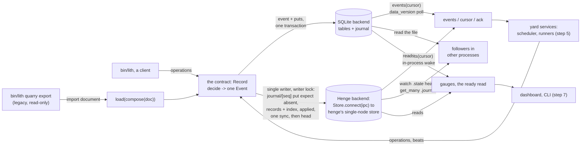

# The record

Plan #3157, effort 0001, step 2: the spec of #3159. The record is everything
the queue knows about efforts, items, tasks, runs and the host they run
on. It is one contract over two stores, SQLite and Henge, and quarrylith's
first code.

**Statement (#3157, user, 2026-10-29):** memLith schedules a mixed workload
on one node, in the yard, under allocation tables, with its record on both
backends behind one contract, and our own development runs on it. This page
specs the record behind that sentence: its records, its operations and
their journal, the two backends, the gauges and the import of the legacy
board. It specs no scheduling. Order, admission rules beyond the ready
read, schedules and the allocator are steps 3 and 4 (#3161, #3163), and
the services that host the record are step 5 (#3165).

**What exists at the base commits.**

- quarrylith `2b08bf0`: a README, the Apache-2.0 LICENSE and a
  `.publicignore` whose `[keep]` list makes `src/`, `tests/` and the
  package files public, and nothing else. No code.
- benchLith `d3fb1bd5`: the legacy board (templet 1423, built). It is
  `BOARD_SCHEMA` (20 tables, `BOARD_SCHEMA_VERSION = 1`), `LocalBoard` over
  one SQLite file, and its journal (`events_since`, `cursor_ack`,
  `wait_events`). 1423's `BoardBackend` contract (phase 3a, #2282) was
  agreed but never built, and there is no Henge board (#1381's templet is
  unmerged). The live file holds 23 tables: `BOARD_SCHEMA`'s 20, and
  `mains`, `change_facts` and `fact_pairs` from #2759's unmerged branch
  (empty), beside `sqlite_sequence`. It holds 3,009 items, 10,478
  comments, 3,049 runs, 584 changes, 1,248 reviews and 65,966 journal
  events (read 2026-10-30).
- henge-store-client `437de30`: `Store`, whose operations (`ops.py::OPS`)
  include `put` and `delete` with `expect` (one object's version, or
  `absent`), `get`, `get_many` (at most 1,000 keys a call: the router's
  `MANY`) and the one-key `watch`. It has **no multi-object transaction and
  no listing of a space's keys**. A value is plain msgpack data of at most
  1 MiB (`Space.max_inline`). `Store.local` starts a Henge (one router, one
  worker) inside the calling process, through henge-store-serve's
  `local.running(folder)`. `Store.close` closes only the client: the engine
  runs on until `local.stop(folder)` or the process exits.
- henge-store-serve `1081c1b`: the router (the ring) and the worker (the
  engine, `Partition`). `Local` takes no durability setting, so local mode
  runs `Durability("batch")`. An acknowledged write is synced by a later
  append 10 ms past the last sync, or else by the worker's housekeeping,
  every second, so it may be unsynced for up to about 1 s. Each of local
  mode's 64 partitions is its own segment file, synced on its own, so a
  power cut can keep one write and lose an earlier one. A process crash
  loses nothing acknowledged (each append is a `write(2)` before the
  reply). A worker's `w0.yaml` may set `durability: {mode: always}`, read
  at its next start. Nothing locks a local mode folder against a second
  engine.



The record is the fold of its journal. Every operation decides one
**event** against the record as it stands. The event carries the whole new
value of every record the operation writes. A backend stores the event and
applies it: SQLite in one transaction, Henge as the journal entry first,
which is the commit point, and then its puts. Both backends store the same
events and so hold the same records, and `dump()` shows it.

## Interfaces

### The package

quarrylith is one package, `quarrylith`, Apache-2.0. Through build step 5
it depends on **the standard library only**. Step 6 adds
**henge-store-client** (Apache-2.0), imported only by
`quarrylith.record.henge`, and nothing else (henge-core, the client's own
dependency, is named beside it for its git source, and the client's
Python 3.12 is the package's floor): the Henge backend reaches a
running store with `Store.connect(ipc://...)`, which needs only the client
(user, 2026-10-30). `src/` never imports henge-store-serve (FSL-1.1).
henge-store-serve is a **dev-only** dependency, for the tests that start a
store (Rationale). Its modules:

| module | holds |
|---|---|
| `quarrylith.record.schema` | `RECORDS`: every record kind, declared once (below); `REFERENCES`, the fields that name another record; the limits; the label and flag grammar, with `MULTI_VALUED_LABELS`, the label keys that may repeat; the key order |
| `quarrylith.record.events` | `Event`, `EVENT_KINDS`, `apply(view, event)`: the fold |
| `quarrylith.record.contract` | `Record` (an `abc.ABC`), the operations written once over it, `open_record`, `BACKENDS`, `Refused`, `Unavailable`, `Unknown`; `check_dump(dump)`, `load`'s checks with no store; `efforts_of(reader, item)`, an item's efforts (its own links, else its parent chain's) |
| `quarrylith.record.sqlite` | `SqliteRecord` |
| `quarrylith.record.henge` | `HengeRecord(store, name)`; `open_henge(folder, name, *, timeout_s=30)`; `HengeFollower(folder, name)`, a follower in another process (step 6) |
| `quarrylith.record.importing` | `IMPORT_FORMAT`, `check_import(doc)`, `compose(doc) -> dump` |
| `quarrylith.gauges` | `Gauge`, `GAUGES`, `measure(record, *, now, window_ms)`, `by_name(name)` |
| `quarrylith.cli` | `quarrylith record init|check|dump|load|import|events|gauges` |

`quarrylith.record` imports nothing of a yard, a harness, a role or a repo
host. Who may make a move, who the user is, and which roles exist are the
caller's (`authorize`, below).

### The records

Each kind is declared in `RECORDS` as `Kind(name, key, fields, match, live,
journaled=True, one_of=())`. A field is `Field(name, type, null=False, default=None)`,
and its `type` is one of **`str`, `int`, `bool`, `json`**. `json` is plain
data: dicts with `str` keys, lists, `str`, `int`, `float`, `bool`, `None`.
Times are `int` milliseconds since the epoch, UTC. Amounts of a resource
are `int`s in its base unit (bytes, millicores, slots). No other type
exists, so every record fits SQLite's affinities and Henge's msgpack values
alike. The schema refuses what the two stores would take differently: a
float that is NaN or infinite, an int outside signed 64 bits, and a `str`
that is not valid UTF-8 (a lone surrogate).

**Keys.** A key field is `int` or `str`, never `json`, `bool` or null.
`match` fields are `int`, `str` or `bool`. **The key order** is one rule on
both backends: component by component, an `int` numerically and a `str` by
code point. SQLite's BINARY collation over UTF-8 gives the same order, and
the Henge backend sorts by the Python tuple. `read()` and `dump()` give
rows in that order, as lists, never tuples.

`match` names the fields `read()` may match on, `live` names the fields
whose `None` means the record is still open (all of them: a change is open
until it is merged or dropped), and `one_of` names the fields of which
exactly one is set (`deps`, `holds`). `schema.VALUES` names the fields that
take one of a few values (the lists in parentheses below; `ITEM_STATES` for an
item's state) with those values, and `validate` refuses any other, so an
operation, a load and an import refuse it alike. **No record is ever deleted.**
A record ends by its end field (`lifted_at`, `released_at`, `merged_at`,
...), and a closed item stays.

| kind | key | fields (beyond the key) | match | live while |
|---|---|---|---|---|
| `meta` | `key` | `value` json | -- | -- |
| `efforts` | `id` str (`0001`) | `slug`, `title`, `standing` (proposed, admitted, parked, concluded), `owner`, `created_at`; the six parts: `statement` str, `inputs` json, `tools` json, `budget` json, `evidence` json, `gates` json; `order` json (step 4's rule; default `{"rule": "unblocks-then-age"}`); `outcome` (complete, incomplete, disproved; null until concluded), `concluded_at` | `standing` | `concluded_at` |
| `effort_links` | `(effort, kind, target)` | `kind` ∈ plan, item, effort; `target` str; `at`, `by`, `unlinked_at` | `effort`, `target` | `unlinked_at` |
| `items` | `number` int | `kind` (task, plan, review, mission, ask, finding, batch), `title`, `state` (`ITEM_STATES`), `role` null, `tier` null, `risk` null, `parent` null, `labels` json (sorted list), `flags` json (sorted list), `admitted` bool, `filed_by` str, `must_fix` bool, `templet` null, `review_round` int, `overruled_at` null, `created_at`, `updated_at`, `closed_at` null, `source` (local, legacy), `source_ref` null | `state`, `kind`, `role`, `parent` | `closed_at` |
| `item_text` | `number` | `body` str | -- | -- |
| `deps` | `id` | `number`; exactly one of `blocker` int, `change` int, `what` str; `added_at`, `added_by`, `lifted_at`, `lifted_by`, `why` | `number`, `blocker`, `change` | `lifted_at` |
| `leases` | `id` | `number`, `holder`, `role` null, `fence` int, `branch`, `machine`, `granted_at`, `renewed_at`, `paused_until` null, `expires_at` null (null while paused), `released_at`, `released_by`, `why` | `number`, `holder` | `released_at` |
| `tasks` | `id` | `number` null (a job has no item), `effort` null, `kind` (agent, gate, review, cell, sweep, job), `labels`, `flags`, `needs` json (`{resource: amount}`), `sandbox` str (a driver class: today's are `process`, `harness`, `podman` and `vm`, and the list is open, since `start_run` checks the node's `drivers` and a new driver needs no schema change), `schedule` str null, `not_before` null, `supervision` json (`{"expect_s", "beat_s"}`), `loop` json (`{"max_attempts", "interval_s"}`), `attempts` int, `state` (open, running, done, failed, cancelled), `created_at`, `ended_at` | `number`, `state`, `kind`, `effort` | `ended_at` |
| `nodes` | `name` | `drivers` json (sorted list, no repeat), `labels` json, `declared_at`, `retired_at` | -- | `retired_at` |
| `capacity` | `(node, resource)` | `amount` int, `unit`, `declared_by`, `at` | `node` | -- |
| `reservations` | `id` | `node`, `resource`, `amount` int, `task` null, `run` null, `holder` str (a standing consumer's name when `task` is null), `from_at`, `until_at` null (open-ended), `released_at`, `why` | `node`, `task`, `run` | `released_at` |
| `runs` | `id` | `task`, `attempt` int, `holder`, `fence` null, `node`, `sandbox`, `branch` null, `pgid` null, `phase`, `phase_at`, `expect_until` null, `harness` json (class, model, effort, folder), `footprint` json, `cost` json, `outcome` null, `reason` null, `started_at`, `finished_at` | `task`, `holder`, `node` | `finished_at` |
| `run_text` | `run` | `result` str (the result the run wrote) | -- | -- |
| `changes` | `id` | `repo`, `n` int, `number` null, `relation` (closes, part), `title` str, `branch`, `head`, `base` null, `position` null, `draft` bool, `url` null, `opened_at`, `opened_by` null, `pushed_at` null, `merged_at`, `dropped_at`, `dropped_by` null | `number`, `repo`, `branch` | `merged_at`, `dropped_at` |
| `change_text` | `change` | `body` str | -- | -- |
| `checks` | `(change, head, name)` | `state` (green, red, skipped, pending), `detail` null, `at`, `by` | `change` | -- |
| `reviews` | `id` | `target` int, `round` int, `kind` (pool, second, templet, conformance, user), `item` null, `author`, `heads` json (`{change id: sha}`, written once), `pages` json, `filed_by` null, `reviewer` null, `verdict` null (approve, changes), `findings` json, `filed_at`, `verdict_at`, `read_at` | `target`, `item` | `verdict` |
| `merges` | `id` | `change`, `sha` (the head merged), `commit` null (the merge commit), `by`, `rule` str (what allowed it), `at` | `change` | -- |
| `comments` | `id` | `number` null, `change` null, `who`, `body` str, `at`, `mark` null (a legacy protocol word, kept as data), `ref` null, `source_ref` null | `number`, `change` | -- |
| `questions` | `id` | `number`, `run` null, `who`, `kind` (blocked, pr), `text`, `asked_at`, `answered_at`, `answered_by`, `answer` null (a comment id) | `number` | `answered_at` |
| `statements` | `id` | `type` (#1228's: observation, inference, proposal, decision, action, outcome, correction), `effort` null, `number` null, `text`, `who`, `at`, `where` null (a URL or a reference), `supersedes` null | `effort`, `number`, `type` | -- |
| `holds` | `id` | exactly one of `number` int, `who` str; `cause`, `why`, `set_at`, `set_by`, `lifted_at`, `lifted_by` | `number`, `who` | `lifted_at` |
| `readings` | `id` | `source`, `kind`, `value` json, `at` | `source`, `kind` | -- |
| `imports` | `id` | `source` json (name, path, schema_version, last seq, read_at), `format`, `started_at`, `finished_at`, `counts` json | -- | `finished_at` |
| `pulled` | `(import, table, legacy_ref)` | `legacy_ref` str (the legacy key's canonical JSON); `record`, `record_key` json, `at` | `import`, `record` | -- |
| `left` | `(import, table, legacy_ref)` | `legacy_ref` str (the legacy key's canonical JSON, `*` for a whole table, `column:<name>` for a column); `legacy_key` json null; `count` int, `why`, `at` | `import` | -- |
| `beats` | `run` | `at`; **bookkeeping, not journaled** | -- | -- |
| `cursors` | `consumer` | `seq`, `at`; **bookkeeping, not journaled** | -- | -- |

The two migration tables are `pulled` (what came from the legacy board,
and when) and `left` (what was left behind, and why). `imports` is the run
that wrote them.

**Ids.** `items.number`, `efforts.id` and every `id` come from counters in
`meta` (`next:<kind>`), given in commit order from the counter, by one,
inside the operation that writes the record. A change's `n` comes from
`next:change:<repo>`. A refused operation takes none. Imported items keep
their legacy numbers, and `next:items` starts past the legacy board's
`next_number`. Imported changes keep their `n`, and each
`next:change:<repo>` starts past the legacy `next_change:<repo>`.

**References.** `schema.REFERENCES` names each field that holds another
record's key, `(kind, field)` -> the kind it names: an item's `parent`, the
`number` of every record that belongs to an item, a task's `effort`, a run's
`task` and `node`, a question's `answer`, a statement's `supersedes`, and the
rest of that kind. Each is one the operations resolve before they write it.
An effort link's `target` (an item's number or an effort's id, by its `kind`;
a plan's is no record) and a review's `heads` (keyed by change id) name
records by their own rule. An item's `templet` and a beat's `run` name
records no operation resolves (`edit_item` takes any number; `beat` is never
refused), so neither is a reference.

**`unsorted`** is the record's own effort, the same wherever it is made:
`schema.unsorted_effort(at)`, from `schema.UNSORTED_EFFORT`. Its id and slug
are `unsorted`, its title `Unsorted`, standing `parked`, owner `record`
(user, 2026-11-01), statement "Items filed with no effort", the five other
parts `{}` and the default order, made at `at`. `file_item` makes it so when
an item first needs it, whoever files, and the import makes the same.
`check_import` refuses a document whose `unsorted` differs in any field but
`created_at`.

**Labels and flags.** A label is `key:value`: the key `[a-z][a-z0-9_.-]*`, the
value `[A-Za-z0-9][A-Za-z0-9_.-]*` (it may also hold `/`), so `repo:benchLith`
and `tier:3` are labels and `Repo:x` and `3tier:x` are not. A record holds
at most one label per key, but for the keys `schema.MULTI_VALUED_LABELS`
names, `legacy` and `repo`, which may repeat with different values: an item
in two repos carries `repo:gadgets` and `repo:widgets`. No label is on a
record twice, whatever its key. A flag is
a word of the key's alphabet, optionally with a `:qualifier` (`needs:lab`).
The keys `effort` and `state` are refused as labels: effort links are
records, and the state is a field. Labels are stored sorted. A task's
**effective labels** are its item's, then its own, by key, the task's
winning: the task's labels of a key replace all of the item's of that key,
one or several. A computed read, `effective_labels(task)`, gives them, and
they are never stored twice.

**Limits** (`schema.LIMITS`), one set on both backends: a `str` field at
most 256 KiB, a `json` field at most 256 KiB encoded, a key field and a
`match` field at most 256 bytes encoded, a **journal entry** (the event and
its priors together, below) at most 768 KiB encoded, 64 labels and 64 flags
on a record. An operation past a limit is refused. The largest legacy texts
are far under these: an item body of 25 KB, a run's result of 20 KB, a
branch name of 51 bytes.

- **Encoded** is one measure on both backends, `schema.size(value)`: the
  length of `schema.canonical(value)` (JSON with sorted keys, no spaces,
  UTF-8, tuples as lists), with each float counted as 9 bytes. That gives
  the value's msgpack size within a margin: a `str` of 256 bytes or more
  costs msgpack 1 to 3 header bytes past JSON's quotes, under 3 KiB on a
  768 KiB entry. 768 KiB leaves Henge's 1 MiB `max_inline` room for that
  and the rest.
- **The priors** are decided by the decide step, which both backends run,
  so SQLite computes them as well. It measures the entry and refuses the
  same operations, and then stores only the event. Invariant 4 holds at the
  limit.

### Events: the journal and the fold

```python
@dataclass(frozen=True)
class Event:
    seq: int          # the journal's order, from 1, by one
    at: int           # the operation's one `now`
    actor: str        # who, as the caller names them
    via: str          # VIAS: cli, service, hook, import, load
    kind: str         # EVENT_KINDS
    subject: str|None # "item:3159", "task:12", "effort:0001", "node:laptop"
    data: dict        # what a consumer needs without a second read
    puts: tuple       # ((kind, key, value), ...): every record written, whole
```

- **`EVENT_KINDS`**: `effort.file`, `effort.edit`, `effort.standing`,
  `effort.conclude`, `effort.link`, `effort.unlink`, `item.file`,
  `item.edit`, `item.state`, `item.admit`, `dep.add`, `dep.lift`,
  `lease.grant`, `lease.renew`, `lease.release`, `task.file`, `task.edit`,
  `task.end`, `node.declare`, `node.retire`, `capacity.set`,
  `reserve`, `reserve.release`, `reserve.replace`, `run.start`, `run.phase`,
  `run.pgid`,
  `run.finish`,
  `change.open`, `change.edit`, `change.drop`, `check.record`,
  `review.file`, `review.verdict`, `review.read`, `merge`, `comment`,
  `question.ask`, `question.answer`, `statement`, `hold.set`, `hold.lift`,
  `reading`, `meta.set`, `note`, `import`. A new kind is a change to this
  page. The schema version does not move for a kind, so an older build
  still opens, replays, checks and writes a record that holds `reserve.replace`;
  what it cannot do is `load` a dump of that record, which it refuses at the
  kind.
- **`run.start`'s `data` may carry `placed`**: `{effort, rule, why}`, three
  non-empty strings, `rule` one of `PLACED_RULES` (`floor`, `resume`,
  `unblocks-then-age`, `listed`, `landing`, the order's own list), so the
  record says why each run started. It is data, not a record: the fold reads
  `puts` only, no schema moves, and no kind is added, so an older build opens,
  replays, checks and writes a record that holds it, and ignores it. A run
  started with no `placed` writes the data it always did, and a record written
  before `placed` loads, replays and checks as it did. `check()` reads the
  `placed` of every `run.start` and reports one that is not whole.
- **`apply(view, event)`** writes `event.puts` into `view`, in order, by
  key. Nothing else. It reads no clock, no counter and no other record.
  Every rule is decided before the event exists, so applying one event
  twice leaves the same record as applying it once.
- **The replay**: `apply` over the journal from seq 1, into an empty
  record, gives exactly the journaled records `dump()` holds. `check()`
  runs it.
- **Bookkeeping is outside the fold**: `beats` and `cursors` are written
  without an event, never replayed and never compared by the replay. A
  lease's liveness is a computed read over its journaled `renewed_at` and
  its run's beat (`lease_view`, below), so a beat changes no journaled
  record.

### `Record`: the contract

`open_record(url, *, readonly=False, shared=False, allow_undurable=False,
actor, via, authorize=None, **backend)` -> a `Record`; `backend` passes the
backend's own settings, for tests only (SQLite's `synchronous` and
`fullfsync`). `url` is
`sqlite:///path/record.sqlite` or `henge:<folder>#<name>`. `BACKENDS =
{"sqlite": SqliteRecord, "henge": HengeRecord}`. `authorize(actor, op,
before, after) -> None | str` is the caller's policy: a string refuses the
operation with that reason. Who may move what (bin/lith's roles, a yard's
grants) lives there, never in quarrylith.

**A caller's actor.** `actor` and `via` are the handle's, and `with
record.acting(actor, via):` replaces both for a span, for a service that is
one writer for many callers. Inside it, an operation calls `authorize` with
that actor, its event names that actor and via, and so does everything an
operation stamps with its actor (the data's `by`, `added_by`, `set_by`,
`released_by`, `declared_by` and `who`), and any rule that reads `via` (a
`number` is taken only via `import`) reads the span's.

- **It is taken under the record's lock**, and held until the span ends: one
  thread's span never names another thread's operation, which waits for it
  and is written under its own actor. So a span holds one caller's work, and
  never a wait: `events(wait=)` inside it is refused, as inside `reading()`.
  On one thread the lock is no guard, so a span is not left suspended (no
  `await` in it).
- **It ends with its body**, on an exception too, and a span inside a span
  gives the outer one's actor back. An actor or via an open would refuse is
  refused before the span begins.
- **Bookkeeping names no one.** `ack` and `beat` run in a span as outside it:
  no event, and they do not reach `authorize`, so a service that grants them
  by caller checks that itself.
- It changes no format: `actor` and `via` are on every event already.

**Errors.** `Refused(reason)`: the operation broke a rule and wrote
nothing. `Unavailable`: the store could not be read or written and **the
operation did not happen**. It is raised `from` the backend's own error,
and never in place of a `Refused`. `Unknown`, a kind of `Unavailable`: the
store failed at or after the commit point, and the record could not tell
whether the operation happened. A caller resolves it by reading (the
event's subject, or `events()` past its last seq). A uniqueness the records
name (one live lease per item, one open change per branch) is a `Refused`.

**Reads**, the same on every backend:

- `get(kind, key)` -> a dict of the declared fields, or None. An item
  carries `body` from `item_text` only when asked (`get("items", n,
  text=True)`), and a change its `change_text` the same way.
- `read(kind, *, live=None, desc=False, limit=None, **match)` -> the records
  whose `match` fields equal the values given, in key order. A match on a
  field that is not in the kind's `match` is refused.
- `reading()`: a context manager inside which every read sees the record
  at one seq, which it yields. It holds other threads' operations back
  until it ends, so `events(wait=)` inside it is refused.
- `ready(*, now)` -> **the ready read**: the open tasks and the items in
  `ready` that are eligible. An item is eligible when it is `admitted`, at
  least one effort it is linked to (directly, else through its parent
  chain) is `admitted`, it has no live dep and no live hold, and neither
  its holder nor its role has a live hold. A task is eligible when its item
  (if it has one) is `ready` or `claimed` and passes those rules (with no
  item, its own `effort` is `admitted`), `not_before` has passed, and
  `attempts < loop.max_attempts`. Step 4 orders this set and does not widen
  it. It gives `{"items": [...], "tasks": [...]}`, each in key order.
- `landable(*, now)` -> **the landing tier's read**, beside `ready`, which
  stays as it is: `{"items": [...], "tasks": [...]}`, each in key order, the
  reviews that `ready()` leaves out only because no effort they are linked
  to is `admitted`. A review is an item of kind `review`, or a task of kind
  `review` or of an item of that kind. It is given when its item is `admitted`
  and (a task's) `ready` or `claimed`, with no live dep and no live hold (its
  own, its holder's or its role's), the task's `not_before` has passed and
  `attempts < loop.max_attempts`, **at least one effort it is linked to
  (directly, else through its parent chain) is `parked` and none is
  `admitted`**, and **the item it reviews has a change that is open**: the
  item its latest review record (by `round`, then `id`) names as `target`
  for it. An item is given only in state `ready`, as `ready()` gives one;
  the open task of a claimed review item is given alone. A task with no item
  reviews no item and is never given. `items` holds review items only, while a
  task is given with its item left out of `items` when the item is not a review
  or is claimed. Nothing else of a parked effort is
  ever given.
- `lease_view(number, *, now)` -> the live lease with `state` running,
  paused or expired (1423's three, the same rules) and its `expiry`,
  computed from `renewed_at`, the latest beat of the holder's live run on
  the item under the lease's fence, and `paused_until`, plus `LEASE_MS`
  (three days, 1423's default). A run under an older fence keeps no new
  lease running. A lease is paused, with no expiry, while its item is not
  `claimed`.
- `free(node, resource, *, from_at, until_at)` -> `capacity` minus the
  largest sum of live reservations overlapping any instant of the span. A
  span, and a reservation, is `[from_at, until_at)`; a null `until_at` has
  no end. An empty or reversed span is refused, as `reserve` refuses it.
- `effective_labels(task_id)`.

**Operations.** Each writes one event or nothing. An edit that changes
nothing writes nothing and returns False. Each takes one `now`, at
its start, from the record's clock (`now_ms`, which the tests move). It
calls `authorize` with the records before and after, refuses as below, and
returns what it made (an id, a number, a fence).

| group | operations, and what each refuses |
|---|---|
| efforts | `file_effort(id, slug, title, owner, parts, standing="proposed")`: an id taken; `id=None` takes `next:efforts`, as four digits. `edit_effort(id, **fields)`. `set_standing(id, standing, why)`: a concluded effort. `conclude(id, outcome, why)`: no outcome. `link(effort, kind, target)`: a link already live. `unlink(...)`: an item's last effort link (invariant 10) |
| items | `file_item(kind, title, body, *, role, tier, risk, parent, labels, flags, effort=None, filed_by, machine=False, must_fix=False, number=None)`: `number` is refused except `via="import"`. An item filed with no effort link takes its parent's links. With no parent, it is linked to `unsorted`, which the same event makes if the record has none, as `schema.unsorted_effort` gives it (below). A machine-filed item (`machine=True`) is filed `admitted=False` unless `must_fix`. `edit_item(n, **fields)`. `move(n, state, why, *, expect=None, fence=None)`: a pair not in `MOVES`, `expect` not the current state, or a run's `fence` not the live lease's. `admit(n, by)` |
| deps | `add_dep(n, *, blocker|change|what, why)`: a cycle, or a dep already live. `lift_dep(id, by, why)` |
| leases | `grant(n, holder, *, role=None, branch, machine, expect=None)` -> fence: a live lease held by another, a live hold (on the item, the holder or the role), `expect` not the state, or a state `MOVES` does not take to `claimed`. It moves the item to `claimed`; the holder's own second grant renews its lease and keeps its fence. `renew(n, holder, fence, *, paused_until=None)` (`paused_until`: a usage limit's reset): a stale fence, or a lease another holds. `release(n, by, why, *, fence=None)`: no live lease, or a stale fence; it moves a `claimed` or `blocked` item to `ready` |
| tasks | `file_task(kind, *, number=None, effort=None, labels=(), flags=(), needs=None, sandbox, schedule=None, not_before=None, supervision=None, loop=None)` -> id: an item or effort not there, `needs` not `{resource: amount}` (an amount from 1); `loop` defaults to `{"max_attempts": 1, "interval_s": 0}` and `supervision` to `{"expect_s": null, "beat_s": null}`. `edit_task(id, **fields)`: an ended task, or its `needs` while a run is live. `end_task(id, state, why)` (done, failed, cancelled): an ended task, or one with a live run; it releases the task's own live reservations (the task's, with no run) in the same event |
| allocation | `declare_node(name, drivers, labels)`: a retired node (a live one is declared anew; False when nothing changes). `retire_node(name)`: live reservations on it. `set_capacity(node, resource, amount, unit)`: below what is reserved at any instant from now. `reserve(node, needs, *, task=None, run=None, holder, from_at, until_at)` -> ids: any resource without room (**the reservation invariant**), a task that has ended, or a run that is finished. `release_reservation(id, why)`: a reservation released already, or one whose run is live (`finish_run` releases it). `replace_reservation(id, amount, why)` -> id, in **one event** (`reserve.replace`): it releases the live reservation `id` and reserves `amount` of the same node, resource, holder and task from now with no end and no run, the room checked without the one it replaces and at every instant from now; refused whole for an `amount` that is not an int from 1, one that does not fit, a reservation released already, one a live run holds (`finish_run` releases it), and a retired node. The same amount, open ended, writes nothing and gives `id` back |
| runs | `start_run(task, holder, *, node, sandbox, fence, branch=None, expect_s, harness=None, placed=None)` -> run id: in **one event**, it checks the task is eligible (and `open`), that `fence` is the item's live lease, held by `holder` (when it has an item; a task with no item takes no fence), that `attempts < max_attempts`, and that `node` is live and runs `sandbox`, then reserves `needs` on `node` from now with no end, raises `attempts`, marks the task `running` and starts the run. It is refused whole if any reservation does not fit: never queued, never part-reserved. `placed` (`{effort, rule, why}`, validated as above) is carried in the event's `data`. **With `placed["rule"]` `landing`, the eligibility check is `landable`'s, read in the same event:** the task must be one `landable(now)` gives (so a task `ready()` gives, an admitted effort's included, is refused with `landing`, and a parked effort's task `landable` does not give is refused), refused with the reason after `not landable:`; the lease, fence, node, attempts and reservation checks are as above. Who may start a landing is `authorize`'s, as for any start: it is called with the operation `start_run` and the records before and after, which carry no `placed`, so **a policy cannot tell a landing start from any other**, and whoever may start a run may start a landable review (separating them takes a different operation, not a different policy). `placed["effort"]` is **not checked** against the task's efforts: the record carries the order's word for why a run started, and no decision reads it. `run_phase(id, phase, *, expect_s=None)`. `run_pgid(id, pgid)`: a live run's process group, known only after its spawn, in an event of its own (`run.pgid`, data `{run, task, pgid}`), once: refused for a run with a `pgid`, whichever group is given, and for a finished run, and moving nothing else of the run (below). `beat(run)` (bookkeeping, never refused). `finish_run(id, outcome, reason, *, footprint, cost, result=None)`: releases the run's reservations in the same event, sets its task `open` again, and is **never refused for a stale fence** (below) |
| changes | `open_or_update_change(repo, branch, head, *, title, body, number, relation, base, position, draft, url, by)` -> id: a second open change on a branch, one whose `number` is not the open change's. With no open change on the branch it opens one (`change.open`), with the repo's next `n`, and a `title`; else it updates the open one (`change.edit`). A field not given keeps its value on an update and takes its default on an open (`body` "", `relation` part, `draft` false, the rest null). An open change with no `number` takes one by an update; one with a number keeps it, so another `number`, or `None` given, is a second open change. `pushed_at` moves when the head does, and an update that changes nothing writes nothing and returns its id. `drop_change(id, by, why)`: a change not open. `record_check(change, head, name, state, detail=None)`, by the actor: False when the check reads so already |
| reviews | `file_review(target, round, kind, *, item=None, author, heads=None, pages=None, filed_by=None)` -> id: `heads` keyed by the ids of changes the record holds, each a non-empty sha. `heads` is written once and never edited. `record_verdict(id, reviewer, verdict, findings)`: a review that already has one. `review_read(id)`: False when it was read already |
| merges | `record_merge(change, sha, by, rule, *, commit=None)` -> id: a change not open, or `sha` not its head. It sets `merged_at` in the same event |
| text | `comment(...)`, `ask(number, text, *, kind, run=None, who=None)` -> id, `answer(question, comment)`: a question answered already, or a comment not on its item (the comment's author answers), `state(type, text, *, effort, number, where, supersedes)` |
| holds | `hold(*, number|who, cause, why)`, `lift_hold(id, by)` |
| readings | `record_reading(source, kind, value)` -> id |
| journal | `note(kind, subject, **data)`: only `note` itself, for what stands for no record |

**A stale fence.** A run's writes that touch its item (`move`, `renew`, any
write of the lease) are refused under a fence that is not the item's live
lease. `finish_run` is not: it records the outcome, releases the run's
reservations and touches nothing of the item. So a run whose lease was
released and granted again still frees what it held.

**`MOVES`** is every state pair of the legacy board's `bin/lith::MOVES`, and
`in-review` to `blocked`, which the legacy board lacks: a hand-over that no
next run of the author could cure ends there, with the item seen (the
connector's page, `3167-the-github-connector.md`, "From the record"). It
leaves out that table's who and when columns, which are policy and go to
`authorize`. `authorize` is given the records before and after, so a
condition such as "an open change" or "merged" is the caller's to check.

| from | to |
|---|---|
| triage | ready |
| ready, blocked | claimed |
| claimed | blocked, in-review, ready |
| ready, in-review | blocked |
| blocked | ready |
| in-review | reviewed |
| reviewed | merge-ready |
| merge-ready | reviewed |
| in-review, reviewed, merge-ready | ready, done |
| ready, claimed, blocked | done, dropped |
| any open state (`ITEM_STATES` but done and dropped) | done, dropped |
| done, dropped | ready, triage (a reopen) |

A move to done or dropped sets `closed_at` and releases the live lease,
and a reopen clears `closed_at`. A move out of `claimed` pauses the lease,
and a move back restarts it, as 1423 says. Narrowing this set would change
the item states' contract, which is the user's to decide.

**The journal, delivered**, to callers in the record's process, with 1423's
semantics on every backend (order, no late event, atomic, complete, at
least once, latency under a second on one host, retention until read):

- `events(cursor, *, limit=500, wait=0.0, subject=None)` -> the events
  after `cursor`, in seq order.
- `head()` -> the highest seq, 0 when empty.
- `cursor(consumer)`, `ack(consumer, seq)` (forward only; a seq past
  `head()` is refused).

**The store's administration**: `init()`, `check()` -> findings (the
replay, then the backend's own), `dump()`, `load(dump)`, `backup(dir)`,
`durable` (a property: does an acknowledged event survive a power cut),
`shared` (a property: this record was opened as the one a yard runs on).

- `dump()` -> `{"format": 1, "records": {kind: [rows in key order]},
  "journal": [events], "bookkeeping": {"beats": [...], "cursors": [...]}}`,
  read at one seq, every key and tuple as a list. Two backends holding the
  same record give the same `dump()` apart from `bookkeeping`.
- `load(dump)` writes a dump into an empty record: every event with its
  seq, applied in order, and the bookkeeping. On SQLite it is one
  transaction. On Henge it is resumable (below). It is refused, writing
  nothing, for a dump that is not whole: seqs not from 1 by one, records
  that are not the fold of its journal, an entry past its limit, or an item
  with no effort link. `check()` reports the last two, and a counter not past
  its kind's highest id, on a record.
  - `contract.check_dump(dump)` makes those checks with no store, so
    `quarrylith record load` and `quarrylith record import` refuse a dump
    before they open the record, and a refused one writes nothing and
    leaves no file.
  - `check()` also reports invariants 6 and 7 broken: a node and resource
    whose live reservations sum past its capacity at an instant from the
    capacity's `at` (`set_capacity` is checked from its own time on), a live
    reservation of a resource with no capacity declared, a running run
    started in the record (first written by a `run.start`) that holds less
    than its task's needs on its node, and a live reservation of a finished
    run. A dump made by hand can carry any of them, since `load` checks the
    fold, the limits and the links, not the reservations.
  - `check()` also reports invariant 16 broken: a run's `pgid` changed by an
    event other than `run.pgid`, set by a `run.pgid` when it already held
    one, when the run was finished or when no `run.start` wrote the run, or
    set to anything but an int above 1. A run first written by an event of
    kind `import` keeps the group it came with, and one imported with a
    group below 2 is reported. No other kind brings a group. `load` does not
    check this either.
- **A shared record is durable.** `open_record(..., shared=True)` is
  refused on a backend whose `durable` is false, unless it is given
  `allow_undurable=True` (tests and the bench only).
- **`durable` means power-safe** (user, 2026-10-30): an acknowledged event
  survives a crash of the process, of the OS and a power cut. Each backend
  syncs before it acknowledges, with `F_FULLFSYNC` on macOS (a plain
  `fsync` there leaves the drive's cache unflushed) and `fsync` on Linux.
  Both backends make that one promise, and `durable` is false on any open
  that does not.

### The SQLite backend

- One file. WAL, `synchronous = FULL`, foreign keys on, a 10 s busy
  timeout, SQLite at least 3.37 (STRICT tables), as `board_open` sets them.
  Many processes write it.
- **Power-safe on every platform**: on macOS, also `PRAGMA fullfsync = ON`
  and `PRAGMA checkpoint_fullfsync = ON`, so a commit and a WAL checkpoint
  sync with `F_FULLFSYNC`. `board_open` sets neither, so the legacy board is
  crash-safe but not power-safe on the laptop. On Linux, `FULL` already
  syncs with `fdatasync` (`fsync` where the platform lacks it), which is
  power-safe for the data. Every connection sets the pragmas, since they
  are per connection. The cost is one full flush per commit, paid in series
  under `BEGIN IMMEDIATE`, which the bake-off times beside Henge's sync.
- One STRICT table per record kind, named as the kind, with the declared
  fields as columns (`json` as TEXT with `json_valid`), the key as its
  primary key, and an index per `match` field. Plus `journal(seq INTEGER
  PRIMARY KEY AUTOINCREMENT, at, actor, via, kind, subject, data, puts)`
  with append-only triggers, as the legacy journal has, and an index on
  `(subject, seq)`.
- **Backstops in the store**, as the legacy schema has them:
  - a `BEFORE DELETE` trigger on every record table that aborts (no record
    is deleted);
  - partial unique indexes for the uniquenesses the records name (one live
    lease per item, one open change per branch);
  - every put is `INSERT ... ON CONFLICT DO UPDATE`, never `INSERT OR
    REPLACE`, whose implicit delete the triggers would refuse.
- An operation is one `BEGIN IMMEDIATE` transaction. It reads, decides the
  event, inserts the journal row (its seq is the row's), writes each put,
  and commits. Nothing inside it runs a subprocess, git or a network call.
  An error from the `COMMIT` itself is `Unknown`. Every earlier error rolls
  back and is `Unavailable`.
- `events(wait=)` polls `PRAGMA data_version` at most every 250 ms, as
  `wait_events` does. Other processes may open the file, so a follower in
  another process reads the file.
- `durable` is true when `synchronous` reads FULL or EXTRA and, on macOS,
  `fullfsync` and `checkpoint_fullfsync` read 1, all read back from the
  connection. A test may open the file with `synchronous=NORMAL` (a
  test-only argument), whose `durable` reads false. That is the stand-in
  for an undurable backend before Henge exists.
- The schema version is the file's own `PRAGMA user_version`
  (`RECORD_SCHEMA_VERSION = 1`), not a `meta` record: a `meta` row no event
  wrote would break the replay and the equal dumps of invariant 4, as Henge's
  `.state ["schema"]` stays apart from `meta`. An open refuses a newer
  version, and an older one names `quarrylith record migrate`. `init()` makes
  a table for every kind, so the version holds through step 4.

### The Henge backend

The Henge backend runs on **henge's single-node store, effort 0001 (user,
2026-10-30)** (Boundaries). That store is henge's router-and-worker pattern on
one host, over `ipc://`, from one folder. The router and the worker ask a
new plugin point, `henge.placements`, for where a key lives: `single` (one
worker), `mirror` (two workers holding the same data) or `ring` (today's
ring). It serves the same `Store` operations as a cluster, `get_many` and
`watch` included. It holds its own lock on its folder until its engines
have stopped, and it acknowledges a `sync` barrier only once everything
written before it is power-safe on disk. The record's build step waits for
it (user, 2026-10-30).

**The store's names** are its spec's: benchLith's
`docs/efforts/0001-the-queue/specs/henge-single-node-store.md`, reviewed
and built (the spec at d2d29c6; henge-store-serve at 24aeed8, local mode
included). They are `Store.connect("ipc://<folder>/henge.sock")`,
`sync(space)` and `durability(space)`, whose report carries `power_safe`
and `ordered`, and the review left them as this page has them.

The backend reaches it with **`Store.connect("ipc://<folder>/henge.sock")`**,
which needs only the Apache-2.0 client, to a store that runs as its own
process (`henge single DIR`, which memLith will run under it). The backend
never starts or stops the store. The layout uses only `put` with `expect`,
`get`, `get_many`, `watch` and `sync`, all of plain values (blobs, which sit
in the store's one segment log), so it does not depend on the placement:
`single` and `mirror` hold it alike.

**The backend never deletes an object.** On Henge, `expect absent`
succeeds on a deleted key (`Partition._live` gives `None` for an object in
the trash, and `_check` takes that as absent). So a late `absent` put could
bring a deleted object back. With no delete, an object once written stays,
and a late `absent` put meets `Conflict`. What would be a delete is a
versioned put of null: `.state ["loading"]`, at a load's end, is the one
such case. (An open also puts `loading` null, `absent`, where it finds none:
"Only past an answer".)

- **One writer per record.** A record on Henge is written by the one
  process that holds its writer lock. `open_henge(folder, name)`:
  1. takes an exclusive `fcntl.flock` on `<folder>/quarrylith.<name>.lock`,
     in the store's own folder, which every opener of the record names. It
     is refused, naming the holder's pid, while another open file holds it,
     and its descriptor is not inherited by children. The store's spec lets
     a foreign file stay in its folder: its conversion moves only the
     entries it names (its S49 at f955dab, from henge's review of it). The lock is
     for liveness. Correctness does not rest on it (the commit protocol,
     below; Rationale).
  2. connects with `Store.connect`, and reads the store's report,
     `durability(space)` on the record's `.journal`. A store without the
     `sync` and `durability` operations cannot run the commit protocol and
     is refused. One whose report is not `power_safe and ordered` opens
     with `durable` false (below).
  3. runs recovery, and gives the `HengeRecord`.

  `close()` closes the client, then releases the lock.

  **One engine per folder is the store's**: its `henge.lock` binds every
  opener of the folder (`henge single`, `henge local`, `Store.single`,
  `Store.local`). The writer lock keeps two record writers apart. A
  writer that has gone can still have a request in flight, and an opener
  that bypassed the lock is a second live writer. So **every put the writer
  makes, but the commit put itself, passes one guard** (below, "The
  guard"), and the table "Every put the writer makes" lists each path with
  it.
- **One put at a time.** The writer sends each put only after the one
  before it is answered: the commit put, the record and index puts, the
  `.state` puts, and the bookkeeping, all under the one lock that orders
  its operations. So the store takes the record's writes in one order, on
  every worker that holds them (Boundaries: "a prefix after a power cut").
  A mirror ignores a space's or a request's `write_ack`
  (`MirrorPlacement.write_ack`, and henge-store-serve's
  `test_a_request_s_own_write_ack_is_not_honoured_on_a_mirror`): a put is
  answered OK only once both copies hold it.
- **One store, tested; a mirror, not proven.** The record is built for one
  store, and the services run it on one. On one store the suite runs the
  whole contract and a writer's crash at each put, as an exception in the
  writer's own process; it kills no process, restarts no store under the
  record and cuts no power. Those were run once, by one reviewer (henge-2,
  round 5 of step 6), on a real `henge single` and not by the suite: 380
  power cuts under operations and mid-load, and 160 `kill -9`s of a writer,
  a loader or the store, with no answered operation lost. The same review's
  cut at the moment a load returned found the gap that a load's closing
  sync (row 11) now closes. On a mirror the record is not proven, and
  nothing in the queue uses it there until the mirror's follow-up lands.
  `durable` reports the store's barrier and order, true on a mirror too, and
  does not say otherwise.
  - **What is fixed.** Review found, one round after another, values the
    writer went on past while they sat on the leader's copy alone. Each one
    found is now put again before the writer goes on, and is in the table
    under "Only past an answer": the commit's entry, the entry a redo starts
    from, a chunk with nothing left to put, `applied`, `head`, `schema`,
    `loading`, and a directory read with no split left. Each has a test on a
    real mirror, with reads steered to one copy, and the leader lost where
    that is the point.
  - **Why that is not proof.** The findings came one round at a time, and
    the last ones were in values the table's first form called safe. The
    suite's fault tests steer their reads, and its whole contract also runs
    on a mirror with the router choosing, with no fault; only one
    reviewer's probes (henge-2's) have run a fault with the router choosing
    the copy.
  - **What the follow-up holds**, all of it: no issue holds it yet, so this
    page is where it is kept.
    - **On a mirror.** Tests in the suite with the router choosing the copy.
      A power cut and a `kill -9` under the record on a mirror: nothing has
      run them. The time a value on the leader alone costs: about 60 s of
      refused opens at the store's default scan pause. What the store is
      asked for, so a settle takes one put (a re-send of a reply that asks
      for a retry, a caller's own request id, a read the leader answers, a
      code of its own for a rate refusal). A record a resumed load refused
      stays stuck, loudly, until a hand repair; and on a mirror a resumed
      load can refuse a record that is the dump's, when its journal read
      lacks an entry the writer put. An open that reads `schema` from the
      copy lacking it says there is no record. An open can be refused with
      no other writer, when recovery's read misses an orphan and the
      guard's check finds it (one retry). After a step-2 `Conflict`, `head`
      on the second copy can lead `applied` until the next commit, and
      `check()` then reports them unequal. A mirror `alone` reads `durable`,
      with `degraded` in its report. The read may land on the same copy
      every retry (inferred, not traced). A mirror opens silently, with
      nothing to tell the caller; the refusal for a store without `sync`
      ends "(a single-node store or a mirror can)". Any later finding that
      only breaks on a mirror goes there too, and not into this step (user,
      2026-11-04).
    - **On one store, not mirror-only.** Power cuts and `kill -9`s have no
      home in the suite, so nothing keeps them true. They need the store's
      `FaultyDisk`, which is in the store's tests and cannot be imported
      here; henge-2's round 5 probes (a power cut under operations, at a
      load's end, and `kill -9` of a writer, a loader and the store) are
      the start, and each takes minutes, so it may belong in a pipeline
      step. A directory never splits, so an index's directory is bounded
      only by the store's object limit, about half a million of the longest
      keys in one index: far past the queue's scale, and refused at once
      there, but a limit this page's "A directory also needs a byte bound"
      does not state. Rows 6 and 7 of the put table assert no outcome in
      `two_live_writers`, where every other raced row does.
    - **For the services' step.** An open during a store's restart is
      refused at once (see "The record's timeout"); whether a service's
      start should ride out a restart is that step's to say. On Henge
      `quarrylith order show URL`, `order merge URL`, the gauges and landing
      are refused while a writer holds the record, as for any second handle,
      and the order's page (`3163-the-order.md`) shows the commands with no
      word on it; that step's service is where they have to be answered.
- **Only past an answer.** The writer goes on past a value only once the
  store has answered a put of it to this writer. On a mirror, a put that
  the second copy did not take in time is applied by the leader and
  answered `Unavailable` ("written here, held by 1 of the 2 copies
  wanted"), and either copy may answer a read. So a value the writer read
  rather than had answered is put again, the same value with the version
  read (an absent `loading` is put null, `absent`), and the writer goes on
  once that put is answered. The table below names every value the writer
  reads and goes on past, and the put that settles it. The leader ships a
  whole object to a copy that lacks it, so the answer means both copies
  hold it. A put of a value read again keeps its content, and a late
  `absent` put still meets `Conflict`. A normal commit pays nothing for it.
  Everything else pays one put per value read: the error path; a redo, with
  one more for each directory that has no split left; every open, four with
  nothing to redo (`applied`, `head`, `schema` and `loading`) and two with a
  redo, whose own step 4 puts `applied` and `head`; a load that resumes, one;
  the next commit after a step-2 `Conflict`, one; and the first new cursor or
  beat after an open on an index with a directory, one.

  | value | read at | goes on past it | put again, answered, by |
  |---|---|---|---|
  | `.state ["applied"]` | decide; recovery | yes: a commit's seq is `applied` + 1 | decide: the last commit's own step 4. Recovery with nothing to redo: at open, at once; after a step-2 `Conflict`, this writer's next commit, before its commit put. A redo: its own step 4 (rows 4, 6) |
  | `.state ["head"]` | decide; recovery | no commit: a seq comes from `applied`, and so do a caller's `head()` and `events()` | at open: recovery, put again as read with nothing to redo, or by the redo's step 4 (row 6). After a step-2 `Conflict` none is needed: the next commit puts it with the version read (row 4) |
  | `.state ["schema"]` | open | yes: the open is `initialised` from its first read | the open, after recovery: that read's value, with its version, whatever a later read says. A retry that reads it absent puts the value `absent`, which the leader's copy refuses, so the open does not go on (row 7). `init` puts it `absent` (row 8) |
  | `.state ["loading"]`, a load in progress | open | only a load of the same dump: every other operation is refused | the resumed load, before its first event; another digest, or none, stops it, and the record closes (row 9) |
  | `.state ["loading"]`, null or absent | open | yes: every operation | the open, after recovery: null put again, absent put null `absent` (row 7) |
  | `.state ["writer"]` | open | no | always put, after a fresh read (row 7) |
  | `journal/[seq]`, step 2's read-back | step 2's `Conflict` | this entry: yes | put again with the version read (row 1). Another entry: recovery, and the operation did not happen |
  | `journal/[a+1]`, an entry | recovery | yes: the redo | put again with the version read, before the redo (row 6) |
  | `journal/[high+1]` absent (the check), and recovery's `journal/[a+1]` and `[a+2]` absent | the guard; recovery | yes | none needed: another writer puts nothing past its entry before that entry's put is answered, and both copies hold an answered put |
  | `journal/[1]` absent, at a load's start | the load's check | yes: the load's first commit | none. An entry of a dead first operation may be on the leader alone. The load's first commit meets it, recovery redoes it, and the load then resumed refuses, since the record's events are not the dump's (row 9) |
  | records, chunks and directories an event puts, a split's new chunks included | decide; a redo's fresh reads | yes | step 3, with the version read; an orphan new chunk, or nothing left to put, is put again as read (rows 2, 3, 5, 6) |
  | records, chunks and directories read and not put: decide's rules and priors, a directory with no split on a normal commit, the load's emptiness check and fold check, a caller's reads | decide; reads | yes | none needed: each was last written by an event at or below `applied`, whose puts were answered before its `applied` was put, or by a redo whose puts were. Once `applied` is settled (above), both copies hold it |
  | a directory a redo reads, with no split left | a redo's fresh reads | yes: it shrinks the old chunk | the redo, as read, before its chunks: the crashed try of this same event may have written it, past `applied`. A retry that reads it absent puts `[]` `absent`, which the leader's copy refuses, so the redo does not go on (row 6) |
  | a redo's chunks already in range | a redo's fresh reads | no | none needed: one may be shrunk on the leader alone, but a read filters a chunk to the directory's ranges, so it reads the same on either copy once the directory is on both (above) |
  | a cursor or a beat, and a new one's `*` chunk and directory | `ack`, `beat` | yes: the larger seq, the later `at` | always a put with the version read, the chunk through the same rule. A directory with no split is put again as read first, since no event wrote it, and costs nothing once it is this writer's own put (rows 12, 13) |
  | a cursor or a beat a caller reads (`cursor()`, `lease()`, `dump()`), and the cursors and beats of the load's emptiness check | reads; the load's start | the writer, no; the load, past an absent one | none. A cursor or a beat on the leader alone is one whose `ack` or `beat` ended `Unavailable`. With the leader lost it reads as before that call, which its `Unavailable` allowed. A load that reads one absent from the second copy goes on: the dump's own rows merge over it, and a row the dump lacks stays |

- **Other processes** may follow the record's events directly: `watch`
  `.state ["head"]` and `get_many` `.journal` up to it, over `henge.sock`,
  and `watch.sock` for the watch. Every other read, and every operation,
  goes through the writer's process, which is step 5's service. Records past `head` may be half
  applied, so a reader in another process must not read `.rec`. Inside the
  process, one lock orders the operations, and a `reading()` holds a read
  lock. So a `dump()` or a gauge sweep delays the writer for its length,
  where SQLite's WAL readers delay nothing (the bake-off times it).
  - The plain `ipc://` transport trusts the role a request names. The
    store folder's mode (`0700`) is what keeps other users out, and a
    follower keeps to `watch`, `get` and `get_many` by its caller's
    convention. The store's spec and step 5 state the grant.
- **`readonly=True`** takes the same writer lock, so it is refused while
  the record is held. It runs recovery (the only writes it makes), then
  refuses every operation.
- **The layout**, in four spaces named `quarrylith.<name>.*`, every key a
  list of plain values:

  | space | key | value |
  |---|---|---|
  | `.journal` | `[seq]` | the **journal entry**: `{"event": the event, "priors": [[kind, key, {match field: value} or null], ...]}` |
  | `.rec` | `[kind, *key]` | the record's fields, plus `_seq`, the event that last wrote it |
  | `.idx` | `[kind, field, value, chunk]`, `[kind, "*", chunk]`, `[journal, subject, chunk]`; for every record kind also its directory, `[kind, field, value, "dir"]` and `[kind, "*", "dir"]` | a chunk: the sorted keys of the records of `kind` whose `field` is `value` (`*`: all of the kind's keys; `journal`: the seqs of a subject). A directory: the chunk numbers, each with its lowest key |
  | `.state` | `["head"]`, `["applied"]`, `["writer"]`, `["schema"]`, `["loading"]` | the highest committed seq; the highest applied; the writer's pid, host and open time; the schema version; a load in progress, with its dump's digest. Not journaled, and apart from the `meta` record kind |

- **The priors.** For each put, the writer records the values its `match`
  fields held before the event (null for a record that did not exist). It
  knows them at decide time. They sit in the journal entry beside the
  event, not in `puts`, so `apply` stays a pure fold and `events()` gives
  the event alone. They make every index move of an event redoable, since
  adding a key to a chunk and removing one are idempotent.
- **Chunks.** A chunk holds at most 8,192 keys and at most 512 KiB encoded.
  - **The journal's seqs.** A subject's chunk is `seq // 8192`. It never
    splits, and a reader knows the chunks from `head` (0 to `head // 8192`;
    an absent one is empty).
  - **The directory, for every record's key**, `int` and `str` alike: a
    kind's `*` index and each of its match fields' indexes. A counter is no
    guide to a record's ids: a load takes a dump whose counter lags its ids
    (`check()` reports it, `load` does not refuse it), a beat names any run,
    and an id may be negative, so a reader that took the chunks from a
    counter would miss records. Its `"dir"` blob lists the chunks by
    number. Chunk 0 is first and has no lower bound. Each other chunk is
    listed with its lowest key.
    - A chunk's **range** runs from its lowest key up to the next listed
      key. Every key below the first listed lowest key is chunk 0's, so a
      key below every key so far needs no directory change.
    - A key goes in the chunk whose range holds it. **Every load of a
      chunk filters it to its range**: a reader's, recovery's, and the
      writer's own load for an edit or a split. Every other key is ignored,
      such as the duplicates a split leaves (below).
  - **A split is deterministic.** It runs after the event's edits are applied to
    the chunk in memory. A chunk past either bound is cut, in key order,
    into pieces of at most 4,096 keys and 256 KiB, each filled before the
    next starts. The first piece stays the chunk. The others are new
    chunks, numbered from the directory's highest number + 1 upward in key
    order.
  - **A split's write order**, each put answered before the next:
    1. every new chunk (`expect absent`);
    2. the directory, which lists them;
    3. the shrunk chunk.

    What each prefix leaves:
    - after (1) alone, the new chunks are orphans the directory does not
      list, and the old chunk is whole;
    - after (2), the old chunk still holds keys that now belong to a new
      chunk's range, and readers ignore them.

    Recovery redoes the event's index edits from its priors against the
    chunks and directory as it finds them, each put through the guard
    (below):
    - **before (2)**, the directory and the old chunk are unchanged, so it
      computes the same split, with the same numbers and the same keys,
      and puts over the orphans;
    - **after (2)**, the directory already lists the new chunks. The old
      chunk, loaded filtered to its range, is the first piece alone and
      within the bounds, so no second split is made. The redo puts the
      directory again as read ("Only past an answer"), then rewrites the old
      chunk to its range, which also drops the duplicates' bytes.

    Any prefix of the three puts is redoable.
  - An event's index edits are batched, so each chunk and directory it
    touches is written once per event (a split's three puts aside). An
    import event of 5,000 comments rewrites a chunk once, not 5,000 times.
- **The commit protocol**, per operation:
  1. Decide the event and its priors against the record at `applied`,
     which equals `head` between operations. At decide the writer reads
     every object the event will put: its records, its index chunks
     (filtered to their range) and their directories, `applied` and `head`.
     So every version steps 3 and 4 expect was seen before step 2.
  2. `put(journal, [seq], entry, expect={"absent": True})`, where seq is
     `head + 1`. **This is the commit point.** Its success is also the
     guard's check for steps 3 and 4 (below).
  3. Each put of the event, `put(rec, [kind, *key], value)`, then the
     event's index edits, batched, a split in its order. Each carries
     `expect={"version": v}` (or `absent` for a new object), by the guard.
  4. `put(state, ["applied"], seq)`, then **one `sync(space)`** (on the
     record's `.journal`; the space names only the grant, and the barrier
     covers every write), then `put(state, ["head"], seq)`, then wake the
     waiting readers, then return. Both `.state` puts pass the guard, and
     **neither moves backward**: each is put only while the value read is
     below seq. A value at or past seq is left as it is. The operation is
     acknowledged only after its sync, so it is power-safe when its caller
     hears of it, and a follower that sees `head` at seq sees a synced
     event. One sync per operation, not per write, is enough because the
     store keeps the record's writes in their order: a power cut keeps a
     write only with every write answered before it was sent, and the
     journal entry comes first, so recovery handles any tail.
- **The guard: one rule for every put but the commit put** (henge-2, round
  4). `high` is the highest seq this writer knows to be committed: its own
  seq inside an operation, the one entry recovery found, and `head`
  between operations.
  - **A put's `expect`** is either:
    - the version of the writer's own last put of that object. Any later
      put by anyone moves it, so the put would meet `Conflict`; or
    - a version (or `absent`) **read before a check that found
      `journal/[high+1]` absent**.
  - **The check** is `get(journal, [high+1])`, or the commit put itself,
    whose `absent` at `high + 1` succeeded (and `high` is then its seq). So
    a put against a version read after the last check is preceded by an
    explicit check, in this order: read the object, then the journal, then
    put.
  - **The check finds the entry**: another writer is live and has committed
    past `high`, or on a mirror an earlier read missed an earlier operation's
    entry. This writer puts nothing more and closes the record. Inside
    an operation past its commit point it raises `Unknown`. The event is
    committed, and the other writer applied it at its own `Conflict` before
    it could commit past it. Anywhere else (an open's recovery, a load's
    `loading`, bookkeeping) it raises `Unavailable`.
  - **A `Conflict` at the put** means the object moved after its version was
    seen. The writer reads it again, checks again, and puts again. The same
    applies after any error from the store at a put. A fresh read that
    leaves nothing to put still puts the value read, after the check ("Only
    past an answer").
  - **Why it holds.** Another writer puts an object for an event past
    `high` only after its entry at `high + 1` exists: no seq is taken
    before the one below it, and step 3 follows step 2. So:
    - if the version read already shows such a put, it was read after that
      entry existed, and the check after it finds it;
    - a put landing after the version was seen moves the version, so this
      writer's put meets `Conflict`.

    Either way, no put of this writer lands over a value of an event past
    `high`. Nor does it land over a newer event at or below `high`: an
    operation puts only its own seq's values, and recovery redoes only
    one entry (below).
  - **Monotone values** keep their order under a retry. `applied` and `head`
    are put only upward. A cursor takes the larger of the value read and its
    own, and a beat the later `at`.
  - **The cost.** None on the normal path, where the versions come from
    decide and the commit put is the check. A retry or a redo costs one more
    read per object.
- **An error at the commit point or after it.** The writer takes no other
  operation until the operation's outcome is known.
  - **A `Conflict` at step 2** is read back. If `journal/[seq]` holds this
    entry (compared by `schema.canonical`, since msgpack gives tuples back
    as lists), it was this writer's own retried put (henge's retry gap,
    #158), or one the store applied and answered `Unavailable`. The writer
    puts the entry again with the version read, and the operation goes on
    to step 3 once that put is answered ("Only past an answer"). A journal
    entry is never put with another value, so this put needs no check. If
    the read finds nothing (a copy that lacks it answered), the put
    `absent` is sent again. If it holds another entry,
    another writer took that seq (a gone one's late request, or a live
    one), or an earlier operation that ended `Unknown` did.
    The writer runs recovery, and the operation raises `Unavailable`: it did
    not happen.
  - **Any other error at step 2** (the store unreachable, a timeout): the
    writer sends the same put again, `expect absent`, until the store
    answers. The commit put is idempotent by content, so a success means it
    committed, and a `Conflict` is read back as above. If the store stays unreachable past the
    record's timeout, the record closes and the operation raises `Unknown`.
    If the entry landed, the next open's recovery finishes it.
    - **The same request where the client allows it.** The client retries
      a call with the same request id until it is answered or its `tries`
      are spent. The store's request memory then answers a write that
      landed with its first reply, and on a mirror re-ships it to a copy
      that lacks it. The record sets the client's `tries` and timeout so
      that the commit's whole wait is one call where it can. At 437de30 a
      caller cannot give a request id of its own, and at d7c2bec the client
      does not resend a reply that asks for a retry with the same id
      ("written here, held by 1 of the 2 copies"). So a resend after a call
      has given up, or after that reply, is a new request: its `Conflict`
      with this entry is put again with the version read, and that put,
      answered, makes good a mirror copy that lacked the entry. A way to
      resend with the caller's own id is henge's to offer, and the record
      uses it once it exists.
  - **An error or a `Conflict` at steps 3 or 4** is the guard's retry: read
    the object, check `journal/[seq+1]`, put again. If the store stays
    unreachable, the record closes and the operation raises `Unknown`. It
    happened, and the next open's recovery finishes it.
- **Recovery**, at open and after a step-2 `Conflict` with another entry.
  It reads `applied` (call it a), then `journal/[a+1]` and `journal/[a+2]`.
  - **No entry at a+1:** nothing to redo, and the read of `journal/[a+1]`
    is the check. At open, it puts `applied` again as read, with the version
    read, then brings `head` up to a, a `head` read at or past a put again
    as read (a crash can fall between the two `.state` puts). The open goes
    on once both are answered ("Only past an answer"). After a step-2
    `Conflict` with another writer's entry, it only brings `head` up to a
    where it is below, and puts nothing more in that operation. The writer
    stays open, and its next commit puts `applied` again as read, answered,
    before its commit put: the other writer may have died, or ended
    `Unknown`, with that `applied` on the leader alone.
  - **One entry, at a+1, and none at a+2:** it redoes that entry whole,
    with `high` = a+1. It first puts the entry itself again, with the
    version read, and goes on once that put is answered ("Only past an
    answer"). That covers every record put (whole values), every
    index move from the priors (loads filtered to their range, a split
    remade as above, a directory with no split left put again as read), and
    then step 4, each put through the guard. It does
    not check `_seq`. An event whose journal entry was written is never
    lost by a crash between steps 2 and 4. One whose entry was not written
    never happened, and its seq is given to the next operation.
  - **A second entry, at a+2: another writer is live.** It redoes nothing,
    and raises `Unavailable`: the open is refused, or the operation did not
    happen. A writer commits seq only once the store's `applied` is at least
    seq − 1 (its own step 4, or its recovery's put of it, at open or before
    its next commit), and `applied` never moves back. So at rest at most
    one entry lies past `applied`. A second one
    means a writer moved `applied` and committed again during this scan.
    Redoing the older entry over the newer one's values is the tear of
    henge-2's round 4, so recovery never redoes past one entry.
- **Every put the writer makes**, each with its guard. "Fresh read" is a
  read made after the last check, so the row's check follows it; "own put"
  is the version of the writer's last put of that object.

  | # | put path | objects | `expect` from | check | when the check finds an entry |
  |---|---|---|---|---|---|
  | 1 | the commit, step 2 (re-sent after an error) | `journal/[seq]` | `absent`; this entry read back, the version read | itself: one entry per seq | its `Conflict` is read back: this entry is put again with the version read, and goes on once answered; another entry, recovery (row 6) and `Unavailable` |
  | 2 | the event's records, step 3 (`meta` counters included) | `.rec` | decide's read, or own put | the commit put | `Unknown` |
  | 3 | the event's index edits and a split, step 3 | chunks; a directory only in a split (with no split, rows 6, 12 and 13 put it again); new chunks `absent` | decide's read (chunks filtered to their range), or own put | the commit put | `Unknown` |
  | 4 | `applied` and `head`, step 4, only upward | `.state` | decide's read, or own put | the commit put | `Unknown` |
  | 5 | a retry after an error or `Conflict` at rows 2-4; nothing left to put, the value read put again | as the row | fresh read | `journal/[seq+1]` | `Unknown` |
  | 6 | recovery's redo of one entry: the entry put again first, then rows 2-4, a split's redo included, and a directory with no split left put again as read before its chunks; nothing left to put, the value read put again. No entry: at open, `applied` and then `head` put again as read; after a step-2 `Conflict`, `head` only brought up, and `applied` put again as read by the writer's next commit, before its commit put | `journal/[a+1]`, then as rows 2-4; no entry, `.state` | the entry's version as read; fresh read | a redo: `journal/[a+2]` (the entry's put needs none). No entry: recovery's read of `journal/[a+1]` (the next commit's put, read again after an error, `journal/[high+1]`). A second entry already found stops it before any put | `Unavailable`: the open is refused, or the operation did not happen |
  | 7 | the open, after recovery: `.state ["schema"]` put again as first read; `["loading"]` null put again as read, absent put null `absent`; then `["writer"]` | `.state` | `schema`: the open's first read (read again absent after an error, `absent`); the others, fresh read | `journal/[head+1]` | `Unavailable`: the open is refused |
  | 8 | `init()`: `.state ["schema"]`, and `applied` and `head` at 0 | `.state` | `absent` | `journal/[1]` | `Unavailable` |
  | 9 | the load's start: `.state ["loading"]` with the dump's digest; a resumed load: the `loading` the open read put again as read, then the record's events compared with the dump's, before its first event | `.state` | the open's own put, `absent`, or fresh read of a null; resumed, the open's read | `journal/[head+1]`, before the put; resumed, the open's check, after its read | `Unavailable`; the record closes if the check finds an entry, and a check whose read gets no answer leaves it open, since nothing was sent. A start put that fails closes it too, since `loading` may be there. Resumed: another digest or none closes it; events that are not the dump's are `Refused`, and `loading` stays |
  | 10 | the load's events | rows 1-6 | | | |
  | 11 | the load's end: `loading` put to null, never deleted, then one `sync` | `.state` | own put (row 9), or fresh read | `journal/[head+1]` after a fresh read | `Unavailable`. A put that fails leaves `loading` as it was, and the next open goes on with the same dump. A sync that is not answered leaves it null with the handle open and still reading the load as in progress; the record is whole, and the next open reads it so, or as a load in progress if a power cut took the null put, which the same dump finishes. The sync also covers the bookkeeping rows the load put without one |
  | 12 | `ack`: a cursor, the larger of read and own; a new one's `*` directory, as read if it has no split, and chunk first | `.rec` `cursors`; `.idx` `[cursors, "*", n]` and `"dir"` | own put, or fresh read | `journal/[head+1]` after a fresh read | `Unavailable` |
  | 13 | `beat`: a beat, the later `at`; a new one's `*` directory, as read if it has no split, and chunk first | `.rec` `beats`; `.idx` `[beats, "*", n]` and `"dir"` | own put, or fresh read | `journal/[head+1]` after a fresh read | `Unavailable` |

  A `readonly` open makes rows 6 and 7 only. `check()`, `dump()` and every
  read put nothing. A path not in this table is a change to this page.

  Correctness therefore never rests on the writer lock. A second live
  writer costs liveness (`Unavailable` and `Unknown`), never a torn record,
  and `applied`, `head` and the cursors never step back (henge-2, rounds 3
  and 4; Rationale, "Two live writers, row by row").
- **Reads** are `get` on `.rec`. `read(**match)` reads the index chunks
  for the first match field, then `get_many`s the keys in batches of at
  most 1,000 (henge's `MANY`), and checks each record against every match
  field. `dump()` walks `[kind, "*", chunk]` the same way. No read lists a
  space.
- **The writer's memory.** The writer keeps each object it has read or
  put, its value and version (a journal entry only as it commits it; at
  most 100,000 objects), so a decide or a read repeats no `get`. A version
  kept from a read was read before a later check, or it is the writer's own
  put, so the guard holds for it. Recovery, `check()` and any failed put
  start again from fresh reads.
- **Events**: `events(wait=)` wakes on the writer's own commit, in the
  process. A follower in another process watches `.state ["head"]` with
  `AsyncStore.watch(..., idle_s=1.0)`: at least once, with the version, and
  caught up by a read after a quiet second. The default of 30 s would let a
  dropped note stand that long, since the publisher never waits for a slow
  subscriber. The follower reads `.journal` from its cursor up to `head`
  with `get_many`, and so gives `events()`'s semantics, latency under a
  second included. `HengeFollower(folder, name)` is that follower:
  `events(cursor, *, limit, wait)` and `head()`, with no lock and no write.
  `cursors` and `beats` are `.rec` entries the writer puts without an
  event, each with its expected version, and an `ack` or a `beat` then ends
  with one `sync(space)`, as SQLite's commit syncs them, so a cursor never
  steps back across a power cut (user, 2026-11-04). A follower's cursor is
  its own, until step 5's service records it.
- **The resumable load** writes events in seq order, each through the
  commit protocol. It first writes `.state ["loading"]`, with the digest
  of the dump (sha256 of its canonical encoding), after a check of
  `journal/[head+1]`. If that put fails, `loading` may be there, so the
  record closes and the next open reads it. A load stopped part-way
  and opened again refuses every other operation. It goes on from
  `head() + 1` only when given a dump of the same digest, and any other
  dump is refused. Before its first event it puts `loading` again, as the
  open read it, and goes on once that put is answered ("Only past an
  answer"); a `loading` that changed meanwhile, to another digest or to
  none, stops it, and the record closes. It then compares the record's
  events up to `head` with the dump's first ones: any other is `Refused`,
  with nothing committed and `loading` left in place. The load's end clears `loading`
  by a versioned put of
  null, never a delete, so a late `absent` put of the load's start meets
  `Conflict` and cannot bring it back (henge-2, round 4).
- **`check()`** on Henge also reports a journal hole (a seq absent below
  `head`), `applied` behind `head`, a record whose `_seq` is past
  `applied`, and an index chunk that disagrees with the records: a key
  indexed with no record, a record the journal wrote that its kind's `*`
  index lacks, or a match field's index, at any value the journal ever
  wrote, that is not the records'. An undurable store (tests, the bench)
  can come back torn after a power cut, and these findings say so.
- **`backup(dir)`** writes the record's `dump()` as one JSON file, `0600`
  from its creation, in `dir` (`0700`).
- **The record's timeout**, `timeout_s` (30 s; tests shorten it), is how
  long the record waits for the store at one put or sync, or at the read
  inside a retry of one of them, before it gives an operation up: past the
  commit point that is `Unknown`, before it `Unavailable`. An open or an
  operation with several blocked puts can take one timeout for each. The
  client tries a call every 2 s, with the same request id, for that long.
  A put, the commit put or a sync that the store refuses at once, and the
  read inside a retry of one of them, is tried again after a pause, 10 ms
  first and each the double of the one before, up to 2 s, so a store that
  refuses at once (a mirror's start, a worker dropped for silence) is not
  hit as fast as the loop turns. **Not retried:** an open (its reads and its
  `sync`), an operation's reads before its commit, a new `ack`'s read, a
  caller's read, a load's emptiness check and a resumed load's read of its
  journal. The record tries each once. While a store restarts (the store's
  `RESTART_S`, 10 s by default) each is refused at once with `Unavailable`,
  on one store too, before anything is committed, and the handle stays
  usable; a service that starts then is refused, not waited for. "At once"
  is the record's own: a real store answered each within milliseconds but
  for the load's emptiness check, at about 2 s, the client's first interval
  (henge-2's probe, round 5, for five of the six; the review of quarrylith#21
  measured the sixth, a resumed load's read, at 0.019 s, though a resumed load
  started in the window rode it out in 2.4 s, its first call being a retried
  put). A refusal for good (`TooLarge`, `Invalid`,
  `Forbidden`) gives up at once, as the timeout would. The store also
  answers a role past its rate with `Forbidden`, a refusal that passes once
  the rate allows; the single store writes its policy with roles only, so
  the record never meets one.
- **`durable`** reads the store's report, `durability(space)`: it is
  `power_safe and ordered`. That is, the `sync` barrier is power-safe
  (`F_FULLFSYNC` on macOS, `fsync` on Linux), and the store is
  **`ordered`** in its spec's words: "after a power cut, a write survives
  only with every write answered before it was sent". That holds with
  `single` or `mirror` alike (on the mirror, `sync` is a barrier on both
  workers).
  - It gives the record a prefix of its writes because the writer sends one
    put at a time, each answered before the next is sent, and goes on only
    past a put answered to it ("Only past an answer"). Every earlier put
    was answered before a later one was sent, so a surviving put survives
    with every put before it: a prefix, in the writer's order.
  - A store whose report says otherwise (a `ring`, or `full_sync: None`)
    opens with `durable` false, so a shared open of it is refused unless
    `allow_undurable` (tests and the bench).
  - Henge's local mode is the single store since henge-store-serve 24aeed8
    (`Local(folder)`, `henge local DIR` and `Store.local` run a `Single`):
    it serves the same `henge.sock`, `sync` and report, and the record
    opens on it unchanged. A local folder of several workers is a ring, so
    its report says `ordered: false` and `durable` is false. A store
    without the operations is refused at open, as above.
  - **The report is read again** after any `Unavailable` from the store,
    before the next operation, since a store restarted under other
    settings may answer on the same socket. A shared record whose report
    is no longer `power_safe and ordered` refuses every operation with
    `Unavailable`, naming the report, until it is.

### The import

The import is a **job in benchLith's `bin/lith`** (user, 2026-10-30): it
reads the legacy board and writes an **import document**. quarrylith
checks the document, composes it into a dump and loads it. quarrylith
never reads the legacy file, and bin/lith never imports quarrylith.

- **`bin/lith quarry export --out FILE [--board PATH] [--effort-doc
  PATH]`** opens the legacy board with `sqlite3`'s `mode=ro` URI (a copy is
  never needed, and nothing is written) and reads it inside one deferred
  transaction (one snapshot).
  - It writes the document, which holds the board's text, to a temporary
    file **created `0600`** (`os.open(..., O_CREAT | O_EXCL, 0o600)`) in
    `FILE`'s folder, then renames it onto `FILE`. So an existing `FILE` is
    replaced whole, and no reader ever sees it half written or readable by
    others.
  - It prints its phases with elapsed time past five seconds, and takes
    `--timing` (the store layer, the only one it has) and `--debug`.
- **Its tables come from the file**: the tables `sqlite_master` lists,
  skipping `sqlite_*`. A table the mapping knows is pulled or left as
  below. A table it does not know is a `left` row, `legacy_ref` `*`,
  "an unknown table", with its row count, and never stops the export. The
  three fact tables are left only when the file has them.
- **The document**, `IMPORT_FORMAT = "quarrylith-import/1"`:

  ```json
  {"format": "quarrylith-import/1",
   "source": {"name": "legacy-board", "path": "...", "schema_version": 1,
              "last_seq": 65965, "read_at": 1793371508596,
              "tables": {"items": 3009, "journal": 65966, "...": 0}},
   "records": {"efforts": [...], "items": [...], "item_text": [...], "...": []},
   "counters": {"next:items": 3181, "next:change:widgets": 120, "...": 0},
   "pulled": [{"table": "items", "legacy_key": [3159], "record": "items", "record_key": [3159]}],
   "left": [{"table": "journal", "legacy_key": null, "count": 65966, "why": "..."},
            {"table": "runs", "legacy_key": null, "column": "pid", "count": 3049,
             "why": "..."}]}
  ```

  `source.tables` is the rows read per legacy table, which is what makes
  invariant 12 checkable from the document alone. A `left` row for a column
  carries `column` (and a null `legacy_key`): `compose` keys it
  `column:<name>`. A `left` row with a null `legacy_key` and no `column` is a
  whole table, keyed `*`. `compose` keys every other row by its legacy key's
  canonical JSON.

- **`quarrylith record import FILE --into URL`**:
  - `check_import(doc)` checks that every record is valid against
    `RECORDS`; that every reference resolves within the document (each
    field of `schema.REFERENCES` that is not null names a record in
    `records`, an item link's `target` is the number of an item in it and an
    effort link's the id of an effort in it, and a review's `heads` are
    `{change id: sha}` of changes in it); that a task's `loop`, `needs` and
    `supervision` are as `file_task` writes them (every key there, each
    value of its type); that every `pulled` row names a record in `records`
    (or a counter); that every legacy table in `source.tables` is named in
    `pulled` or `left` and that per table the pulled rows plus the left rows'
    counts (a column is not a row) equal the rows read; and that each
    counter is past the highest id its records hold (`next:change:<repo>`:
    the highest `n` of that repo). It refuses with every fault it finds
    (`ImportRefused`), not the first only. So a reference that does not
    resolve, or a shape no operation writes, never loads: a run whose task
    is missing, a task whose item is missing or whose `loop` is not a dict
    would load clean, and a gauge or `ready()` would raise on it later. It
    does not check what the operations check across records: an effort
    linked to itself, or two items each the other's parent, still load, and
    no read raises on either.
  - `compose(doc)` writes one `imports` record, then the records in
    `RECORDS` order as `import` events (one per record kind, split to stay
    under the journal entry's limit), then `pulled` and `left` as `import` events,
    then the counters as `meta.set`, all `via="import"`, each at the
    source's `read_at`; it adds `next:imports` itself. Compose is pure, so
    the same document gives the same dump.
  - It splits by the entry, the event and its priors together. A load
    goes into an empty record, so each put's prior is `[kind, key, null]`,
    and compose computes them as it fills an event. It closes the event
    before the entry would pass 768 KiB by `schema.size`.
  - Then it `load`s into an empty record. It is refused on a record that
    has items.
- **What is pulled** (user, 2026-10-30: every item, the journal left):

  | legacy | the record |
  |---|---|
  | every item, open and closed | `items` with its number, `source="legacy"`, `source_ref` its `github_url` if any; `body` as `item_text`; `role`, `tier`, `risk`, `parent`, `templet`, `review_round`, `overruled_at`; `created_by` as `filed_by`; `item_repos` as `repo:` labels, `item_labels` as labels (one that is not `key:value` as `legacy:<label>`), all of them: an item in two repos carries both `repo:` labels, and each label that is not `key:value` its own `legacy:` label; `kind` as it was; `admitted=True`; its state as it was: **nothing closed, nothing reopened** |
  | `comments` | `comments`, `mark` and `ref` kept, `github_id` as `source_ref` |
  | an `answer`-marked comment whose body starts `Decided` | also a `statements` row of type `decision`, `where` naming the comment |
  | `claims` | `leases`, fences and `role` as they were |
  | `deps` | `deps` |
  | `runs` | `runs`, each under a task `kind="agent"` made per (item, legacy run kind); `who` as `holder`; `harness` from class, model, effort and folder; `branch`; `node` `legacy` (a node the import declares and retires, so nothing is placed on it) and `sandbox` `harness`; `result` as `run_text`; `beat_at` as a `beats` row |
  | `changes` | `changes` with `title`, `opened_by`, `pushed_at`, `dropped_by`, `github_url` as `url`; `body` as `change_text`; a merged one also a `merges` row (`sha` its head, `commit` its `merge_commit`, `by` its `merged_by`, `rule="legacy"`) |
  | `gates` | `checks` (`gate` as `name`) |
  | `reviews` | `reviews`, `filed_by` kept |
  | `questions` | `questions` |
  | `quarantine` | `holds` (`at` and `by` as `set_at` and `set_by`) |
  | `budget` | `readings` (`source="budget"`, `seen_at` as `at`; `status`, `utilization`, `resets_at` and `run` in `value`) |
  | `meta` `next_number`, `next_change:<repo>` | the counters `next:items`, `next:change:<repo>` |
  | `board_figures`' output at the export | one `statements` row of type `observation`, the figures as data |
  | `docs/efforts/0001-the-queue/effort.md` (`--effort-doc`) | `efforts` `0001`, `admitted`, its six parts; its Decisions as `decision` statements and its Log lines as `action` statements |
  | the linking pass | an item is linked to `0001` when it, or an item in its parent chain, is an item the effort document names (its plan, #3157, and the items in its steps table, its Decisions or its plans). So #2287 and #2707, whose parent is #1342, are linked. Every other item is linked to effort `unsorted` (`parked`), which the import makes |

- **Choices the export makes** where neither the mapping nor the sample
  does (the sample shows none of them):
  - a legacy `templet` of `this issue writes it` is the item's own number,
    and `not required` is null: nothing in the record reads `templet`, and
    the waiver's comment comes with the comments, so a null `templet` on a
    deep item is not a missing one;
  - a null the record does not take becomes a value it does: a claim's null
    `branch` or `machine` is `""`, and a run's null `phase_at` is its
    `started_at`;
  - a merge's null `merged_by` is `"unknown"`, which names no actor, so a
    count of merges by `by` shows it apart;
  - a run with no item goes under a task with a null `number`, by the same
    (item, legacy run kind) rule;
  - of two labels of a key that takes one per record, the first in sort
    order is kept and the other is a `left` row, "one label per key";
  - a label of a barred key (`effort:x`) is tried as `legacy:effort:x`,
    which no label takes, so it is a `left` row;
  - an item left for a limit takes its subtree: every item whose `parent`
    names it dangles, so it is left too, and so on down, with its comments,
    runs and changes. The report lists each. (Setting such a `parent` to
    null instead is the user's choice, to raise if it happens.)
- **Columns dropped**, each a `left` row `column:<name>` with its count of
  non-null values: `items.source` and `comments.source` (every imported
  record is `legacy`, and one that came from GitHub carries its
  `source_ref`), and `runs.pid` (a process of the legacy host, meaningless
  after the switch). Every other legacy column is pulled or folded as the
  table above says. A column the mapping does not name is dropped and
  counted the same way, so a new legacy column shows in the report rather
  than vanishing.
- **What is left**, each a `left` row with its reason:
  - the `journal` (65,966 events): the legacy record's own history, kept
    readable in the legacy file, which goes read-only. `source.last_seq`
    marks where the new record starts. The figures observation reads it (the
    first move of each item to merge-ready), and the journal stands behind it
    as `rounds` does.
  - `ranks` (retired by #3157);
  - `needs_you` (derived, and #3052's to rebuild);
  - `digests` (empty);
  - `rounds` (the old loop's own accounting, standing behind the figures
    observation);
  - `mains`, `change_facts` and `fact_pairs` (derived from git, empty),
    when present;
  - `meta` beyond the counters;
  - `cursors`.

  A row the mapping cannot take (a value past a limit, a dangling
  reference) is a `left` row keyed by that row, with the problem, and never
  stops the export.
- **The report**: `quarrylith record import` ends with the pulled and left
  counts per legacy table, and the dropped columns. They are the same
  numbers `imports.counts` holds. It prints one line per table, `<table>
  <read> <pulled> <left>` under a header, then `dropped <table>.<column>
  <count>` per column. A document it cannot read, or one `check_import`
  refuses (every fault on its own line), exits 2 before the record is
  opened.
- **The sample document**, `tests/import-sample.json` in quarrylith, with the
  effort document it was read from beside it (`import-sample-effort.md`). It
  is synthetic: twelve items under neutral roles and repos, every kind the
  import takes, every legacy table of the mapping: the journal, `ranks`,
  `needs_you`, `digests`, `rounds`, `mains` and `cursors` left whole by the
  reasons above, `meta` beyond the counters left row by row, and `scratch`,
  a table the mapping does not know, left as an unknown table. One item,
  #19, is in two repos and has two labels that are not `key:value`, so it
  carries two `repo:` and two `legacy:` labels. It is step 5's export of its
  fixture board, which is built to export it. Where the mapping above leaves a
  choice, the sample makes it, and step 5 follows (its tests read each from the
  sample):
  - the effort's id and `title` are its document's heading's, `# Effort
    <id>: <title>`; its `owner` the document's `Owner:` line; its `slug` the
    title in lower case, each run of other characters a hyphen, and none at
    either end; `standing` `admitted`; and `created_at` the export's
    `read_at`;
  - an effort part from the effort document (`inputs`, `tools`, `budget`,
    `evidence`, `gates`) is `{"lines": [...]}`, its section's list items,
    and the statement its paragraph;
  - its Decisions and Log lines are statements of `effort` `0001` by its
    owner, `at` the line's date (midnight UTC), the text after the date;
  - a `decision` statement from a `Decided` answer is the comment's body,
    `who`, `at` and item, with `where` `comment:<id>`;
  - a task made per (item, legacy run kind) is labelled
    `legacy-run:<kind>`, with `loop.max_attempts` its runs' count, `attempts`
    the same, `created_at` its first run's `started_at`, and state `done`
    (`ended_at` the item's `closed_at`) for a closed item, `running` with a
    live run, else `open`. An `open` one (the sample's on #10, whose one run
    failed) has `attempts == loop.max_attempts`, so `ready()` never gives
    it: work on its item after the switch takes a new task;
  - the node `legacy` has the drivers `["harness"]` and no labels, and is
    declared and retired at `read_at`;
  - a reading of `budget` takes the legacy `kind` (the window, `five_hour`)
    as its `kind`; the legacy `source` (event or limit) is a dropped column
    (user, 2026-11-01);
  - a review's `findings` is `[]`, which the legacy board did not keep;
  - the figures observation's `text` is `board_figures`' output over the
    board as canonical JSON (its `switched_at`, and per figure `n`, `median`
    and `p90` before and after it), by `import` at `read_at`, with `where`
    `board figures`. `board_figures` reads the board and no clock, so two
    exports of one board give the same figures. The sample's board has a
    `switched_at` and the rows for a value on both sides of it, but
    `finish to merge-ready`, which is after the switch only.

### Gauges

`Gauge(name, unit, labels, help, compute)`, where `compute(record, *, now,
window_ms) -> [(labels, value)]` reads only through the contract (`get`,
`read`, `reading`, `free`, `effective_labels`, and `contract.efforts_of` over
them). `labels` is a dict of the gauge's labels, and the series are sorted by
them. `GAUGES` is the one list the dashboard (step 7) and a node's report to
its peers read, and `measure(record, *, now, window_ms)` computes every gauge
inside one `reading()`. Each is computed from the records named, and none is
stored. `quarrylith record gauges URL [--now MS] [--window-h H] [--json]`
prints them, as `name{label="value",...} value` lines under `# HELP` and
`# UNIT`, or as one JSON object.

| gauge | unit | labels | from |
|---|---|---|---|
| `capacity`, `reserved`, `free` | the resource's | node, resource | `capacity`, `reservations`; a live node's, `free` as `free(node, resource, from_at=now, until_at=None)` and `reserved` the capacity less it |
| `measured` | the resource's | node, resource, holder (`""` for the host) | `readings` (`source="host"`, `kind="measure"`): per live node named by `value.node`, its latest reading, whatever its age: the host's `memory_available` as memory and `disk_free` as disk with holder `""`, and each `value.consumers[holder][resource]` as that holder's use. A reading with no live node, and a figure that is not a number, are skipped |
| `queue_depth` | items, tasks | of (items, tasks), state, effort, label key:value | `items`, `tasks`, `effort_links`: the open ones; label `*` counts every one, and each other a record that carries it (a task's effective labels) |
| `runs_active` | runs | phase, node | `runs` |
| `run_age` | s | run | `runs` (`now - started_at`) |
| `filed_to_start`, `start_to_done` | s | kind (the task's), effort, stat (p50, p90 over the window) | `items`, `tasks`, `runs`: a first attempt started in the window, from its item's `created_at` (a task's own with no item); a run finished in the window, from its start |
| `outcomes` | runs | task kind, outcome | `runs` finished in the window |
| `unmerged_changes` | changes | repo | `changes` |
| `review_rounds` | rounds | effort, stat (median, worst) | `reviews`: per item with a review filed in the window, the rounds its reviews were filed in |
| `budget_pace` | %/h | provider, window | `readings` (`source="budget"`): per `value.provider` (`""` without one) and the reading's `kind`, the rise of `value.utilization` (0 to 1) per hour, in percent, across the window's readings of the latest period (`value.resets_at`) |
| `footprint` | the resource's | task kind, resource | `runs.footprint`: the largest number a run finished in the window reported |
| `stalls` | runs | node | `runs`, `beats`: alive with no phase change past `expect_until` + 5 min, or 10 min with no expectation (AGENTS.md's stall margins); one series per node with a live run |

- **The window** is `[now - window_ms, now]`. Durations are seconds, and
  `p50`, `p90` and `median` are by nearest rank, so each is a value the
  window holds.
- **A series' effort** is a task's own effort, else its item's efforts (its
  own links, else its parent chain's), one series each, and `""` with none.
- **Alive** is beating: a live run whose latest beat is within two of its
  task's `supervision.beat_s`, or within 10 minutes when the task sets none.
  A run with no beat is not known alive, so it is no stall (user,
  2026-11-01).
- **A `json` field** a gauge reads (a run's `footprint`, a task's
  `supervision`, a reading's `value`) may hold any JSON, an import's above
  all: a gauge takes one only as a dict and a figure in it only as a number,
  skipping what it cannot read, so a `beat_s` that is not a positive number
  is none, and no such field stops `measure`.

## Reuse

- benchLith `bin/lith::BOARD_SCHEMA`, `ITEM_STATES`, `MOVES` -- the item
  states and every move, and the legacy tables the import reads. The
  record's `items`, `leases`, `deps`, `changes`, `checks`, `reviews`,
  `questions` and `holds` are those tables' fields, renamed where the name
  was a GitHub one, so the import is a mapping, not a translation.
- benchLith `BOARD_SCHEMA`'s backstops (`claims_one_live`,
  `changes_one_open`, the journal's append-only triggers) -- the SQLite
  backend's partial unique indexes and triggers.
- benchLith `bin/lith::events_since`, `cursor_ack`, `wait_events` -- the
  journal's delivery semantics (1423, "`events(cursor)`") and the
  `data_version` poll, taken as written.
- benchLith `bin/lith::board_open` -- the SQLite settings the SQLite backend
  copies (WAL, FULL, STRICT, the busy timeout, the version floor), and its
  `readonly` open (`mode=ro`), which the export uses.
- benchLith `bin/lith::board_figures` -- the figures the import records as
  one observation.
- 1423's lease rules (Claims as leases: running, paused, expired; expiry is
  a report, never a release) -- `lease_view` reads them the same way.
- 2710's review heads -- `reviews.heads` written once, the one binding of
  an approval.
- henge-store-client `Store.put` with `expect`, `get`,
  `get_many`, `AsyncStore.watch` -- the Henge backend's operations, with
  the single-node store's `Store.connect`, `sync(space)` and
  `durability(space)` once they exist.
- henge-store-serve, dev-only: `henge single DIR` and `Store.single`, which
  the Henge tests start a store with.
- 1423's conformance pattern (`BACKENDS`, `over_backends`, a fixture per
  backend, a skip with its reason, never a pass) -- the suite in
  quarrylith's `tests/`.

What looked reusable but was not:

- **1423's `BoardBackend`**: never built, and shaped around bin/lith's
  `gh`-shaped methods and GitHub's protocol comments (`MARKS`). The record
  keeps its semantics and drops that shape.
- **Henge tables** for the indexes: `rows(where=)` matches the whole key
  only, `remove` takes every row with a key value, and a table stops at
  32 MiB (`Space.max_table`). Index chunks in blobs do what the reads need.
- **Henge logs** for the journal: `append` takes no `expect`, so two
  appends cannot be ordered against a decision. A blob per seq written
  `absent` can.
- **`Store.local`** for the backend: it starts the store inside the
  writer's process, needs FSL henge-store-serve, and has no `watch` (no
  watch endpoint, no listen address, no grant for the local role).
  `Store.connect` to the single-node store has none of these problems.
- **memlith `board.py`**: a GitHub mirror whose record is GitHub. It is not
  a backend.

## Invariants

1. **One event per operation, or none.** A refused operation writes no
   record, no event and no counter. A failed one leaves nothing that
   recovery does not finish. Once the record is open again, the operation
   happened whole or not at all, and its caller was told which (its result,
   or `Unavailable`), or told `Unknown`.
2. **The record is the replay of its journal**: the fold of every event
   from seq 1 equals the journaled records, on both backends.
3. **Seqs rise by one from 1 and are never given twice**; a reader that saw
   seq N never later sees an event below N.
4. **Same journal, same record**: two backends given the same operations at
   the same `now`s give equal `dump()`s, `bookkeeping` aside, in the one key
   order.
5. **No record is deleted.** A record ends by its end field.
6. **Reservations never exceed capacity**: for every node and resource, at
   every instant, the live reservations covering it sum to at most the
   capacity. A start or a reserve that would break it is refused, never
   queued past it and never part-made, `replace_reservation` is checked
   without the reservation it replaces, and `set_capacity` below what is
   reserved is refused.
7. **Every running run started in the record holds live reservations for
   its task's needs** on its node, made in its `run.start` event and
   released in its `run.finish`, whatever its fence by then. (Runs the
   import brings sit on the retired node `legacy` and hold none.)
8. **One live lease per item**; its fence rises per item from 1. A run's
   writes that touch the item under a fence that is not the live lease's
   are refused; its `finish_run` is not. An expired lease is a report,
   never a release.
9. **Only an admitted effort's work is ever ready**: `ready()` never gives
   an item or task whose every linked effort is not `admitted`, nor a
   machine-filed should-fix item before `admit`. `start_run` starts no task
   of a parked effort either, except a review `landable` gives when its
   `placed` names the rule `landing`.
10. **Every item has an effort link** once filed (its own, its parent's, or
    `unsorted`).
11. **A review's heads are written once**, at `file_review`.
12. **The import closes nothing and writes nothing to the legacy file**.
    Every table the legacy file holds (but `sqlite_*`) is named in `pulled`
    or in `left`, and `pulled` plus `left` counts equal the rows read, per
    table.
13. **One writer per Henge record, and one engine per folder**: the
    record's writer lock is held while a writer is open on it, and the
    store's own folder lock is held until its engines have stopped. No put
    after the commit point overwrites a newer value: every put but the
    commit put (records, indexes, `.state`, cursors, beats) carries the
    version it expects, by the one guard, and every put path is a row of
    the table "Every put the writer makes". Any prefix of an event's puts,
    a split's included, is finished by recovery, which redoes at most one
    entry. Even two live writers (the lock bypassed) never tear the record,
    and `applied`, `head` and the cursors never move backward. No object is
    ever deleted.
14. **A shared record is durable.**
15. **quarrylith's `src/` names nothing of a yard, a role, a harness or a
    repo host**, and no internal name. Its imports are on an allow-list,
    checked by a test. The internal names are the polish lint's, run as
    the gate of a public-bound repo (`bin/lith polish quarrylith`), not as
    a test.
16. **A run's `pgid` is set once**: by its `run.pgid`, while it is live, to
    a group above 1. Nothing else moves it after, and no event but an
    import's brings one.

## Acceptance

Each item is a test marked `templet:3159`, run over every backend in
`BACKENDS` unless it names one. Steps below name which make which pass.

- [ ] `RECORDS` declares every kind of the table above with its key,
  fields, match and live field, and a record with an undeclared field or a
  wrong type is refused
- [ ] each of these is refused: a label that is not `key:value`, a second
  label of a key other than `legacy` and `repo`, a label twice, an `effort:` or
  `state:` label, a field past its limit,
  a NaN or infinite float, an int outside signed 64 bits, a lone surrogate,
  and a `json` or null key field
- [ ] an operation whose journal entry, the event and its priors by
  `schema.size`, passes 768 KiB is refused on every backend, though its
  event alone is under it; and `compose` splits an import of many small
  records with long keys so that every entry fits
- [ ] the key order sorts ints numerically and strs by code point, and
  SQLite's `ORDER BY` of the same keys agrees with it
- [ ] `apply` of one event twice equals `apply` once, and `apply` reads no
  clock or counter
- [ ] `compose` of the same import document gives the same dump twice
- [ ] `check_import` refuses a document whose legacy table is in neither
  `pulled` nor `left`, and one whose `pulled` row names a missing record
- [ ] imports: every module under `src/quarrylith` imports only the
  standard library and `quarrylith`, and `henge.store.client` only from
  `quarrylith/record/henge.py`, never `henge.store.serve` (an allow-list
  read from the import statements, naming no internal module)
- [ ] a refused operation writes no record, no event and takes no id or
  seq: the next operation gets the numbers it would have had
- [ ] after a run of mixed operations, the replay of the journal from seq 1
  equals the journaled records of `dump()`
- [ ] `events(cursor)` gives seqs from `cursor + 1` in order, with no gap,
  and an operation's event carries every put it made
- [ ] a waiting `events(..., wait=5)` returns within a second of a commit
  by another caller
- [ ] `ack` moves a cursor forward only, and a beat or an ack writes no
  event
- [ ] `dump()` of a record loaded from another backend's `dump()` equals it
- [ ] `read` on a field outside the kind's `match` is refused
- [ ] an item filed with no effort and no parent is linked to `unsorted`;
  one with a parent takes its parent's links
- [ ] `ready()` leaves out an item whose efforts are all parked, an
  unadmitted machine-filed should-fix item, an item with a live dep, and an
  item with a live hold; a must-fix machine-filed item is in it at once
- [ ] `MOVES` holds exactly the pairs of the table above, which the test
  holds inline (among them a reopen from done or dropped, claimed to done,
  and in-review to done and to blocked, which replays and which `check()`
  reports nothing of, on every backend); a move not in it is refused, and `move(...,
  expect=)` with a stale state is refused
- [ ] `authorize` returning a reason refuses the operation with it
- [ ] a second `grant` on an item with a live lease held by another is
  refused; fences rise from 1 per item
- [ ] a lease past its expiry reads `expired` and still holds the item; a
  beat of the holder's live run moves its expiry and writes no event
- [ ] `reserve` past capacity at any instant of its span is refused whole,
  across several resources
- [ ] two processes starting runs at once on one node never hold
  reservations summing past its capacity (SQLite: separate processes;
  Henge: concurrent callers of the one writer)
- [ ] `start_run` with a fence that is not the live lease's, or past
  `loop.max_attempts`, is refused and reserves nothing
- [ ] `landable(now=)` gives a parked effort's review (an item of kind
  `review`, ready, and its open task) whose reviewed item has an open change,
  and nothing `ready()` gives: not a task item, a job, a task with no item, a
  review of an item with no open change (none, merged, dropped), a review
  linked to an admitted effort or to none parked, nor one with a live dep
  or hold, unadmitted, or a task not before its time or out of attempts;
  it writes nothing and `ready()` is as it was
- [ ] `start_run(..., placed=)` carries `{effort, rule, why}` in the
  `run.start` event's data and nothing else changes in it; a `placed` that is
  not those three non-empty strings, or a `rule` that is none of
  `PLACED_RULES`, is refused whole; `check()` reports a journal whose
  `placed` is not whole; a record written before `placed` (a frozen dump)
  loads, replays, checks clean and takes a start with it
- [ ] `start_run` with `placed` rule `landing` starts a task `landable` gives
  (its check read through the start's own operation, never before it) and refuses every other task, a parked effort's
  non-review task, a review of nothing to land and an admitted effort's ready
  task included; without `landing` a parked effort's task is refused as it
  was; the fence, holder, node and reservation checks and `authorize` still
  decide; over a matrix of efforts and tasks a task starts under `landing`
  exactly when `landable` gives it
- [ ] `finish_run` releases the run's reservations in its own event
- [ ] inside `acting(actor, via)`, an operation calls `authorize` with that
  actor and its event names that actor and via, and the data's `by`,
  `added_by`, `set_by`, `released_by`, `declared_by` and `who` name that
  actor; outside and after it, those fixed at open
- [ ] a caller `authorize` denies inside `acting` writes nothing
- [ ] a span ends with its body, on an exception too; a span inside a span
  gives the outer one's actor back; `acting` refuses what an open refuses,
  before the span begins
- [ ] another thread's operation waits for a span to end, and is written
  under its own actor
- [ ] `events(wait=)` inside a span is refused, and that ends with the span;
  `ack` and `beat` inside a span write no event and do not reach `authorize`
- [ ] a span's via is the one the rule on `number` reads
- [ ] `run_pgid` sets a live run's `pgid` in one event `run.pgid`, of the
  run's subject, moving nothing else of the run; a later `run_phase` and
  `finish_run` keep it
- [ ] `run_pgid` is refused, writing nothing, for a run with a `pgid` (the
  same group or another), a finished run, a run not there, a read-only handle,
  a caller `authorize` denies, and any `pgid` but an int above 1
- [ ] a record with `run.pgid` events replays, and its dump loads into an
  empty record on any backend, the same and clean
- [ ] `check()` reports a `pgid` set twice (the same group too), changed by
  another kind, set on a finished run, set to no group, or brought by a
  `run.start`, a run first written by a `run.phase` or a `run.pgid` with a
  group, or an import with a group below 2; a run an import brought with a
  group is clean
- [ ] a dump written before `acting` and `run.pgid` loads on every backend,
  and a SQLite file written before them opens with no migration; each is
  clean, and its live run then takes a group
- [ ] Henge: a `run.pgid` whose writer died once its journal put was answered
  is redone onto the run at the next open
- [ ] for a run whose lease was released and granted again, its `move` and
  `renew` are refused, and its `finish_run` records the outcome and
  releases its reservations
- [ ] `set_capacity` below the reserved amount is refused
- [ ] `replace_reservation` releases a live reservation and reserves the
  new amount for the same node, resource, holder and task from now, in one
  `reserve.replace` event, checked without the reservation it replaces and
  at every instant from now; it is refused whole for an amount that does
  not fit, and for a reservation a live run holds or one released already,
  and writes nothing for the same amount
- [ ] a record written before `reserve.replace` existed (a frozen dump)
  loads, replays to its records, checks clean and takes a replace
- [ ] a second open change on one branch is refused, and `record_merge` of
  a sha that is not the change's head is refused
- [ ] `record_verdict` on a review that has one is refused, and no
  operation edits a review's `heads`
- [ ] every gauge in `GAUGES` computes from a fixture record, through the
  contract only, to the expected values
- [ ] `measured` gives, per node, the latest `host/measure` reading's host
  and consumer figures, and skips a reading with no live node and a figure
  that is not a number
- [ ] `stalls` counts a run alive past `expect_until` + 5 min, or 10 min
  with no expectation, and not one inside its margin
- [ ] `open_record(..., shared=True)` is refused on a backend whose
  `durable` is false (SQLite opened `synchronous=NORMAL`), unless
  `allow_undurable`
- [ ] SQLite: `open_record` refuses a newer `schema_version` and names
  `migrate` for an older one
- [ ] SQLite: a `DELETE` on a record table is aborted by its trigger
- [ ] SQLite: every connection reads back `synchronous` FULL and, on macOS,
  `fullfsync` and `checkpoint_fullfsync` on; one opened without them reads
  `durable` false
- [ ] Henge: a second `open_henge` on a held record is refused, naming the
  holder's pid, and so is a `readonly` open; the lock file
  `<folder>/quarrylith.<name>.lock` is the only thing the open writes into
  the store's folder
- [ ] Henge, **two live writers, every row of the put table**: two
  writers on one record (the lock bypassed for the second) run 200
  interleaved operations over a store fake that can hold back any one put
  and release it later. It is run once per row of "Every put the writer
  makes", each time holding back a put of that row until the other writer
  has committed past it:
  - rows 1-5: the commit, a record, an index chunk, each of a split's three
    puts, `applied` and `head`, and a retry;
  - row 6: an open whose recovery runs while the other writer commits and
    puts, held at each of its own puts in turn, and one whose scan finds
    two entries;
  - rows 7-11: an open's `writer`, two `init()`s racing, a load's start, its
    events and its end, beside the other writer's operations;
  - rows 12-13: an `ack` and a `beat`, each released late.

  Each run: the replay equals the records, `check()` is clean, `applied`,
  `head` and every cursor never step back (read after every operation), and
  a writer that ends in `Unknown` or `Unavailable` made no put after a check
  found `journal/[high+1]` (the fake records every put and read in order).
  A test lists the table's rows and fails if a row has no run
- [ ] Henge: no object is ever deleted (the store fake refuses `delete`);
  a load's end puts `loading` to null, and a late `absent` put of the load's
  start then meets `Conflict`
- [ ] Henge: a store without `sync` and `durability` is refused at open;
  one whose report is not `power_safe and ordered` reads `durable` false,
  and a shared open of it is refused unless `allow_undurable`
- [ ] Henge: after an `Unavailable`, the report is read again before the
  next operation, and a shared record whose report has turned not
  power-safe refuses the operation
- [ ] Henge: an operation's `sync(space)` comes after its last record and
  index put and before its `head` put and its return, once per operation;
  and no put is sent before the one before it is answered
- [ ] Henge: a late request from a writer that has gone (held back, then
  released after a new writer committed) never overwrites a newer value,
  whatever the object (a record, a chunk, a directory, `applied`, `head`, a
  cursor, a beat), and a late commit put at a seq the new writer took is
  recovered as that entry
- [ ] Henge: a follower in another process, connected over `ipc://`, gets
  every event up to `head` in order, with no gap, by `watch` and
  `get_many`; with a watch note dropped, it still sees a commit within
  1.5 s
- [ ] Henge: a crash after the journal put and before `applied` is
  recovered at the next open, and the replay still equals the records
- [ ] Henge: a crash between a record put and its index puts (an item
  moved from ready to claimed, and an item filed) is recovered: `read` by
  every match field agrees with `dump()`, and `dump()` holds every record
- [ ] Henge: a crash after each put of a split (B, the directory, A) is
  recovered: `read` gives every key once, and the directory lists every
  chunk; a redo after the directory put makes no second split; a key below
  every key of a directory goes in chunk 0 with no directory put
- [ ] Henge: a `Conflict` at the commit point that is the writer's own
  retried put (its entry read back with tuples as lists) puts the entry
  again with the version read, and goes on as committed once that put is
  answered; an error at the commit point re-sends
  the same put and returns the operation's result; a store unreachable past
  the timeout raises `Unknown`, and the next open finishes an entry that
  landed
- [ ] Henge, the mirror: with the second copy refusing the replicate of one
  put once (the leader applied it and answered `Unavailable`), the writer
  puts again, answered, the value it read back from the leader before it
  goes on: the commit put's entry, the entry a redo starts from, a chunk
  whose retry has nothing left to put, the `applied` and `head` an open's
  recovery reads with no entry past it, the `applied` a recovery reads
  after a step-2 `Conflict` (put by the next commit), the `schema` an open
  first reads, whatever a later read says, a `loading` an open reads null or
  absent, the `loading` a resumed load reads, and a directory a redo or a new
  cursor or beat reads with no split left. With the store's default scan
  pause and no worker lost, the second copy alone gives `events()` with no
  gap and a clean `check()`; with the leader then lost for good, the record
  on the second copy has no hole below `head`, and goes on. These tests steer
  reads to one copy, and are not the proof the mirror's follow-up holds ("One
  store, tested; a mirror, not proven")
- [ ] Henge: a put, the commit put or a sync that the store refuses at once,
  and the read inside a retry of one of them, is tried again after a pause,
  each the double of the one before, up to `TRY_MS`, until the timeout; an
  open (its report, its sync and its reads), an operation's reads before its
  commit, a new `ack`'s read, a caller's read, a load's emptiness check and a
  resumed load's read of its journal are not: each is tried once and is
  `Unavailable` well before the timeout, with nothing committed and the
  handle usable; a refusal for good (`TooLarge`, `Invalid`, `Forbidden`) gives
  up at once
- [ ] Henge: a load stopped part-way continues from `head() + 1` at the
  next open when given the same dump, refuses a different dump, and refuses
  every other operation until it ends
- [ ] Henge: a load whose start put fails closes the record, and the next open
  goes on with the same dump; a load's start after an open checks
  `journal/[head+1]` before it puts; a `loading` changed under a resumed load
  closes the record; and a resumed load refuses a record whose events are not
  the dump's, committing nothing
- [ ] Henge: a chunk splits past 8,192 keys or 512 KiB, a `read` across
  chunks gives every key in order, and `get_many` is never called with more
  than 1,000 keys
- [ ] Henge: `check()` reports a journal hole, a record past `applied` and
  an index chunk that disagrees with the records
- [ ] Henge: no read lists a space (a client that refuses listing, a
  delete and a `get_many` past 1,000 keys runs the whole suite, on the real
  store)
- [ ] export: `bin/lith quarry export` over a fixture legacy board opened
  read-only writes the document `0600` from its creation, replaces an
  existing `--out` whole, and leaves the fixture's bytes unchanged
- [ ] export: every item of the fixture is pulled with its number and its
  state, nothing closed or reopened, and every table of the fixture's file
  is in `pulled` or `left` (an unknown table as `left`, with its count)
- [ ] export: a `Decided` answer comment is also a `decision` statement,
  and a merged change is also a `merges` row with its head and merge commit
- [ ] export: every legacy column is pulled, folded or a `left`
  `column:<name>` row; `overruled_at`, `created_by`, `changes.title`,
  `claims.role` and `reviews.filed_by` arrive in the record
- [ ] export: the linking pass links the descendants of the items the
  fixture's effort document names (its plan, and an item named there whose
  parent is another, as #2707 is under #1342 on the live board) to `0001`,
  and every other item to `unsorted`
- [ ] export: its document over the fixture board equals the sample import
  document step 4 ships (a copy kept in benchLith's tests)
- [ ] export: `bin/lith::MOVES`' state pairs equal quarrylith's `MOVES` but
  for `in-review` to `blocked`, which only quarrylith's has, read from the quarrylith submodule's source (a literal, by `ast`, never
  an import); skipped with the reason when the submodule is not checked
  out
- [ ] import: the report's pulled and left counts per table equal the rows
  the fixture holds, per table

## Build steps

In merge order. Each step is one PR that merges alone and passes its gate
without any later step. The tests of every step carry `templet:3159`. The
last step's PR, step 6's, sets `status: built` and the pins, and #3159
closes with it.

1. **The declarations and the fold** -- quarrylith:
   - the package files (`pyproject.toml`: Apache-2.0, no dependencies;
     `poetry.toml`, `.flake8`, `.gitignore`, `changes/`);
   - the rules copy (`AGENTS.md`, and `CLAUDE.md` importing it), carried
     from step 1 of the effort;
   - `schema.RECORDS`, `LIMITS`, the key order, the label and flag grammar;
   - `events.Event`, `EVENT_KINDS`, `apply`;
   - `importing.IMPORT_FORMAT`, `check_import`, `compose`;
   - the imports allow-list test.

   Pure code, no store.
   Acceptance: `RECORDS` declares; each of these is refused; the key order;
   `apply` twice; `compose` twice; `check_import` refuses; imports.
   Aim: tier 3.
2. **The contract and the SQLite backend: the record's core** --
   quarrylith: `Record`, `open_record`, `BACKENDS = {"sqlite": ...}`,
   `SqliteRecord` for `meta`, `efforts`, `effort_links`, `items`,
   `item_text`, `deps`, `comments`, `statements`, `holds`, the journal,
   `cursors`, `dump`, `load`, `check`, the backstops; the conformance
   fixtures and `over_backends`; the ready read without tasks; `quarrylith
   record init|check|dump|load|events`.
   Acceptance: refused writes nothing; replay; `events` order; waiting
   `events`; `ack`; `dump` of a load; `read` outside `match`; effort links;
   `ready()` leaves out; `MOVES`; `authorize`; `shared` refused; SQLite
   `schema_version`; SQLite `DELETE` aborted; SQLite power-safe pragmas;
   the journal entry's limit (`schema.size` and `schema.canonical` land
   here, `compose`'s split by the entry with them).
   Aim: tier 4, deep: the transaction and the journal's guarantees across
   processes.
3. **Work in flight on SQLite** -- quarrylith: `leases`, `tasks`, `nodes`,
   `capacity`, `reservations`, `runs`, `run_text`, `beats`, `lease_view`,
   `free`, `start_run` and `finish_run` as single events; the ready read
   gains tasks.
   Acceptance: second `grant`; lease expiry and beat; `reserve` past
   capacity; two processes starting; `start_run` refused; `finish_run`
   releases; a stale fence; `set_capacity` below.
   Aim: tier 4, deep: the reservation invariant under concurrent starts.
4. **The landing records and the gauges** -- quarrylith: `changes`,
   `change_text`, `checks`, `reviews`, `merges`, `questions`, `readings`,
   `imports`, `pulled`, `left`; `quarrylith record import`; `GAUGES`;
   `quarrylith record gauges`; a sample import document in `tests/`.
   The document is **synthetic**: neutral role and repo names (`role:alpha`,
   `repo:widgets`), an effort document written for the test, and no
   internal plan text. It is public, and the polish lint judges it.
   Acceptance: second open change and merge sha; `record_verdict` and
   heads; every gauge; `stalls`; the import report's counts (over the
   sample document).
   Aim: tier 3.
5. **The legacy export** -- benchLith: `bin/lith quarry export`, the
   mapping above, over a fixture board in `tests/` built to export a copy
   of step 4's sample document. It writes step 1's format as plain JSON.
   It merges after step 4.
   Acceptance: export read-only and `0600`; every item pulled; decisions
   and merges; every legacy column; the linking pass; the sample document;
   `MOVES` equal to bin/lith's.
   Aim: tier 3.
6. **The Henge backend** -- quarrylith: `HengeRecord`, `open_henge` over
   `Store.connect`, the writer lock in the store's folder, the layout and its chunks with
   their split order, the commit protocol with its versions, the guard on
   every row of its put table, one put at a time, its one sync and its
   errors, recovery of at most one entry, the
   resumable load, events and followers, and `check()`'s Henge findings;
   henge-store-client as the one dependency, and henge-store-serve as a
   dev-only one for the fixture. `BACKENDS` gains `henge`, and the whole
   suite runs over it, on the `single` store and on the `mirror`. **Waits
   on henge's single-node store, effort 0001 (user, 2026-10-30), the
   mirror included.** If the store's review renames what this page uses
   (`Store.connect`, `sync(space)`, `durability(space)`, `power_safe`,
   `ordered`), the step's PR updates the page by a `proposed:` line.
   Acceptance: every `Henge:` item.
   Aim: tier 5, deep: a commit protocol over single-object writes and its
   recovery. henge reviews it as the second role.

**The order around it** (user, 2026-10-30, "Henge before the switch"): the
bake-off (#2707) may run its SQLite half after step 4, and its Henge half
after step 6. The switch (#3170) waits on the bake-off.

## Boundaries

- What the build may touch: quarrylith's `src/`, `tests/`, its package
  files (`pyproject.toml`, `poetry.toml`, `.flake8`, `.gitignore`),
  `changes/` and the rules copy (`AGENTS.md`, `CLAUDE.md`); and, for step 5
  only, benchLith's `bin/lith` and its tests.
  - benchLith's submodule pointer to quarrylith, and the plan number in
    the repos.toml note (#344), are benchLith's own `chore/` change, not a
    build step's.
  - No other repo, and no yard code: the services that host the record,
    its socket and `memlith up` are step 5's (#3165).
- No scheduling policy: the order, the per-repo landing limit, the parser
  of `tasks.schedule`, the allocator and its standing consumers are steps 3
  and 4 (#3161, #3163). The record stores `schedule` as text and
  `not_before` as a time, and refuses only what its invariants name.
- No roles: who may move, grant or merge, and every `when` condition of
  `MOVES`, is the caller's `authorize`.
- **Henge is henge's.** The Henge backend uses `Store`'s operations as they
  are, and its build step waits on a store henge provides: **henge's
  single-node store, effort 0001 (user, 2026-10-30)**. It is a henge step
  written up by the planner with the user (the effort's
  `steps/henge-single-node-store.md`), and its number comes later. It is
  henge's router-and-worker pattern on one host, over `ipc://`, with the
  ring behind a new plugin point, `henge.placements`: `single`, `mirror` or
  `ring`. It is not a fork of local mode, and not a store without the
  router. What the record needs of it, and no more:
  - the same `Store` operations: `put` and `delete` with `expect`, `get`,
    `get_many` (with its limit stated) and `watch`, for a follower in
    another process;
  - one folder, reached by `Store.connect("ipc://<folder>/henge.sock")`
    with the Apache-2.0 client alone;
  - its own folder lock, held until the engine stops, whoever opens the
    folder;
  - **a write acknowledged only once it is durable**, power-safe, with
    writes kept in their order. The store decided how: a `sync` barrier,
    once per operation, with group commit (user, 2026-10-30);
  - **a prefix after a power cut.** The store is `ordered` in its spec's
    words (f955dab): "after a power cut, a write survives only with every
    write answered before it was sent", and never as a per-key mix of two
    workers' tails (henge-2, round 2).
    - The writer sends one put at a time, each answered before the next, so
      each worker takes the record's writes in that one order, and what
      survives is a prefix of them. It goes on only past a put answered to
      it, so a value it read back is put again first: on a mirror an
      `Unavailable` put may sit on the leader alone, and either copy may
      answer a read (henge-2, step 6's review).
    - The store's spec meets this in its section "The mirror". Both workers
      take a write before it is answered. Each log reopens as a prefix of
      its own (its invariant 6). A mirror that starts from `both` runs one
      scan exchange before any client request, and the union of two prefixes
      of one order is the longer prefix. `alone: wX` serves only the worker
      that holds every answered write.
    - The store's own review checks that side.
  - its durability reported (`durability(space)`), so `durable` can read
    it.

  This page edits nothing of henge's.
- The legacy board is read only: opened `mode=ro`, never copied into place,
  never written. The switch (#3170) makes it read-only.
- The bake-off is #2707's (user, 2026-10-30: step 2b). Its figures may
  propose changes to this page, by its PR's History line. The operations it
  times are `grant`, `release`, `renew`, `add_dep`, `ready`, `comment`,
  the journal's write and `events`/`ack`, `record_check` with the merge
  read, `start_run` and `reserve`, `get` and `file_item`, and, on Henge,
  how long a `dump()` or a gauge sweep holds the writer. It also times a
  burst like the legacy peak (273 events in one second) on both backends:
  each commit's full flush is paid in series (SQLite's writers wait under
  `BEGIN IMMEDIATE`, Henge's one writer orders its operations), so the
  burst's queue, not one operation, is the figure.
- Nothing internal in `src/` or `tests/` (quarrylith is public-bound),
  the sample import document included.
  This page lives in `docs/`, which the mirror's `[keep]` list leaves out.

## Rationale

**The record as the fold of its journal.** Henge gives one object's
compare-and-set and nothing wider, so an operation that writes four records
cannot be one Henge write. It can be one event: the journal entry, written
`absent` at the next seq, is the commit, and the records are its
consequence, applied after it and re-applied on recovery. SQLite does the
same in one transaction, so the two backends differ in how they make an
event durable and never in what an operation means. Putting whole values in
the event makes `apply` trivially idempotent and the replay a test. It
costs journal size. Item, change and run text are their own records, so a
move does not copy a body, and the largest legacy text (a 25 KB body) is
far under the limit. Rejected:
- a Henge write per record with a compensating undo: a crash between them
  leaves a half operation readable;
- Henge logs: no conditional append;
- a schema that is two schemas, one per store, with parity tested after:
  the 10-22 decision asks for one contract.

**The priors in the journal entry** (both reviews of round 1). Recovery
must redo an event's index moves, and a move out of a chunk needs the value
the record held before, which the overwritten record no longer has. The
writer knows that value when it decides, so it writes it beside the event,
in the same commit put. The priors stay out of `Event`, so the fold and the
SQLite journal do not carry them. Rejected:
- ordering index adds before the record put and removes after, with every
  read re-checking and `check()` sweeping: it leaves stale entries for a
  reader to step over;
- rebuilding the touched chunks from the records: it needs the old value
  too.

**One engine per folder is the store's; one writer per record is the
record's.** Two engines on one set of segments would each check `expect
absent` against their own memory, and either one's compaction could replace
files the other appends to. Round 1 ruled that out with quarrylith's own
lock held until it stopped the store. With the store in its own process,
reached by `Store.connect`, the backend no longer owns the engine, and the
store's `henge.lock` binds every opener itself (henge's single-node store,
effort 0001). What stays the record's is one writer per record: it makes the
decide step safe, since between operations the writer's view is the record.
Multi-writer Henge would need a fenced writer lease and a re-read on every
conflict, which nothing on one node needs. The mesh's placement moves the
writer and never splits it (out of scope). The lock is `flock` rather than
`lockf`: a `lockf` lock is per process, so a second open in the same
process would pass.

**The writer lock in the store's folder** (henge-2, round 3). Round 2
moved the lock to a `home` the caller named. Two callers naming two homes
then held two locks on one record, and the protocol of round 2 let two live
writers tear it. So the lock is tied to the store again:
`<folder>/quarrylith.<name>.lock`. The folder is the one thing every opener
of the record names (it is in the URL), so every opener finds one lock,
with no configuration to agree on. Round 2's objection was that this is a
foreign file in henge's folder. The store's spec now lets one stay there,
since its conversion moves only the entries it names, and its S49 keeps a
foreign file and folder in place (f955dab, taking henge's review of it,
Note 2). If the agreed spec says otherwise, step 6 moves the lock by a
`proposed:` line. Rejected:
- a caller-named `home` (round 2): two homes, two writers;
- a sibling folder derived from the store's path: a write into a folder
  neither henge nor the record owns, which buys nothing once the store
  allows the file;
- `.state ["writer"]` put with `expect` at open: a lease in the store,
  which a crashed writer leaves held until something expires it. `flock`
  is released by the kernel.

**One guard, and a table of every put** (henge-2, round 4). Rounds 2, 3
and 4 each found one more path by which a second live writer tears the
record:
- round 2's lock in a caller's `home`;
- round 3's retry at steps 3 and 4;
- round 4's recovery, which put against a version it had just read and so
  never met the `Conflict` that ran the check.

Patching each path as it was found left the next one open. So the page now
has one rule, the guard, which says where a put's `expect` may come from:
the writer's own last put, or a read made before a check that found
`journal/[high+1]` absent. It has one table listing every put path with
its form of that rule, and a path not in the table is a change to this
page. The commit put is the check on the normal path, so the guard costs
nothing there. Recovery redoes at most one entry, since at rest only one
can lie past `applied`. A second entry means a live writer, and redoing
past it is round 4's tear. Rejected:
- trusting the lock alone, which is a matter of configuration and of a
  tool that bypasses it;
- checking only on a `Conflict` (round 3), which a fresh read hides;
- a fenced writer lease in `.state`, which a crashed writer leaves held
  until something expires it.

**Two live writers, row by row: what was checked.** W1 and W2 both pass
the lock, and either can be slow at any put. Three facts are used
throughout:
- **(F1)** No seq is taken before the one below it, and a writer puts for
  seq only after its entry at seq is answered (one put at a time).
- **(F2)** A writer commits seq only once the store's `applied` is at least
  seq − 1, and `applied` never moves back. So at rest at most one entry
  lies past `applied`.
- **(G)** The guard. A put of W1 can land over a value W2 wrote for an event
  past W1's `high` only if W1's `expect` already shows that write. That
  version was then read after `journal/[high+1]` existed (F1), so the check
  after the read finds it. A write by W2 after the version was seen moves
  the version, and W1's put meets `Conflict`.

The store side is assumed: one leader answers every put with `expect` and
every `get` of a key in one order, as the store's spec gives (its review
checks it).

Row by row, with s the seq at stake:
- **Row 1, the commit.** `absent` lets one of W1 and W2 take s. The other reads
   back another entry, runs recovery (row 6) and raises `Unavailable`. A
   slow commit put lands before the other's, and wins, or after it, and
   meets `Conflict`. A re-sent commit is read back by content. No seq is
   taken twice and none is skipped (F1).
- **Row 2, a record R.** W1 has committed s and is slow at R. W2 meets `Conflict`
   at s, and its recovery puts R with s's value, the same value as W1's.
   Whichever lands second meets `Conflict` and retries (row 5).
   - If W2 has committed s+1, W1's journal read finds it, and W1 stops
     with `Unknown`.
   - Otherwise W1 puts s's value again, which is the same value.
   - When W2 puts R for s+1, its `expect` came before any later put of
     W1's, or W2 retries with `journal/[s+2]` absent. So s+1's value stands.
   - W1 never puts s's value over s+1's, by G.
- **Row 3, index chunks and a split.** Each chunk and directory is an object as
   in row 2.
   - A split's new chunks are `absent`. If the other writer's redo made one
     first, the put meets `Conflict`, and the retry finds the same content
     (the split is deterministic) and puts it against the version read.
   - Filtered loads mean neither writer's redo splits a chunk twice.
   - A key's membership never takes s's priors over s+1's, by G.
- **Row 4, `applied` and `head`.** W1, slow at `applied` = s, meets a value W2 put
   at s+1. Its `expect` came before that put (by G), so it meets
   `Conflict`. It re-reads, finds s+1 at or past s, and leaves it. Neither
   key ever moves back.
- **Row 5, a retry,** is the guard's explicit form, covered in rows 2 to 4.
- **Row 6, recovery** (round 4's case). W1 opens while W2 commits.
   - If W2 commits during W1's scan, W1 sees two entries past `applied`
     (F2) and stops before any put. Round 4's case, a scan that finds s
     and s+1, stops there.
   - If the scan sees one entry, a+1, W1 redoes it with `high` = a+1.
     - An object W1 reads after W2's puts for a+2 has its check find a+2,
       and W1 stops.
     - An object W1 reads before them: W1's put lands first, and W2's
       then meets `Conflict` and retries, or it lands second and meets
       `Conflict` itself, and its check finds a+2.

   So recovery never redoes an older event over a newer one.
- **Row 7, `writer`.** It is a fresh read and a check. A stale value only
   misnames the holder, and nothing reads it for correctness.
- **Row 8, `init()`.** Both writers put `schema`, `applied` and `head` `absent`.
   The second meets `Conflict` and re-reads the same values. A check that
   finds `journal/[1]` stops it.
- **Rows 9 and 11, the load's start and end.**
   - A start whose check finds the other writer's entry stops.
   - Otherwise the load's first commit meets `Conflict` with the other's
     entry (row 1) and raises `Unavailable`. `loading` stays set, and the
     next open asks for the same dump: liveness, not a tear.
   - `loading` is never deleted, so a gone writer's late `absent` start
     meets `Conflict`. An end's null against an old version meets
     `Conflict` and re-reads.
- **Row 10, the load's events,** are rows 1 to 6.
- **Rows 12 and 13, cursors and beats,** are not journaled, so they cannot tear the
    record. A put against a moved version meets `Conflict`, re-reads and
    puts the larger value or the later `at`, so neither steps back.

Not checked here: the store's side of the mirror after a power cut, which
is its spec's review.

**One put at a time.** With puts sent concurrently, two mirror workers
could apply them in different orders. After a power cut, a store could
then serve a later write without an earlier one, such as `applied` without
the records. Sending each put after the one before it is answered gives
the store one order to keep. The cost is a round trip over `ipc://` per
put, 5 to 10 per operation, well under the one full flush each operation
pays anyway. The bake-off times it. Rejected: putting the phases
concurrently (the record puts together, then `applied`). Each phase ends
before the next starts, so that would also be safe, but it is harder to
state and check, and nothing measured asks for it yet.

**A split's order, and keys read only within their range** (henge-2's
must-fix, round 2). A split writes three objects, and a crash can stop it
after any of them. Written as new chunks, then the directory, then the
shrunk chunk:
- no key is ever in no chunk, since the old chunk keeps every key until
  the directory lists the new ones;
- the only stale state is a key held twice, which the range rule hides on
  every load, the writer's own included, so a redo after the directory put
  finds the old chunk within its bounds and does not split it again
  (henge-2, round 3);
- the split is a function of the chunk and the directory, so recovery
  remakes the same split with the same numbers.

Chunk 0 has no lower bound, so a key below every key so far needs no
directory write. Pieces are filled to half the bounds, so a chunk just
split does not split again on the next event. Rejected: the shrunk chunk
first, which loses the moved keys at a crash (henge-2's case). Also
rejected: a split as one object, a chunk that names its successor, which
turns every read into a walk.

**The entry's limit, priors included** (henge-2, round 2). The priors can
approach half an event's size for many small records with long keys. A
limit on the event alone would let Henge refuse, `TooLarge`, what SQLite
takes. Both backends run the decide step, so both can measure the entry,
and one rule refuses the same operations on each. `schema.size` counts a
float as 9 bytes, so a JSON measure, which the standard library gives
steps 1 to 5, gives the msgpack the store holds within a margin of a few
kilobytes (henge-2, round 3), which the 256 KiB under `max_inline` covers.

**A follower's `idle_s` of 1 s** (henge-2, round 2). `watch` promises a
note at least once, but the publisher drops notes for a slow subscriber,
and the catch-up read comes only after `idle_s`. At the default 30 s a
follower would miss `events()`'s bound of under a second. One read of
`head` a second per follower is cheap.

**Versions on every put after the commit.** A writer over a socket cannot
stop the store to end a request it stopped waiting for. So a request from a
writer that has gone can land after the next writer has written. Every put
after the commit point therefore expects the version the writer last saw,
and a late one fails rather than overwriting a newer value. The commit put
expects `absent`, so a late one meets the seq taken and is either the same
entry or recovered as its own.

**An error at the commit point is resolved, not passed on.** A store error
at step 2 may be a write that landed. Reporting it as not done would be
false, and reporting every one as unknown would hand each caller a read.
The commit put is idempotent by content, so the writer sends it again until
the store answers, and the answer is then known. It is `Unknown` only when
the store stays unreachable. Step 5's service needs the same rule for a
caller whose connection drops (left to it).

**Indexes as blob chunks.** No Henge read lists a space, so every read the
contract offers has to come from a key the record already knows. The
journal's seqs chunk by `seq // 8192`, which never splits or renumbers,
and a reader finds the chunks from `head`. Every record kind's keys,
counter ones included, go through a directory: a counter can lag the ids a
load brings, and nothing bounds a beat's run, so chunks found from a
counter could miss a record (step 6). A directory also needs a byte bound
as well as a count, since 8,192 keys of 256 bytes would pass
`max_inline`. The largest legacy group (2,222 done
items) is one chunk. Henge tables were rejected (Reuse, above).

**One key order, and no `json` in keys.** SQLite would order a `json` key
as text (`[10]` before `[2]`), and Python cannot order `None` against a
list. So `pulled` and `left` key on the legacy key's canonical JSON as a
`str` (`legacy_ref`) and keep the value as a field. With keys of `int` and
`str` only, SQLite's BINARY order over UTF-8 and Python's tuple order are
the same.

**Followers by `watch`, reads through the writer.** The single-node store
serves `watch` over `ipc://`, so a follower in another process watches
`head` and reads the journal itself, with no hop through step 5's service.
That is the cheaper path, and the events are the record's contract either
way. Record reads stay with the writer, since only it knows which records
are past `head` and half applied. On SQLite a follower may read the file,
as it can today.

**Item states kept as the legacy board's nine, and every move kept.** The
review flow (2710's `PR_OUT`), the landing mode and the import all read
the states. The import pulls items in every state, so a reopen and a merge
under a live claim must stay possible. Admission is a field and a read,
not a state, so the ready read can be the one place the rule lives
(invariant 9), without a tenth state that every move would have to know.
Narrowing the moves is the user's to decide, and nothing asks for it.

**Leases on items, reservations on runs.** A claim is a durable hold on the
work, which expiry reports and never frees (1423, the scheduler primitives
review of 2026-10-26). A reservation is the host's room for one attempt,
made and released with it. They stay two records, so losing a run never
loses the claim, and a claim never holds memory. A stale fence refuses what
touches the claim and never what frees the host. Otherwise a run cut off
from its lease would hold its memory until someone noticed.

**The import in bin/lith** (user, 2026-10-30). The importer reads our
private board format, so it lives with that format in benchLith.
quarrylith defines only a source-neutral document and the migration
tables. **Every item pulled, the journal left** (user, 2026-10-30): the
gauges need history (filed-to-start, outcomes, review rounds), and the
legacy events are another system's kinds, readable in the legacy file for
as long as it is kept. The export lists its tables from the file and names
every column, so a table or column the mapping does not know is counted,
never lost in silence. A sample document shared by steps 4 and 5 (copied,
not imported) catches drift between the writer and the reader before the
switch.

**Henge before the switch** (user, 2026-10-30). Today's local mode is a
router and a worker with a one-node ring, in process. The user asked:
- for henge's single-node store instead: the same router-and-worker
  pattern on one host over `ipc://`, the ring a plugin behind
  `henge.placements`, one Henge and not a fork;
- for the Henge step to wait for it, the mirror included;
- for that store to join effort 0001 now, as a henge step.

So the order has no cycle: step 6 waits on the store's step, the bake-off's
Henge half on step 6, and the switch on the bake-off. The SQLite steps, the
import and the bake-off's SQLite half do not wait on the store. The layout
here uses only the `Store` operations, so it holds on either store.

**The store's requirement is the record's, not the store's design.** One
sync per write, on 64 partitions, would be 10-20 fsyncs an operation. A
sweep's burst (the legacy journal's peak is 273 events in one second) would
queue for seconds. henge-2's reading is that one ordered log with one sync
per operation is as safe for this protocol: a power cut then loses only a
tail, and since the journal entry is written first, recovery handles any
tail. That holds. So the page asked only that a write is acknowledged once
it is durable and that writes keep their order, and left the unit of sync
to the store's step. That step decided it: one `sync` barrier per
operation, with group commit (user, 2026-10-30). The backend calls it once,
at step 4, and once after an `ack` or a `beat` (user, 2026-11-04).

**`durable` means power-safe** (user, 2026-10-30). A record that runs our
development must survive the laptop losing power. So both backends sync
with `F_FULLFSYNC` on macOS and `fsync` on Linux: Henge through the store's
`sync`, SQLite through `fullfsync` and `checkpoint_fullfsync`, which
`board_open` never set. The two backends then make the same promise, and
the bake-off measures what that costs each of them. Rejected: crash-safe
only, which is what `FULL` with a plain `fsync` gives on macOS. It would
have left the meaning of `durable` hanging on the platform.

**The dependency: the client alone** (user, 2026-10-30). Steps 1 to 5 use
nothing of Henge, so they depend on nothing, and `bin/lith standalone
quarrylith` pulls in no client and no zmq for them. Step 6 reaches the
store by `Store.connect(ipc://...)`, which needs only the Apache-2.0
client. So Apache-2.0 quarrylith never imports FSL henge-store-serve, and
the licence question is settled. `Store.single(folder)` starts the store in
the calling process and needs henge-store-serve, so the backend does not
use it.

**The tests may start a store, as a dev-only dependency.**
henge-store-serve sits in quarrylith's dev group only. It is never in the
package's dependencies, so nothing that installs quarrylith gets it, and
the imports test keeps it out of `src/`.
- The Henge fixture starts `henge single DIR` (and `--mirror`) as a
  process and connects with `Store.connect`, so the suite runs the path
  production takes.
- A test that needs the store in its own process may use `Store.single`.
- Without henge-store-serve installed, the Henge tests skip with that
  reason, never pass (1423's pattern).

Rejected: a fake store for the whole Henge suite. It would test the layout
and not the sync, the lock or `watch` over `ipc://`, and "Real before fake"
asks for the real one where it exists.

**Left to later steps**:
- the order, the admission filter's ranking and the landing limit
  (step 4);
- the allocator's policy and its standing consumers (step 3);
- the services, their socket, a follower's cursor kept for it, a dropped
  caller's unknown outcome, supervision's kill of the process tree and the
  sandbox drivers (step 5);
- running `henge single` as a yard service under memLith (memlith's, in a
  later step);
- the dashboard's views (step 7);
- the choice of default backend for a release (the bake-off, #2707).

#3109's efforts templet (`3106-efforts.md`) is not written. Its design
(#3044) shaped the `efforts`, `effort_links` and `statements` records here,
and gate evaluation stays its own.

**A caller's actor, for a span.** The services' scheduler is the one writer
and answers many callers, and on Henge the writer lock allows it one open, so
an actor fixed at open would name it on every event, and its grants could not
tell a yard user from a runner. A span (`3165-the-services.md`, "Each write
carries its caller's actor") keeps every operation's signature as it is.
Rejected: an `actor=` on each of some forty operations, for the same result;
a thread-local actor, which would leave `actor` and `via` on the handle to mean
something else, and let a span run beside another thread's operation, when the
lock already orders them.

**A run's group in an event of its own.** The group is known only after the
spawn, which follows `start_run`. Rejected: `run_phase(..., pgid=)`, the other
form the services' page offers. A runner that adopts a run sends a group it
finds in the run's folder, and a phase with it would move `phase_at` and
`expect_until`, which supervision reads as progress, for a run that has made
none. **Once, the same group too**, as the services' page asks: a lost reply is
the request memory's and a read's to resolve (`3165-the-services.md`, "At most
once"), so a refusal naming the group it holds is all a caller needs. **Above
1**, because `killpg(0)` is the caller's own group and `killpg(1)` is init's,
and the services kill by this field after a restart. **No new schema version:**
the field was always there and the fold is unchanged, so a record written
before this opens and replays with no migration. The cost is one way: a copy
from before this reads and replays a record with `run.pgid` events, and `load`
there refuses a dump of one ("no kind"), so a dump moves forward only.

**Nothing is left open for the user.** Round 2 left two questions, and the
user answered both on 2026-10-30: `durable` means power-safe, and the
client alone is the dependency (above).

## History

- 2026-10-30 agreed (merge of this PR, user)
- 2026-10-30 revised: round 2, before the merge, answering every must-fix
  and should-fix of round 1's reviews (henge-2, the second role;
  workbench-4, the owner) and the order the user decided ("Henge before
  the switch") (this PR)
- 2026-10-30 revised: aligned with henge's single-node store, effort 0001
  (user, 2026-10-30): the router-and-worker pattern on one host with
  `henge.placements`; `durable` power-safe on both backends; the backend
  on `Store.connect` with the client alone, and henge-store-serve dev-only
  for the tests (this PR)
- 2026-10-30 revised: answering round 2's reviews (henge-2, the second
  role; workbench-4, the owner), every must-fix and should-fix: a split's
  write order, the journal entry's limit with its priors, a prefix after a
  power cut and one put at a time, a follower's `idle_s`, versions on every
  put but the commit put, `MOVES` inline, a synthetic sample document, and
  the writer lock in the record's `home`; and named as henge's store spec
  names it at 75b39f4 (this PR)
- 2026-10-30 revised: answering round 3 of henge-2's review: after the
  commit, a `Conflict` reads the object and then `journal/[seq+1]`, and
  stops with `Unknown` when that seq exists; `applied` and `head` never move
  backward, so two live writers never tear the record; the writer lock back
  in the store's folder, which the store's spec lets stay; every load of a
  chunk filtered to its range; and round 3's notes (this PR)
- 2026-10-30 revised: answering round 4 of henge-2's review: one guard for
  every put but the commit put (`expect` from the writer's own last put, or
  read before a check that found `journal/[high+1]` absent), a table of
  every put path with its guard, recovery redoing at most one entry and
  stopping on a second, the two-writer walk-through under Rationale, the
  two-writer test run once per row; no object ever deleted, `loading`
  cleared by a versioned null; and `ordered` in the store spec's words at
  f955dab (this PR)
- 2026-10-30 changed: the import document names the rows read per legacy
  table (`source.tables`) and marks a column's `left` row with `column`, so
  `check_import` can hold invariant 12 from the document alone; `check_import`
  also checks the counters against the ids in use; `Kind` gains `one_of`
  (`deps`, `holds`) and its `live` may name several fields (`changes`), as the
  table says (approved: the conformance review of quarrylith#3, round 1, and
  the user's merge)
- 2026-10-31 changed: label values allow capitals and a leading digit;
  keys stay lowercase, as the user decided on 2026-10-31, and a flag is a
  word of the key's alphabet (approved: the user's decision of 2026-10-31,
  the conformance review of quarrylith#3, rounds 1 and 2, and the user's
  merge)
- 2026-10-31 changed: what building step 2 settled: `schema.VALUES` (the
  enumerated fields, refused by `validate`); SQLite's schema version in
  `PRAGMA user_version`, not a `meta` record; `open_record(**backend)` for
  test-only settings; `file_effort(id=None)` from `next:efforts`;
  `file_item` makes `unsorted` when it is absent; `unlink` refuses an item's
  last effort link; an edit that changes nothing writes nothing; `ack`
  refuses a seq past `head()`; `ready()` gives items and tasks; `load`
  refuses a dump that is not whole, and `check()` reports an entry past its
  limit, items with no link and counters behind (approved: the conformance
  review of quarrylith#4, rounds 1 and 2, and the user's merge)
- 2026-11-01 changed: what building step 3 settled: `grant` moves the item to
  `claimed` by `MOVES`, and the holder's own second grant renews its lease and
  keeps its fence; `renew(..., paused_until=None)` for a usage limit; `move`
  and `release` take a run's `fence`; `release` moves a `claimed` or `blocked`
  item to `ready`, and a move to done or dropped releases the live lease
  (1423's rules); `LEASE_MS`, three days; `lease_view` gives `state` and
  `expiry`; a span is `[from_at, until_at)`; a task is ready when its item is
  `ready` or `claimed` and passes the item rules, or, with no item, its own
  effort is admitted; `file_task`'s signature and defaults; `edit_task`
  refuses an ended task and its needs while a run is live; `end_task` refuses
  a live run; `declare_node` declares a live node anew and refuses a retired
  one; a node's drivers have no repeat; `start_run(..., harness=None)`, its
  holder the lease's, no fence for a task with no item, the node live and
  running the sandbox, the task `running` until `finish_run`; `events(wait=)`
  inside `reading()` is refused; and, new in round 2: `release_reservation`
  refuses a reservation whose run is live; `reserve` refuses an ended task and
  a finished run, and `end_task` releases the task's own live reservations in
  its event; `lease_view` counts only the beats of runs under the live lease's
  fence; `free()` refuses an empty or reversed span; `beat(run)`, as the code
  names it; the four driver classes are today's and the list is open
  (approved: the conformance review of quarrylith#5, rounds 1 and 2, and the
  user's merge)
- 2026-11-01 changed: what building step 4 settled: `unsorted` named once,
  `schema.unsorted_effort` (owner `record`, the user's 2026-11-01), made the
  same by `file_item` whoever files and by the import, and `check_import`
  refuses another; `check_import` names an effort link to an effort the
  document lacks; `contract.check_dump`, so `load` and `import` refuse a dump
  before they open the record and a refused one leaves no file; `check_dump`
  and `efforts_of` in the module table; `check()` reports invariants 6 and 7
  (a node past its capacity from the capacity's `at`, a live reservation of a
  resource with no capacity declared, a running run started in the record
  without its task's needs reserved, a finished run's live reservation), since
  `load` checks the fold, the limits and the links, not the reservations;
  `open_or_update_change` opens (`change.open`) or updates (`change.edit`), a
  field not given kept on an update and defaulted on an open, an open change
  with no `number` taking one by an update, `pushed_at` with the head, a
  second open change one of another `number` (or none, once numbered), and an
  update that changes nothing returns its id; `record_merge` -> id;
  `record_check` and `review_read` give False when nothing changes;
  `file_review`'s heads name changes the record holds; `ask` and `answer`'s
  signatures, the answer a comment on the question's item and its author the
  answerer; `measure` and `by_name` in `quarrylith.gauges`, and the gauges'
  conventions: the window, a series' effort, the `of` and `stat` labels,
  `budget_pace` by `provider` and `window`, `footprint` the largest,
  `reserved` the capacity less `free`, a run alive while it beats (the user's
  2026-11-01), a `json` field read only as a dict and a figure only as a
  number; the import's report and the `gauges` command; and the sample
  document's choices where the mapping leaves one: effort parts, the effort's
  id, title, `owner` (its document's `Owner:` line), `slug` and `created_at`,
  its dated statements, a `Decided` statement's fields, the tasks per (item,
  run kind) with their `created_at` and state, an `open` one never ready, the
  node `legacy`, `budget.source` dropped (the user's 2026-11-01), a review's
  `findings`, and the figures observation (approved: the conformance
  review of quarrylith#6, rounds 1 and 2, and the user's merge)
- 2026-11-03 changed: what step 4's follow-ups settled: `check_import`
  refuses a reference that does not resolve within the document
  (`schema.REFERENCES`, in the module table and under "References", an
  effort link's `target` by its kind, a review's `heads`) and a task's
  `loop`, `needs` or `supervision` other than `file_task` writes it; an
  item's `templet` and a beat's `run` are no reference; the slug's hyphens
  none at either end; "any of them" for `check()`'s four findings; "or
  `None` given" for `open_or_update_change`'s `number`; two lines reflowed
  (approved: the conformance review of quarrylith#8)
- 2026-11-03 changed: the label rule: `schema.MULTI_VALUED_LABELS`, the
  keys `legacy` and `repo`, may repeat with different values; every other
  key one label per record; no label twice; a task's labels of a key replace
  all of its item's of that key in its effective labels; in the module
  table, under "Labels and flags" and in the acceptance item (the user's
  decision of 2026-11-03 on step 5: named multi-valued label keys) (approved:
  the conformance review of quarrylith#9 and the user's merge)
- 2026-11-03 changed: the mapping's `item_repos` and `item_labels`: every
  row arrives, an item in two repos with both `repo:` labels and each label
  that is not `key:value` its own `legacy:` label, not the first of a key
  (the user's decision of 2026-11-03 on step 5) (approved: the conformance
  review of quarrylith#9 and the user's merge)
- 2026-11-03 changed: the sample document's description: twelve items, #19
  in two repos with two `legacy:` labels, the sample step 5's export of its
  board; the figures observation `board_figures`' output, both halves showing
  (the user's decisions of 2026-11-03 on step 5: the figures as the
  mapping says, every repo and legacy label) (approved: the conformance review
  of quarrylith#9 and the user's merge)
- 2026-11-03 changed: `check_import`'s claim narrowed to what it checks: a
  reference that does not resolve, or a shape no operation writes, never
  loads; an effort linked to itself and a parent cycle, which the operations
  refuse, still load, and no read raises on either (the templet role's
  review of quarrylith#8) (approved: the conformance review of quarrylith#9 and
  the user's merge)
- 2026-11-03 changed: the export's choices beyond the mapping, in "The
  import": a legacy `templet` of `this issue writes it` the item's own number
  and `not required` null; a claim's null `branch` or `machine` `""` and a
  run's null `phase_at` its `started_at`; a merge's null `merged_by`
  `"unknown"`; a run with no item under a task with a null `number`; of two
  labels of a one-per-key key the first in sort order kept; a label of a
  barred key left as `legacy:effort:x`, which no label takes; an item left
  for a limit takes its subtree (the templet role's review of
  benchLith#1649, round 1 choices 1-5 and the three beside them) (approved: the
  conformance review of quarrylith#14)
- 2026-11-03 changed: the journal's reason for being left says the figures
  observation reads it, as `rounds`' does (the templet role's review of
  benchLith#1649, round 2 note 1) (approved: the conformance review of
  quarrylith#14)
- 2026-11-03 changed: the sample's description names the tables it leaves
  and why, in place of "two of them left"; the acceptance item reads "a key
  other than `legacy` and `repo`" (the templet role's review of
  quarrylith#9, notes 1 and 4) (approved: the conformance review of
  quarrylith#14)
- 2026-11-03 changed: the benchLith pin's `at` the export's merge,
  `2a8a78e5` (the templet role's review of benchLith#1649, `docs-later`)
  (approved: the conformance review of quarrylith#14)
- 2026-11-03 proposed: every record kind's index goes through a directory,
  counter keys included (a counter can lag a loaded record's ids, and a beat
  names any run), and only the journal's subject index chunks by
  `seq // 8192`; the `*` index has its directory too (`[kind, "*", "dir"]`):
  in the layout's table, under "Chunks" and in the Rationale (this PR)
- 2026-11-03 proposed: the writer's memory: each object read or put kept
  with its version (a journal entry only as it is committed; 100,000 at
  most), its versions under the guard, so a decide or a read repeats no
  `get` (this PR)
- 2026-11-03 proposed: `HengeFollower(folder, name)` in the module table and
  under "Events"; `open_henge`'s `timeout_s` (30 s) and the client's tries
  every 2 s, under "The record's timeout" (this PR)
- 2026-11-03 proposed: rows 12 and 13 name the `*` chunk a new cursor or
  beat joins, put before its record (this PR)
- 2026-11-03 proposed: `check()` also reports `applied` behind `head`, a key
  indexed with no record and a record its kind's `*` index lacks, and checks
  a match field's index at every value the journal wrote (this PR)
- 2026-11-03 proposed: `backup(dir)` on Henge writes the dump as one JSON
  file, `0600` from its creation (this PR)
- 2026-11-03 proposed: henge-core named beside the client for its git
  source, and Python 3.12, the client's floor, the package's (this PR)
- 2026-11-03 proposed: "no read lists a space" runs the whole suite through
  a client that refuses a listing, a delete and a `get_many` past 1,000
  keys, on the real store, where the item said a store fake (the
  Rationale: the real store where it exists) (this PR)
- 2026-11-04 proposed: `ack` and `beat` end with one `sync(space)` after
  their last put, as SQLite's commit syncs them, so a cursor never steps
  back across a power cut (user, 2026-11-04): under "Events" and in the
  Rationale (this PR)
- 2026-11-04 proposed: a follower in another process reaches the store
  over `henge.sock`, and `watch.sock` for the watch (the store's watch
  endpoint), where the page said "the same socket" (this PR)
- 2026-11-04 proposed: "Only past an answer" (henge-2's review of step 6,
  its fix A, decided by the coordinator, 2026-11-04): the writer goes on
  past a value only once the store has answered a put of it to this
  writer, so the commit put's entry read back after a `Conflict`, a retry
  or a redo whose fresh read leaves nothing to put, the entry a redo
  starts from, the `applied` and `head` an open's recovery reads with no
  entry past it, the `applied` a recovery reads after a step-2 `Conflict`
  (put by the writer's next commit, before its commit put), the `schema` an
  open first read, a `loading` an open reads null or absent (an absent one put
  null, `absent`), the `loading` a resumed load reads, and a directory a redo
  or a new cursor or beat reads with no split left are each put again
  with the version read, answered, before it goes on: a new bullet with a
  table of every value the writer reads and goes on past, and the step-2
  `Conflict`, the request-id note, a split's redo, the guard's found entry,
  recovery's no entry and one entry, rows 1, 3, 5, 6, 7, 9, 12 and 13, the
  resumable load, the layout's null `loading`, the Boundaries' prefix and
  `durable`'s prefix argument (this PR)
- 2026-11-04 proposed: the record is built and tested for one store, and on a
  mirror is not proven, so nothing in the queue uses it there until the
  mirror's follow-up lands: a bullet before "Only past an answer", and the
  mirror's acceptance item (the user's decision, 2026-11-04). A load whose start
  put fails closes the record, a load's start after an open checks the journal
  before it puts, and a resumed load refuses a record whose events are not the
  dump's: row 9, the resumable load and an acceptance item. The record's timeout
  is per put, read or sync (this PR)
- 2026-11-04 proposed: a load's end syncs once after `loading` is put to
  null (row 11, so a load that returned survives a power cut); the heading
  and paragraph "One store, tested; a mirror, not proven" say what the suite
  and the reviews showed; the follow-up list is whole on the page; what the
  record's timeout retries and what it refuses at once, on one store too
  (under "The record's timeout" and its acceptance item); row 9's cell for a
  check whose read gets no answer (this PR)
- 2026-11-04 proposed: a call the store refuses at once is tried again
  after a pause, 10 ms doubling up to 2 s, and a refusal for good
  (`TooLarge`, `Invalid`, `Forbidden`) gives up at once, under "The
  record's timeout", which also says the store's rate limit answers
  `Forbidden`, a refusal the single store never makes; two acceptance items
  for them and for the mirror (this PR)
- 2026-11-04 proposed: local mode is the single store since
  henge-store-serve 24aeed8 (`henge local DIR` serves the same
  `henge.sock`, `sync` and report; a local folder of several workers is a
  ring, so `durable` is false), where the page said local mode is refused
  at open; the store's names paragraph cites the reviewed spec (d2d29c6)
  and the built store, where it said "under review" (this PR)
- 2026-11-04 proposed: a mirror ignores a space's or a request's
  `write_ack` (`MirrorPlacement.write_ack`), cited where the page warned
  against a space declaring `write_ack: 1` (this PR)
- 2026-11-05 proposed: `replace_reservation(id, amount, why)` and its event
  kind `reserve.replace` (a kind added to the journal: an older build
  still opens and writes the record, but cannot load a dump of it), with
  the allocator's declaration as its use: the allocation row,
  `EVENT_KINDS`, invariant 6 and two acceptance items. A record written
  before the kind loads and replays as it did (this PR)
- 2026-11-05 proposed: the gauge `measured` (labels node, resource, holder),
  computed from the latest `host/measure` reading of each live node, which
  names its node in `value.node`: a row in the gauges table and an acceptance
  item (this PR)
- 2026-11-05 proposed: `Record.acting(actor, via)`, a caller's actor and via
  for a span, under the record's lock (under "A caller's actor", with the
  acceptance items and the Rationale); `Record.run_pgid(id, pgid)` and the
  event kind `run.pgid`, a live run's group, once, above 1, moving nothing
  else of the run (the runs row, `EVENT_KINDS`, invariant 16, what `check()`
  reports, the acceptance items and the Rationale): the two needs the
  services' page names (`3165-the-services.md`, "From the record"). What is
  not retried gains a resumed load's read, each item of it has a test, and
  "at once" says what a real store measured; the follow-up list gains the
  directory's bound, rows 6 and 7, and the order's commands on a held record
  (this PR)
- 2026-11-05 proposed: `("in-review", "blocked")` in `MOVES`, the connector's
  page's need (`3167-the-github-connector.md`, "From the record", item 1): a
  hand-over that no next run of the author could cure leaves the item
  `in-review`, where the pair was refused, and `ready` then `blocked` has a
  window a round could resume the author in. The table, the `MOVES` note and
  the export acceptance item say it; `check()` is stricter on `pgid`: only a
  run first written by an `import` is exempt, one imported with a group below 2
  is reported, and a run first written by a `run.pgid` is reported too (the
  review of quarrylith#21, round 1) (this PR)
- 2026-11-05 proposed: `landable(*, now)`, the landing tier's read beside
  `ready()` (the order's page, "Needs from the record" 1): a read and an
  acceptance item (this PR)
- 2026-11-05 proposed: `start_run(..., placed=None)`, `placed` being
  `{effort, rule, why}` carried in the `run.start` event's data, with
  `PLACED_RULES` and `check()` reading it; data only, no record, kind or
  schema version moves, and a record written before it loads as it did: the
  operations row, "Events" and an acceptance item (this PR)
- 2026-11-05 proposed: `start_run` with `placed` rule `landing` replaces the
  eligibility check by `landable`'s, read in the same event, and invariant 9
  gains its sentence: the operations row, the invariant and an acceptance
  item (this PR)
