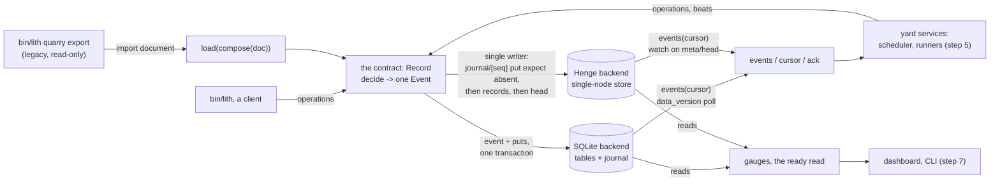

# The record

Plan #3157, effort 0001, step 2: the spec of #3159. The record is everything
the queue knows about efforts, items, tasks, runs and the host they run
on. It is one contract over two stores, SQLite and Henge, and quarrylith's
first code.

**Statement (#3157, user, 2026-10-29):** memLith schedules a mixed workload
on one node, in the yard, under allocation tables, with its record on both
backends behind one contract, and our own development runs on it. This page
specs the record behind that sentence: its records, its operations and
their journal, the two backends, the gauges and the import of the legacy
board. It specs no scheduling. Order, admission rules beyond the ready
read, schedules and the allocator are steps 3 and 4 (#3161, #3163), and
the services that host the record are step 5 (#3165).

**What exists at the base commits.**

- quarrylith `2b08bf0`: a README, the Apache-2.0 LICENSE and a
  `.publicignore` whose `[keep]` list makes `src/`, `tests/` and the
  package files public, and nothing else. No code.
- benchLith `d3fb1bd5`: the legacy board (templet 1423, built). It is
  `BOARD_SCHEMA` (20 tables, `BOARD_SCHEMA_VERSION = 1`), `LocalBoard` over
  one SQLite file, and its journal (`events_since`, `cursor_ack`). 1423's
  `BoardBackend` contract (phase 3a, #2282) was agreed but never built, and
  there is no Henge board (#1381's templet is unmerged). The live file holds
  3,009 items, 10,478 comments, 3,049 runs, 584 changes, 1,248 reviews and
  65,966 journal events (read 2026-10-30).
- henge-store-client `437de30`: `Store`, whose operations (`ops.py::OPS`)
  include `put` and `delete` with `expect` (one object's version, or
  `absent`), `get`, `get_many` and the one-key `watch`. It has **no
  multi-object transaction and no listing of a space's keys**. A value is
  plain msgpack data of at most 1 MiB (`Space.max_inline`). `Store.local`
  runs a Henge (one router, one worker) inside the calling process, from
  henge-store-serve.
- henge-store-serve `1081c1b`: the router (the ring) and the worker (the
  engine, `Partition`). `Local` takes no durability setting, so local mode
  runs `Durability("batch")`: a write is acknowledged up to 10 ms before it
  is synced. Nothing locks a local mode folder against a second process.



The record is the fold of its journal. Every operation decides one
**event** against the record as it stands. The event carries the whole new
value of every record the operation writes. A backend stores the event and
applies it: SQLite in one transaction, Henge as the journal entry first,
which is the commit point, and then its puts. Both backends store the same
events and so hold the same records, and `dump()` shows it.

## Interfaces

### The package

quarrylith is one package, `quarrylith`, Apache-2.0, depending on
**henge-store-client** only (Apache-2.0). Its modules:

| module | holds |
|---|---|
| `quarrylith.record.schema` | `RECORDS`: every record kind, declared once (below); the limits; the label and flag grammar |
| `quarrylith.record.events` | `Event`, `EVENT_KINDS`, `apply(view, event)`: the fold |
| `quarrylith.record.contract` | `Record` (an `abc.ABC`), the operations written once over it, `open_record`, `BACKENDS`, `Refused`, `Unavailable` |
| `quarrylith.record.sqlite` | `SqliteRecord` |
| `quarrylith.record.henge` | `HengeRecord(store, name)`; `open_local(folder, name)` |
| `quarrylith.record.importing` | `IMPORT_FORMAT`, `check_import(doc)`, `compose(doc) -> dump` |
| `quarrylith.gauges` | `Gauge`, `GAUGES` |
| `quarrylith.cli` | `quarrylith record init|check|dump|load|import|events|gauges` |

`quarrylith.record` imports nothing of a yard, a harness, a role or a repo
host. Who may make a move, who the user is, and which roles exist are the
caller's (`authorize`, below).

### The records

Each kind is declared in `RECORDS` as `Kind(name, key, fields, match, live,
journaled=True)`. A field is `Field(name, type, null=False, default=None)`,
and its `type` is one of **`str`, `int`, `bool`, `json`**. `json` is plain
data: dicts with `str` keys, lists, `str`, `int`, `float`, `bool`, `None`.
Times are `int` milliseconds since the epoch, UTC. Amounts of a resource
are `int`s in its base unit (bytes, millicores, slots). No other type
exists, so every record fits SQLite's affinities and Henge's msgpack values
alike.

`match` names the fields `read()` may match on, and `live` names the field
whose `None` means the record is still open. **No record is ever deleted.**
A record ends by its end field (`lifted_at`, `released_at`, `merged_at`,
...), and a closed item stays.

| kind | key | fields (beyond the key) | match | live while |
|---|---|---|---|---|
| `meta` | `key` | `value` json | -- | -- |
| `efforts` | `id` str (`0001`) | `slug`, `title`, `standing` (proposed, admitted, parked, concluded), `owner`, `created_at`; the six parts: `statement` str, `inputs` json, `tools` json, `budget` json, `evidence` json, `gates` json; `order` json (step 4's rule; default `{"rule": "unblocks-then-age"}`); `outcome` (complete, incomplete, disproved; null until concluded), `concluded_at` | `standing` | `concluded_at` |
| `effort_links` | `(effort, kind, target)` | `kind` ∈ plan, item, effort; `target` str; `at`, `by`, `unlinked_at` | `effort`, `target` | `unlinked_at` |
| `items` | `number` int | `kind` (task, plan, review, mission, ask, finding, batch), `title`, `state` (`ITEM_STATES`), `role` null, `tier` null, `risk` null, `parent` null, `labels` json (sorted list), `flags` json (sorted list), `admitted` bool, `filed_by` str, `must_fix` bool, `templet` null, `review_round` int, `created_at`, `updated_at`, `closed_at` null, `source` (local, legacy), `source_ref` null | `state`, `kind`, `role`, `parent` | `closed_at` |
| `item_text` | `number` | `body` str | -- | -- |
| `deps` | `id` | `number`; exactly one of `blocker` int, `change` int, `what` str; `added_at`, `added_by`, `lifted_at`, `lifted_by`, `why` | `number`, `blocker`, `change` | `lifted_at` |
| `leases` | `id` | `number`, `holder`, `fence` int, `branch`, `machine`, `granted_at`, `renewed_at`, `paused_until` null, `expires_at` null (null while paused), `released_at`, `released_by`, `why` | `number`, `holder` | `released_at` |
| `tasks` | `id` | `number` null (a job has no item), `effort` null, `kind` (agent, gate, review, cell, sweep, job), `labels`, `flags`, `needs` json (`{resource: amount}`), `sandbox` str (a driver class: `process`, `harness`, `podman`, `vm`), `schedule` str null, `not_before` null, `supervision` json (`{"expect_s", "beat_s"}`), `loop` json (`{"max_attempts", "interval_s"}`), `attempts` int, `state` (open, running, done, failed, cancelled), `created_at`, `ended_at` | `number`, `state`, `kind`, `effort` | `ended_at` |
| `nodes` | `name` | `drivers` json (sorted list), `labels` json, `declared_at`, `retired_at` | -- | `retired_at` |
| `capacity` | `(node, resource)` | `amount` int, `unit`, `declared_by`, `at` | `node` | -- |
| `reservations` | `id` | `node`, `resource`, `amount` int, `task` null, `run` null, `holder` str (a standing consumer's name when `task` is null), `from_at`, `until_at` null (open-ended), `released_at`, `why` | `node`, `task`, `run` | `released_at` |
| `runs` | `id` | `task`, `attempt` int, `holder`, `fence` null, `node`, `sandbox`, `pgid` null, `phase`, `phase_at`, `expect_until` null, `harness` json (class, model, effort, folder), `footprint` json, `cost` json, `outcome` null, `reason` null, `started_at`, `finished_at` | `task`, `holder`, `node` | `finished_at` |
| `changes` | `id` | `repo`, `n` int, `number` null, `relation` (closes, part), `branch`, `head`, `base` null, `position` null, `draft` bool, `url` null, `opened_at`, `merged_at`, `dropped_at` | `number`, `repo`, `branch` | `merged_at`, `dropped_at` |
| `checks` | `(change, head, name)` | `state` (green, red, skipped, pending), `detail` null, `at`, `by` | `change` | -- |
| `reviews` | `id` | `target` int, `round` int, `kind` (pool, second, templet, conformance, user), `item` null, `author`, `heads` json (`{change id: sha}`, written once), `pages` json, `reviewer` null, `verdict` null (approve, changes), `findings` json, `filed_at`, `verdict_at`, `read_at` | `target`, `item` | `verdict` |
| `merges` | `id` | `change`, `sha`, `by`, `rule` str (what allowed it), `at` | `change` | -- |
| `comments` | `id` | `number` null, `change` null, `who`, `body` str, `at`, `mark` null (a legacy protocol word, kept as data), `ref` null | `number`, `change` | -- |
| `questions` | `id` | `number`, `run` null, `who`, `kind` (blocked, pr), `text`, `asked_at`, `answered_at`, `answered_by`, `answer` null (a comment id) | `number` | `answered_at` |
| `statements` | `id` | `type` (#1228's: observation, inference, proposal, decision, action, outcome, correction), `effort` null, `number` null, `text`, `who`, `at`, `where` null (a URL or a reference), `supersedes` null | `effort`, `number`, `type` | -- |
| `holds` | `id` | exactly one of `number` int, `who` str; `cause`, `why`, `set_at`, `set_by`, `lifted_at`, `lifted_by` | `number`, `who` | `lifted_at` |
| `readings` | `id` | `source`, `kind`, `value` json, `at` | `source`, `kind` | -- |
| `imports` | `id` | `source` json (name, path, schema_version, last seq, read_at), `format`, `started_at`, `finished_at`, `counts` json | -- | `finished_at` |
| `pulled` | `(import, table, legacy_key)` | `record`, `record_key` json, `at` | `import`, `record` | -- |
| `left` | `(import, table, legacy_key)` | `legacy_key` json (null for a whole table), `count` int, `why`, `at` | `import` | -- |
| `beats` | `run` | `at`; **bookkeeping, not journaled** | -- | -- |
| `cursors` | `consumer` | `seq`, `at`; **bookkeeping, not journaled** | -- | -- |

The two migration tables are `pulled` (what came from the legacy board,
and when) and `left` (what was left behind, and why). `imports` is the run
that wrote them.

**Ids.** `items.number`, `efforts.id` and every `id` come from counters in
`meta` (`next:<kind>`), given in commit order from the counter, by one,
inside the operation that writes the record. A refused operation takes
none. Imported items keep their legacy numbers, and `next:items` starts
past the legacy board's `next_number`.

**Labels and flags.** A label is `key:value`, both `[a-z][a-z0-9_.-]*` (a
value may also hold `/`), at most one label per key on a record. A flag is
a word of the same alphabet, optionally with a `:qualifier` (`needs:lab`).
The keys `effort` and `state` are refused as labels: effort links are
records, and the state is a field. Labels are stored sorted. A task's
**effective labels** are its item's, then its own, by key, the task's
winning. A computed read, `effective_labels(task)`, gives them, and they are
never stored twice.

**Limits** (`schema.LIMITS`), one set on both backends: a `str` field at
most 256 KiB, a `json` field at most 256 KiB encoded, an event at most
768 KiB encoded (under Henge's 1 MiB `max_inline` with room for the
envelope), 64 labels and 64 flags on a record. An operation past a limit is
refused.

### Events: the journal and the fold

```python
@dataclass(frozen=True)
class Event:
    seq: int          # the journal's order, from 1, by one
    at: int           # the operation's one `now`
    actor: str        # who, as the caller names them
    via: str          # VIAS: cli, service, hook, import, load
    kind: str         # EVENT_KINDS
    subject: str|None # "item:3159", "task:12", "effort:0001", "node:laptop"
    data: dict        # what a consumer needs without a second read
    puts: tuple       # ((kind, key, value), ...): every record written, whole
```

- **`EVENT_KINDS`**: `effort.file`, `effort.edit`, `effort.standing`,
  `effort.conclude`, `effort.link`, `effort.unlink`, `item.file`,
  `item.edit`, `item.state`, `item.admit`, `dep.add`, `dep.lift`,
  `lease.grant`, `lease.renew`, `lease.release`, `task.file`, `task.edit`,
  `task.end`, `node.declare`, `node.retire`, `capacity.set`,
  `reserve`, `reserve.release`, `run.start`, `run.phase`, `run.finish`,
  `change.open`, `change.edit`, `change.drop`, `check.record`,
  `review.file`, `review.verdict`, `review.read`, `merge`, `comment`,
  `question.ask`, `question.answer`, `statement`, `hold.set`, `hold.lift`,
  `reading`, `meta.set`, `note`, `import`. A new kind is a change to this
  page.
- **`apply(view, event)`** writes `event.puts` into `view`, in order, by
  key. Nothing else. It reads no clock, no counter and no other record.
  Every rule is decided before the event exists, so applying one event
  twice leaves the same record as applying it once.
- **The replay**: `apply` over the journal from seq 1, into an empty
  record, gives exactly the journaled records `dump()` holds. `check()`
  runs it.
- **Bookkeeping is outside the fold**: `beats` and `cursors` are written
  without an event, never replayed and never compared by the replay. A
  lease's liveness is a computed read over its journaled `renewed_at` and
  its run's beat (`lease_view`, below), so a beat changes no journaled
  record.

### `Record`: the contract

`open_record(url, *, readonly=False, actor, via, authorize=None)` -> a
`Record`. `url` is `sqlite:///path/record.sqlite` or
`henge:<folder>#<name>`. `BACKENDS = {"sqlite": SqliteRecord, "henge":
HengeRecord}`. `authorize(actor, op, before, after) -> None | str` is the
caller's policy: a string refuses the operation with that reason. Who may
move what (bin/lith's roles, a yard's grants) lives there, never in
quarrylith.

**Errors.** `Refused(reason)`: the operation broke a rule and wrote
nothing. `Unavailable`: the store could not be read or written, raised
`from` the backend's own error and never in place of a `Refused`. A
uniqueness the records name (one live lease per item, one open change per
branch) is a `Refused`.

**Reads**, the same on every backend:

- `get(kind, key)` -> a dict of the declared fields, or None. An item
  carries `body` from `item_text` only when asked (`get("items", n,
  text=True)`).
- `read(kind, *, live=None, desc=False, limit=None, **match)` -> the records
  whose `match` fields equal the values given, in key order. A match on a
  field that is not in the kind's `match` is refused.
- `reading()`: a context manager inside which every read sees the record
  at one seq, which it yields.
- `ready(*, now)` -> **the ready read**: the open tasks and the items in
  `ready` that are eligible. An item is eligible when it is `admitted`, at
  least one effort it is linked to (directly, else through its parent
  chain) is `admitted`, it has no live dep and no live hold, and neither
  its holder nor its role has a live hold. A task is eligible when its item
  (if it has one) is eligible or `claimed`, `not_before` has passed, and
  `attempts < loop.max_attempts`. Step 4 orders this set and does not widen
  it.
- `lease_view(number, *, now)` -> the live lease with `state` running,
  paused or expired (1423's three, the same rules), its expiry computed
  from `renewed_at`, the latest beat of the holder's live run, and
  `paused_until`.
- `free(node, resource, *, from_at, until_at)` -> `capacity` minus the
  largest sum of live reservations overlapping any instant of the span.
- `effective_labels(task_id)`.

**Operations.** Each writes one event or nothing. Each takes one `now`, at
its start, from the record's clock (`now_ms`, which the tests move). It
calls `authorize` with the records before and after, refuses as below, and
returns what it made (an id, a number, a fence).

| group | operations, and what each refuses |
|---|---|
| efforts | `file_effort(id, slug, title, owner, parts, standing="proposed")`: an id taken. `edit_effort(id, **fields)`. `set_standing(id, standing, why)`: a concluded effort. `conclude(id, outcome, why)`: no outcome. `link(effort, kind, target)`, `unlink(...)` |
| items | `file_item(kind, title, body, *, role, tier, risk, parent, labels, flags, effort=None, filed_by, machine=False, must_fix=False, number=None)`: `number` is refused except `via="import"`. An item filed with no effort link takes its parent's links. With no parent, it is linked to `unsorted`. A machine-filed item (`machine=True`) is filed `admitted=False` unless `must_fix`. `edit_item(n, **fields)`. `move(n, state, why, *, expect=None)`: a pair not in `MOVES`, or `expect` not the current state. `admit(n, by)` |
| deps | `add_dep(n, *, blocker|change|what, why)`: a cycle, or a dep already live. `lift_dep(id, by, why)` |
| leases | `grant(n, holder, *, branch, machine, expect=None)` -> fence: a live lease held by another, a live hold, or `expect` not the state. `renew(n, holder, fence)`. `release(n, by, why)` |
| tasks | `file_task(...)`, `edit_task(id, **fields)`, `end_task(id, state, why)` |
| allocation | `declare_node(name, drivers, labels)`, `retire_node(name)`: live reservations on it. `set_capacity(node, resource, amount, unit)`: below what is reserved at any instant from now. `reserve(node, needs, *, task=None, run=None, holder, from_at, until_at)` -> ids: any resource without room (**the reservation invariant**). `release_reservation(id, why)` |
| runs | `start_run(task, holder, *, node, sandbox, fence, expect_s)` -> run id: in **one event**, it checks the task is eligible or claimed by `holder`, that `fence` is the item's live lease (when it has an item), and that `attempts < max_attempts`, then reserves `needs` on `node` from now with no end, raises `attempts` and starts the run. It is refused whole if any reservation does not fit: never queued, never part-reserved. `run_phase(id, phase, *, expect_s=None)`. `beat(id)` (bookkeeping, never refused). `finish_run(id, outcome, reason, *, footprint, cost)`: also releases the run's reservations in the same event |
| changes | `open_or_update_change(repo, branch, head, *, number, n, relation, base, position, draft, url)`: a second open change on a branch. `drop_change(id, why)`. `record_check(change, head, name, state, detail)` |
| reviews | `file_review(target, round, kind, *, item, author, heads, pages)`: `heads` is written once and never edited. `record_verdict(id, reviewer, verdict, findings)`: a review that already has one. `review_read(id)` |
| merges | `record_merge(change, sha, by, rule)`: a change not open, or `sha` not its head. It sets `merged_at` in the same event |
| text | `comment(...)`, `ask(...)`, `answer(question, comment)`, `state(type, text, *, effort, number, where, supersedes)` |
| holds | `hold(*, number|who, cause, why)`, `lift_hold(id, by)` |
| readings | `record_reading(source, kind, value)` |
| journal | `note(kind, subject, **data)`: only `note` itself, for what stands for no record |

`MOVES` is the legacy board's state pairs (`bin/lith::MOVES`, without its
who and why columns, which are policy): triage to ready; ready or blocked
to claimed; claimed to blocked, in-review or ready; ready to blocked;
blocked to ready; in-review to reviewed; reviewed and merge-ready each way;
in-review, reviewed or merge-ready to ready; any open state to dropped;
reviewed or merge-ready to done. A move out of `claimed` pauses the lease,
and a move back restarts it, as 1423 says.

**The journal, delivered**, with 1423's semantics on every backend (order,
no late event, atomic, complete, at least once, latency under a second on
one host, retention until read):

- `events(cursor, *, limit=500, wait=0.0, subject=None)` -> the events
  after `cursor`, in seq order.
- `head()` -> the highest seq, 0 when empty.
- `cursor(consumer)`, `ack(consumer, seq)` (forward only).

**The store's administration**: `init()`, `check()` -> findings (the
replay, then the backend's own), `dump()`, `load(dump)`, `backup(dir)`,
`durable` (a property: does an acknowledged event survive a power cut),
`shared` (a property: this record was opened as the one a yard runs on).

- `dump()` -> `{"format": 1, "records": {kind: [rows in key order]},
  "journal": [events], "bookkeeping": {"beats": [...], "cursors": [...]}}`,
  read at one seq. Two backends holding the same record give the same
  `dump()` apart from `bookkeeping`.
- `load(dump)` writes a dump into an empty record: every event with its
  seq, applied in order, and the bookkeeping. On SQLite it is one
  transaction. On Henge it is resumable: it writes events in seq order, and
  a load stopped part-way, opened again, goes on from `head() + 1`, refusing
  every other operation until `meta.loading` is cleared by its end.
- **A shared record is durable.** `open_record(..., shared=True)` is
  refused on a backend whose `durable` is false, unless it is given
  `allow_undurable=True` (tests and the bench only).

### The SQLite backend

- One file. WAL, `synchronous = FULL`, foreign keys on, a 10 s busy
  timeout, SQLite at least 3.37 (STRICT tables), as `board_open` sets them.
  Many processes write it.
- One STRICT table per record kind, named as the kind, with the declared
  fields as columns (`json` as TEXT with `json_valid`), the key as its
  primary key, and an index per `match` field. Plus `journal(seq INTEGER
  PRIMARY KEY AUTOINCREMENT, at, actor, via, kind, subject, data, puts)`
  with append-only triggers, as the legacy journal has, and an index on
  `(subject, seq)`.
- An operation is one `BEGIN IMMEDIATE` transaction. It reads, decides the
  event, inserts the journal row (its seq is the row's), and writes each
  put with `INSERT OR REPLACE`, then commits. Nothing inside it runs a
  subprocess, git or a network call.
- `events(wait=)` polls `PRAGMA data_version` at most every 250 ms, as
  `wait_events` does.
- `durable` is true when `synchronous` reads FULL or EXTRA.
- `schema_version` in `meta` (`RECORD_SCHEMA_VERSION = 1`). An open
  refuses a newer version, and an older one names `quarrylith record
  migrate`.

### The Henge backend

The Henge backend runs on **henge's single-node store** (below): one store
in one process, from one folder, serving henge-store-client's `Store`
operations, with no router and no ring. Its build step waits for it (user,
2026-10-30). The layout uses only `put` and `delete` with `expect`, `get`
and `get_many` of plain values, and the one-key `watch`, so it does not
depend on what serves them.

- **One writer.** A record on Henge is written by the one process that
  holds it. `open_local(folder, name)` takes an exclusive `flock` on
  `<folder>/quarrylith.lock` (refused, naming the holder's pid, while
  another process holds it), opens the store on the folder, and gives the
  `HengeRecord`. Other processes reach the record through that process,
  which is step 5's service. Inside the process, one lock orders the
  operations, and a `reading()` holds a read lock.
- **The layout**, in four spaces named `quarrylith.<name>.*`, every key a
  list of plain values:

  | space | key | value |
  |---|---|---|
  | `.journal` | `[seq]` | the event, as a dict |
  | `.rec` | `[kind, *key]` | the record's fields, plus `_seq`, the event that last wrote it |
  | `.idx` | `[kind, field, value, chunk]` | the sorted keys of the records of `kind` whose `field` is `value`, at most 8,192 per chunk; `[kind, "*", chunk]` for all of a kind's keys, and `[journal, subject, chunk]` for the seqs of a subject |
  | `.meta` | `["head"]`, `["applied"]`, `["writer"]`, `["schema"]`, `["loading"]` | the highest committed seq, the highest applied, the writer's pid, host and open time, the schema version, a load in progress |

- **The commit protocol**, per operation:
  1. Decide the event against the record at `applied`, which equals `head`
     between operations.
  2. `put(journal, [seq], event, expect={"absent": True})`, where seq is
     `head + 1`. This is the commit point. A `Conflict` here means a second
     writer, which the lock forbids: the operation fails with `Unavailable`
     and the record is opened again.
  3. Each put of the event: `put(rec, [kind, *key], value)`, then the
     index chunks the change moves a key into or out of.
  4. `put(meta, ["applied"], seq)`, `put(meta, ["head"], seq)`, then wake
     the waiting readers.
- **Recovery** at open: read `applied`, then `get` journal seqs from
  `applied + 1` until one is absent. Re-apply each (step 3, skipping a
  record whose `_seq` is already at or past it), then set `applied` and
  `head`. An event whose journal entry was written is never lost by a
  crash between steps 2 and 4. One whose entry was not written never
  happened, and its seq is given to the next operation.
- **Reads** are `get` on `.rec`, and `read(**match)` is the index chunks
  for the first match field, then a `get_many` of the keys, filtered by the
  rest. `dump()` walks `[kind, "*", chunk]`. No read lists a space.
- **Events**: `events(wait=)` wakes on the writer's own commit in the
  process, and a follower in another process may `watch` `meta/["head"]`
  and read `.journal` from its cursor with `get_many`. `cursors` are
  `.rec` entries the writer puts without an event.
- **`durable`** is true only when the store syncs each write before it
  acknowledges it. Under today's local mode (`batch`) it is false, so a
  shared record on Henge waits for a store that syncs: an ask of henge's
  single-node store (Boundaries).

### The import

The import is a **job in benchLith's `bin/lith`** (user, 2026-10-30): it
reads the legacy board and writes an **import document**. quarrylith
checks the document, composes it into a dump and loads it. quarrylith
never reads the legacy file, and bin/lith never imports quarrylith.

- **`bin/lith quarry export --out FILE [--board PATH] [--effort-doc
  PATH]`** opens the legacy board with `sqlite3`'s `mode=ro` URI (a copy is
  never needed, and nothing is written), reads it inside one deferred
  transaction (one snapshot), and writes `FILE` (`0600`, it holds the
  board's text). It prints its phases with elapsed time past five seconds,
  and takes `--timing` (per layer: store, git, gates, network) and
  `--debug`.
- **The document**, `IMPORT_FORMAT = "quarrylith-import/1"`:

  ```json
  {"format": "quarrylith-import/1",
   "source": {"name": "legacy-board", "path": "...", "schema_version": 1,
              "last_seq": 65965, "read_at": 1793371508596},
   "records": {"efforts": [...], "items": [...], "item_text": [...], "...": []},
   "counters": {"next:items": 3181, "...": 0},
   "pulled": [{"table": "items", "legacy_key": [3159], "record": "items", "record_key": [3159]}],
   "left": [{"table": "journal", "legacy_key": null, "count": 65966, "why": "..."}]}
  ```

- **`quarrylith record import FILE --into URL`**: `check_import(doc)`
  (every record valid against `RECORDS`, every `pulled` row naming a record
  in `records`, every legacy table named in `pulled` or `left`), then
  `compose(doc)`. Compose writes one `imports` record, then the records in
  `RECORDS` order as `import` events (one per record kind, split to stay
  under the event limit), then `pulled` and `left` as `import` events, then
  the counters as `meta.set`, all `via="import"`. Then `load` into an empty
  record. It is refused on a record that has items. Compose is pure, so the
  same document gives the same dump.
- **What is pulled** (user, 2026-10-30: every item, the journal left):

  | legacy | the record |
  |---|---|
  | every item, open and closed | `items` with its number, `source="legacy"`, `source_ref` its GitHub URL if any; `item_text`; `role`, `tier`, `risk`, `parent`, `templet`, `review_round`; `item_repos` as `repo:` labels, `item_labels` as labels (one that is not `key:value` as `legacy:<label>`); `kind` as it was; `admitted=True`; its state as it was: **nothing closed, nothing reopened** |
  | `comments` | `comments`, `mark` kept |
  | an `answer`-marked comment whose body starts `Decided` | also a `statements` row of type `decision`, `where` naming the comment |
  | `claims` | `leases`, fences as they were |
  | `deps` | `deps` |
  | `runs` | `runs`, each under a task `kind="agent"` made per (item, legacy run kind), `harness` from class, model, effort and folder |
  | `changes` | `changes`; a merged one also a `merges` row (`rule="legacy"`, `sha` its head) |
  | `gates` | `checks` |
  | `reviews` | `reviews` |
  | `questions` | `questions` |
  | `quarantine` | `holds` |
  | `budget` | `readings` (`source="budget"`) |
  | `board_figures`' output at the export | one `statements` row of type `observation`, the figures as data |
  | `docs/efforts/0001-the-queue/effort.md` (`--effort-doc`) | `efforts` `0001`, `admitted`, its six parts; its Decisions as `decision` statements and its Log lines as `action` statements |
  | the linking pass | an item linked to `0001` when `#3157` is in its parent chain or it is a plan `0001` names; every other item linked to effort `unsorted` (`parked`), made by the import |

- **What is left**, each a `left` row with its reason: the `journal`
  (65,966 events: the legacy record's own history, kept readable in the
  legacy file, which goes read-only; `source.last_seq` marks where the new
  record starts); `ranks` (retired by #3157); `needs_you` (derived, and
  #3052's to rebuild); `digests` (empty); `rounds` (the old loop's own
  accounting, standing behind the figures observation); `mains`,
  `change_facts` and `fact_pairs` (derived from git, empty); `meta` beyond
  the counters; `cursors`. A row the mapping cannot take (a value past a
  limit, a dangling reference) is a `left` row keyed by that row, with the
  problem, and never stops the export.
- **The report**: `quarrylith record import` ends with the pulled and left
  counts per legacy table, the same numbers `imports.counts` holds.

### Gauges

`Gauge(name, unit, labels, help, compute)`, where `compute(record, *, now,
window_ms) -> [(labels, value)]` reads only through the contract. `GAUGES`
is the one list the dashboard (step 7) and a node's report to its peers
read. Each is computed from the records named, and none is stored:

| gauge | unit | labels | from |
|---|---|---|---|
| `capacity`, `reserved`, `free` | the resource's | node, resource | `capacity`, `reservations` |
| `queue_depth` | items, tasks | state, effort, label key:value | `items`, `tasks`, `effort_links` |
| `runs_active` | runs | phase, node | `runs` |
| `run_age` | s | run | `runs` (`now - started_at`) |
| `filed_to_start`, `start_to_done` | s (p50, p90 over the window) | kind, effort | `items`, `tasks`, `runs` |
| `outcomes` | runs | task kind, outcome | `runs` |
| `unmerged_changes` | changes | repo | `changes` |
| `review_rounds` | rounds (median, worst) | effort | `reviews` |
| `budget_pace` | %/h | provider | `readings` (`source="budget"`) |
| `footprint` | the resource's | task kind, resource | `runs.footprint` |
| `stalls` | runs | node | `runs`, `beats`: alive with no phase change past `expect_until` + 5 min, or 10 min with no expectation (AGENTS.md's stall margins) |

## Reuse

- benchLith `bin/lith::BOARD_SCHEMA`, `ITEM_STATES`, `MOVES` -- the item
  states and moves, and the legacy tables the import reads. The record's
  `items`, `leases`, `deps`, `changes`, `checks`, `reviews`, `questions`
  and `holds` are those tables' fields, renamed where the name was a GitHub
  one, so the import is a mapping, not a translation.
- benchLith `bin/lith::events_since`, `cursor_ack`, `wait_events` -- the
  journal's delivery semantics (1423, "`events(cursor)`") and the
  `data_version` poll, taken as written.
- benchLith `bin/lith::board_open` -- the SQLite settings the SQLite backend
  copies (WAL, FULL, STRICT, the busy timeout, the version floor).
- benchLith `bin/lith::board_figures` -- the figures the import records as
  one observation.
- 1423's lease rules (Claims as leases: running, paused, expired; expiry is
  a report, never a release) -- `lease_view` reads them the same way.
- 2710's review heads -- `reviews.heads` written once, the one binding of
  an approval.
- henge-store-client `Store.put`/`delete` with `expect`, `get_many`,
  `AsyncStore.watch` -- the Henge backend's only operations.
- 1423's conformance pattern (`BACKENDS`, `over_backends`, a fixture per
  backend, a skip with its reason, never a pass) -- the suite in
  quarrylith's `tests/`.

What looked reusable but was not:

- **1423's `BoardBackend`**: never built, and shaped around bin/lith's
  `gh`-shaped methods and GitHub's protocol comments (`MARKS`). The record
  keeps its semantics and drops that shape.
- **Henge tables** for the indexes: `rows(where=)` matches the whole key
  only, `remove` takes every row with a key value, and a table stops at
  32 MiB. Index chunks in blobs do what the reads need.
- **Henge logs** for the journal: `append` takes no `expect`, so two
  appends cannot be ordered against a decision. A blob per seq written
  `absent` can.
- **memlith `board.py`**: a GitHub mirror whose record is GitHub. It is not
  a backend.

## Invariants

1. **One event per operation, or none.** A refused or failed operation
   writes no record, no event, no counter.
2. **The record is the replay of its journal**: the fold of every event
   from seq 1 equals the journaled records, on both backends.
3. **Seqs rise by one from 1 and are never given twice**; a reader that saw
   seq N never later sees an event below N.
4. **Same journal, same record**: two backends given the same operations at
   the same `now`s give equal `dump()`s, `bookkeeping` aside.
5. **No record is deleted.** A record ends by its end field.
6. **Reservations never exceed capacity**: for every node and resource, at
   every instant, the live reservations covering it sum to at most the
   capacity. A start or a reserve that would break it is refused, never
   queued past it and never part-made, and `set_capacity` below what is
   reserved is refused.
7. **Every running run holds live reservations for its task's needs** on
   its node, made in its `run.start` event and released in its
   `run.finish`.
8. **One live lease per item**; its fence rises per item from 1. A run's
   writes under a fence that is not the live lease's are refused. An
   expired lease is a report, never a release.
9. **Only an admitted effort's work is ever ready**: `ready()` never gives
   an item or task whose every linked effort is not `admitted`, nor a
   machine-filed should-fix item before `admit`.
10. **Every item has an effort link** once filed (its own, its parent's, or
    `unsorted`).
11. **A review's heads are written once**, at `file_review`.
12. **The import closes nothing and writes nothing to the legacy file**;
    every legacy table it reads is named in `pulled` or in `left`, and
    `pulled` plus `left` counts equal the rows read, per table.
13. **One writer per Henge record**, held by the folder's lock.
14. **A shared record is durable.**
15. **quarrylith's `src/` names nothing of a yard, a role, a harness or a
    repo host**, and no internal name (the polish lint).

## Acceptance

Each item is a test marked `templet:3159`, run over every backend in
`BACKENDS` unless it names one. Steps below name which make which pass.

- [ ] `RECORDS` declares every kind of the table above with its key,
  fields, match and live field, and a record with an undeclared field or a
  wrong type is refused
- [ ] a label that is not `key:value`, a second label of one key, an
  `effort:` or `state:` label, and a field past its limit are each refused
- [ ] `apply` of one event twice equals `apply` once, and `apply` reads no
  clock or counter
- [ ] `compose` of the same import document gives the same dump twice
- [ ] `check_import` refuses a document whose legacy table is in neither
  `pulled` nor `left`, and one whose `pulled` row names a missing record
- [ ] a refused operation writes no record, no event and takes no id or
  seq: the next operation gets the numbers it would have had
- [ ] after a run of mixed operations, the replay of the journal from seq 1
  equals the journaled records of `dump()`
- [ ] `events(cursor)` gives seqs from `cursor + 1` in order, with no gap,
  and an operation's event carries every put it made
- [ ] a waiting `events(..., wait=5)` returns within a second of a commit
  by another writer
- [ ] `ack` moves a cursor forward only, and a beat or an ack writes no
  event
- [ ] `dump()` of a record loaded from another backend's `dump()` equals it
- [ ] `read` on a field outside the kind's `match` is refused
- [ ] an item filed with no effort and no parent is linked to `unsorted`;
  one with a parent takes its parent's links
- [ ] `ready()` leaves out an item whose efforts are all parked, an
  unadmitted machine-filed should-fix item, an item with a live dep, and an
  item with a live hold; a must-fix machine-filed item is in it at once
- [ ] a move not in `MOVES` is refused, and `move(..., expect=)` with a
  stale state is refused
- [ ] `authorize` returning a reason refuses the operation with it
- [ ] a second `grant` on an item with a live lease held by another is
  refused; fences rise from 1 per item
- [ ] a lease past its expiry reads `expired` and still holds the item; a
  beat of the holder's live run moves its expiry and writes no event
- [ ] `reserve` past capacity at any instant of its span is refused whole,
  across several resources
- [ ] two processes starting runs at once on one node never hold
  reservations summing past its capacity (SQLite: separate processes;
  Henge: concurrent callers of the one writer)
- [ ] `start_run` with a fence that is not the live lease's, or past
  `loop.max_attempts`, is refused and reserves nothing
- [ ] `finish_run` releases the run's reservations in its own event
- [ ] `set_capacity` below the reserved amount is refused
- [ ] a second open change on one branch is refused, and `record_merge` of
  a sha that is not the change's head is refused
- [ ] `record_verdict` on a review that has one is refused, and no
  operation edits a review's `heads`
- [ ] every gauge in `GAUGES` computes from a fixture record, through the
  contract only, to the expected values
- [ ] `stalls` counts a run alive past `expect_until` + 5 min, or 10 min
  with no expectation, and not one inside its margin
- [ ] `open_record(..., shared=True)` is refused on a backend whose
  `durable` is false, unless `allow_undurable`
- [ ] SQLite: `open_record` refuses a newer `schema_version` and names
  `migrate` for an older one
- [ ] Henge: a second `open_local` on a held folder is refused, naming the
  holder's pid
- [ ] Henge: a crash after the journal put and before `applied` is
  recovered at the next open, and the replay still equals the records
- [ ] Henge: a load stopped part-way continues from `head() + 1` at the
  next open, and refuses every other operation until it ends
- [ ] Henge: no read lists a space (a store fake that refuses listing runs
  the whole suite)
- [ ] export: `bin/lith quarry export` over a fixture legacy board opened
  read-only writes the document `0600`, and the fixture's bytes are
  unchanged
- [ ] export: every item of the fixture is pulled with its number and its
  state, nothing closed or reopened, and every legacy table is in `pulled`
  or `left`
- [ ] export: a `Decided` answer comment is also a `decision` statement,
  and a merged change is also a `merges` row
- [ ] export: the linking pass links #3157's descendants to `0001` and
  every other item to `unsorted`
- [ ] import: the report's pulled and left counts per table equal the rows
  the fixture holds, per table
- [ ] lint: quarrylith's `src/` holds no name from the polish lint's list
  and imports no yard, harness or role module

## Build steps

In merge order. Each step is one PR that merges alone and passes its gate
without any later step. The tests of every step carry `templet:3159`. The
last step's PR sets `status: built` and the pins.

1. **The declarations and the fold** -- quarrylith: `pyproject.toml`
   (Apache-2.0, depends on henge-store-client only), `schema.RECORDS`,
   `LIMITS`, the label and flag grammar, `events.Event`, `EVENT_KINDS`,
   `apply`, `importing.IMPORT_FORMAT`, `check_import`, `compose`, and the
   lint test. Pure code, no store.
   Acceptance: `RECORDS` declares; a label ... refused; `apply` twice;
   `compose` twice; `check_import` refuses; lint.
   Aim: tier 3.
2. **The contract and the SQLite backend: the record's core** --
   quarrylith: `Record`, `open_record`, `BACKENDS = {"sqlite": ...}`,
   `SqliteRecord` for `meta`, `efforts`, `effort_links`, `items`,
   `item_text`, `deps`, `comments`, `statements`, `holds`, the journal,
   `cursors`, `dump`, `load`, `check`; the conformance fixtures and
   `over_backends`; the ready read without tasks; `quarrylith record
   init|check|dump|load|events`.
   Acceptance: refused writes nothing; replay; `events` order; waiting
   `events`; `ack`; `dump` of a load; `read` outside `match`; effort links;
   `ready()` leaves out; `MOVES`; `authorize`; `shared` refused; SQLite
   `schema_version`.
   Aim: tier 4, deep: the transaction and the journal's guarantees across
   processes.
3. **Work in flight on SQLite** -- quarrylith: `leases`, `tasks`, `nodes`,
   `capacity`, `reservations`, `runs`, `beats`, `lease_view`, `free`,
   `start_run` and `finish_run` as single events; the ready read gains
   tasks.
   Acceptance: second `grant`; lease expiry and beat; `reserve` past
   capacity; two processes starting; `start_run` refused; `finish_run`
   releases; `set_capacity` below.
   Aim: tier 4, deep: the reservation invariant under concurrent starts.
4. **The landing records and the gauges** -- quarrylith: `changes`,
   `checks`, `reviews`, `merges`, `questions`, `readings`, `imports`,
   `pulled`, `left`; `quarrylith record import`; `GAUGES`; `quarrylith
   record gauges`.
   Acceptance: second open change and merge sha; `record_verdict` and
   heads; every gauge; `stalls`; the import report's counts (over a
   fixture document).
   Aim: tier 3.
5. **The legacy export** -- benchLith: `bin/lith quarry export`, the
   mapping above, over a fixture board in `tests/`. It needs only step 1's
   format, which it writes as plain JSON. It merges after step 1 and runs
   against a real record after step 4.
   Acceptance: export read-only and `0600`; every item pulled; decisions
   and merges; the linking pass.
   Aim: tier 3.
6. **The Henge backend** -- quarrylith: `HengeRecord`, `open_local`, the
   layout, the commit protocol, recovery, the resumable load, events;
   `BACKENDS` gains `henge`, and the whole suite runs over it. **Waits on
   henge's single-node store** (Boundaries), and the bake-off (#2707) waits
   on this step.
   Acceptance: Henge second `open_local`; crash recovery; stopped load; no
   listing.
   Aim: tier 5, deep: a commit protocol over single-object writes and its
   recovery. henge reviews it as the second role.

## Boundaries

- quarrylith's `src/` and `tests/`, and, for step 5 only, benchLith's
  `bin/lith` and its tests. No other repo, and no yard code: the services
  that host the record, its socket and `memlith up` are step 5's (#3165).
- No scheduling policy: the order, the per-repo landing limit, the parser
  of `tasks.schedule`, the allocator and its standing consumers are steps 3
  and 4 (#3161, #3163). The record stores `schedule` as text and
  `not_before` as a time, and refuses only what its invariants name.
- No roles: who may move, grant or merge is the caller's `authorize`.
- **Henge is henge's.** The Henge backend uses `Store`'s operations as they
  are, and its build step waits on a store henge provides: a
  **single-node store** (the user's proposal, 2026-10-30: the engine
  without the router or the ring, serving the same operations, run from one
  folder) that **syncs each write before it acknowledges it**, so `durable`
  is true. Neither is filed yet: the plan is the user's and henge's, filed
  by the planner once the board takes new work. This page edits nothing of
  henge's.
- The legacy board is read only: opened `mode=ro`, never copied into place,
  never written. The switch (#3170) makes it read-only.
- The bake-off is #2707's (user, 2026-10-30: step 2b). Its figures may
  propose changes to this page, by its PR's History line. The operations it
  times are `grant`, `release`, `renew`, `add_dep`, `ready`, `comment`,
  the journal's write and `events`/`ack`, `record_check` with the merge
  read, `start_run` and `reserve`, `get` and `file_item`.
- Nothing internal in `src/` or `tests/` (quarrylith is public-bound).
  This page lives in `docs/`, which the mirror's `[keep]` list leaves out.

## Rationale

**The record as the fold of its journal.** Henge gives one object's
compare-and-set and nothing wider, so an operation that writes four records
cannot be one Henge write. It can be one event: the journal entry, written
`absent` at the next seq, is the commit, and the records are its
consequence, applied after it and re-applied on recovery. SQLite does the
same in one transaction, so the two backends differ in how they make an
event durable and never in what an operation means. Putting whole values in
the event makes `apply` trivially idempotent and the replay a test. It
costs journal size. Item text is its own record, so a move does not copy a
body, and the largest legacy record (a 25 KB body) is far under the limit.
Rejected: a Henge write per record with a compensating undo (a crash
between them leaves a half operation readable); Henge logs (no conditional
append); and a schema that is two schemas, one per store, with parity
tested after (the 10-22 decision asks for one contract).

**One writer on Henge.** Local mode runs its store inside the opening
process and does not lock its folder, so two processes opening one folder
would be two engines on one set of segments. The writer's lock makes that
impossible, and it also makes the decide step safe: between operations the
writer's view is the record. Multi-writer Henge would need a fenced writer
lease and a re-read on every conflict, which nothing on one node needs. The
mesh's placement moves the writer, never splits it (out of scope).

**Indexes as blob chunks.** No Henge read lists a space, so every read the
contract offers has to come from a key the record already knows. One chunk
per (kind, field, value) holds the keys. 8,192 keys of msgpack ints are a
few tens of KiB, and the largest legacy group (2,222 done items) is one
chunk. Henge tables were rejected (Reuse, above).

**Item states kept as the legacy board's nine, and labels as `key:value`.**
The review flow (2710's `PR_OUT`), the landing mode and the import all read
them. Admission is a field and a read, not a state, so the ready read can
be the one place the rule lives (invariant 9) without a tenth state that
every move would have to know.

**Leases on items, reservations on runs.** A claim is a durable hold on the
work that expiry reports and never frees (1423, the scheduler primitives
review of 2026-10-26). A reservation is the host's room for one attempt,
made and released with it. They stay two records, so losing a run never
loses the claim, and a claim never holds memory.

**The import in bin/lith** (user, 2026-10-30). The importer reads our
private board format, so it lives with that format in benchLith. quarrylith
defines only a source-neutral document and the migration tables. **Every
item pulled, the journal left** (user, 2026-10-30): the gauges need history
(filed-to-start, outcomes, review rounds), and the legacy events are
another system's kinds, readable in the legacy file for as long as it is
kept.

**Henge waits for the single-node store** (user, 2026-10-30). Today's local
mode is a router and a worker with a ring, for one node. The user asked for
an engine-only single-node store instead, and for the Henge step to wait
for it. The layout here uses only the `Store` operations, so it holds on
either. The SQLite steps, the import and the bake-off's SQLite half do not
wait.

**Left to later steps**: the order, the admission filter's ranking and the
landing limit (step 4); the allocator's policy and its standing consumers
(step 3); the services, their socket, supervision's kill of the process
tree and the sandbox drivers (step 5); the dashboard's views (step 7); the
choice of default backend for a release (the bake-off, #2707). #3109's
efforts templet (`3106-efforts.md`) is not written. Its design (#3044)
shaped the `efforts`, `effort_links` and `statements` records here, and
gate evaluation stays its own.

## History

- 2026-10-30 agreed (merge of this PR, user)
