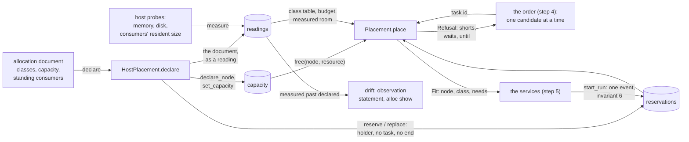

# The allocator

Plan #3157, effort 0001, step 3: the spec of #3161. The allocator decides
**whether and where** a task fits on a host. It knows the host's allowance,
which is its capacity less the **standing consumers** declared on it. It
slices a reservation off that allowance per **run class**. It refuses a start
that does not fit, and gives the reason. It is the first plugin on #1342's
**Placement** seam, so MeshLith's placement later fills the same contract.

The record (step 2, `3159-the-record.md`) already holds what this builds on,
and the allocator re-implements none of it:

- the tables `nodes`, `capacity` (`(node, resource)`, `amount`, `unit`) and
  `reservations` (`node`, `resource`, `amount`, `task` or `holder`,
  `from_at`, `until_at`);
- the read `free(node, resource, *, from_at, until_at)`;
- the operations `declare_node`, `set_capacity`, `reserve` and
  `release_reservation`;
- `start_run`, which checks in **one event** that the task's stored `needs`
  fit and takes its reservations;
- **invariant 6**: reservations never sum past capacity at any instant, and a
  start that would break it is refused, never queued past it.

The record enforces the invariant atomically. The allocator is the policy
around it: which needs a task has, which node it goes to, which standing
consumers hold room, and the checks the table cannot make (the budget, the
host's measured memory and disk). Its answer is advice that `start_run`
either confirms or refuses. The allocator never takes a run's reservation
itself.

**What exists at the base commits.** quarrylith `bd0420d0` has the record's
build steps 1 to 5: schema, events, contract, the SQLite backend, gauges and
import. The Henge backend is step 6, not yet built. Nothing allocates:
`capacity` and `reservations` are written only by tests. The legacy launcher
in benchLith `2a8a78e5` (`bin/lith`) guards starts with:

- caps per harness: Claude 4, Codex 3, local 1, with 2 review slots;
- a lab cap of 2 VMs, with room for one more, the smoke's;
- the disk floor, `min_free_gb` 20 (a failed reading holds the launch);
- the budget pacing: 2 runs at a warning, none from 95%, and a stale reading
  holds nothing;
- one lane, a repo's ceiling of 4 agents (`[launch.lanes]`, `min` 0), and
  the scheduler's 2 gates at once;
- lab prune, the process-group kill at run end, and gate timeouts.

There is **no memory guard anywhere**. #3102, a memory guard for local runs,
stays filed for the legacy launcher. Manual sessions are unguarded.

**The host on 2026-10-30 (the user):** 48 GiB of memory, and 87 GiB of disk
free (91% used). The Podman machine is allotted 15.4 GiB of memory and 8
CPUs, and its resident size was 19.7 GB for two days (#2746's amendment). The
user grows its disk to 40 GiB (sparse) before the build. Lab VMs are 4 GiB
each. The local model's peak was 19.6 GB at load and 35.6 to 37.8 GB with a
full 64k context (#2703). It stays off, and undeclared, until this allocator
lands.



## Interfaces

### The modules

| module | holds |
|---|---|
| `quarrylith.allocator` | the seam: `Placement` (an `abc.ABC`), `Fit`, `Refusal`, `Short`, `CAUSES`, `placement_for(name)`, `PLACEMENT_GROUP`; the document: `Document`, `load_document(text)`, `parse_amount(value, unit)`, the document as plain data and back, `to_data(document, figures=None)` and `document_from_data(raw)`; the shared policy: `classify`, `needs_of`, `table_shorts(reader, node, needs, *, now)`, `budget_shorts(reader, document, node, needs, *, now)`, and `allowance(reader, document, node, provider, *, now)`, the budget's allowance that `budget_shorts` and `headroom` both read |
| `quarrylith.allocator.host` | `HostPlacement`, the laptop plugin: the seam's methods, plus `declare` (which returns a `Declaration`: `wrote`, `refusals` by consumer, `failed`; with `dry_run=True` it writes nothing and returns the lines it would write), `declared`, `check_resize`, `resize`, `resolve`, `measure`, `drift` and `sample_consumer`; the probes `probe_memory()`, `probe_disk(path)`, `probe_size(path)` (allocated bytes, so a sparse file counts what it holds), `probe_tree(pid)` and `probe_process(match)`; `ProbeError` |
| `quarrylith.allocator.show` | `snapshot(record, *, now)`, plain data of what is declared, held, free, measured and drifting, and `lines(snapshot)`, the text `alloc show` prints; it reads the record only |
| `quarrylith.alloc_cli` | the commands `quarrylith alloc declare|show|place|measure|consumer measure` (below), added to the parser by `quarrylith.cli`; the one module outside `quarrylith.allocator` that builds on it |

The allocator imports the standard library and `quarrylith.record` only, and
reads and writes the record only through the contract: `get`, `read`,
`reading`, `free`, `effective_labels` and the operations named below. So it
works the same on SQLite and on Henge. It names nothing of a yard, a role or
a repo host (the record's invariant 15). The host plugin names no vendor
tool: a consumer's probe is data in the document.

### The seam: `Placement`

```python
PLACEMENT_GROUP = "quarrylith.placement"   # entry points: name -> class

class Placement(abc.ABC):
    name: str                                         # "host"

    def __init__(self, record): ...                   # a Record, or a reader

    @abc.abstractmethod
    def place(self, task: int, *, now: int) -> "Fit | Refusal":
        """Whether and where one task fits, now. Writes nothing."""

    @abc.abstractmethod
    def headroom(self, *, now: int) -> dict:
        """{node: {resource: amount}}: what a start may still take on each
        live node, the least of the table's free, the budget allowance and
        the measured room. Writes nothing."""

    @abc.abstractmethod
    def hold(self, holder: str, needs: dict, *, task: int | None = None,
             node: str | None = None, measured: bool = True,
             now: int) -> "list[int] | Refusal":
        """A standing reservation (task None) or a task's own (it outlives
        the task's runs): checked against the table as `place` checks it,
        and against the measured room unless `measured` is False (a consumer
        already running is in the measurement already, so `declare` passes
        False), then `reserve` with no end. Returns the reservation ids, or
        the Refusal."""

    @abc.abstractmethod
    def release(self, holder: str, *, node: str | None = None,
                why: str) -> list[int]:
        """Release every live reservation of `holder` on the node that no
        live run holds."""

def placement_for(name: str) -> type[Placement]:
    """The class registered under `name` in PLACEMENT_GROUP; LookupError
    naming the group and the names it has."""
```

quarrylith's own `pyproject.toml` registers `host =
"quarrylith.allocator.host:HostPlacement"`. A MeshLith placement registers
its own name in the same group.

- `place` reads the record **inside one `reading()`**. It gets the same
  answer for the same record at the same `now`, on every backend.
- `place` looks at **one candidate**. It never reads the ready set, never
  compares candidates, and never refuses one task because of another task.
  The order (step 4) decides what is asked next.
- The seam leaves the mesh's ranking open: #1342's fit, then locality, then
  cost. On one host, fit is the whole decision. Fairness within a lane is the
  order's.

### The answers

```python
CAUSES = ("room", "measured", "unmeasured", "pressure", "budget",
          "undeclared", "unclassified", "driver", "node")

@dataclass(frozen=True)
class Fit:
    task: int
    node: str
    run_class: str        # the class that matched
    needs: dict           # {resource: amount}: what start_run must reserve
    sandbox: str
    why: str              # one line: "agent on laptop: memory 2.0 of 9.1 GiB free, ..."

@dataclass(frozen=True)
class Short:
    cause: str            # one of CAUSES
    node: str | None
    resource: str | None  # None for driver, node, unmeasured: see below
    asked: int | None
    free: int | None      # what the table, the measurement or the allowance had
    capacity: int | None
    waits: bool           # can waiting alone ever make it fit?
    until: int | None     # a time after which it may fit (a budget reset), else None
    holders: list         # the three largest live holders of the resource, [(holder, amount)]
    detail: str = ""      # a line for a cause the figures do not say: the floor, or why unmeasured

@dataclass(frozen=True)
class Refusal:
    task: int | None      # None for a hold with no task
    run_class: str | None
    needs: dict
    shorts: tuple         # every Short, in CAUSES order, then by resource
    waits: bool           # all(s.waits for s in shorts)
    until: int | None     # the latest `until` of the shorts, when every one has one
    text: str             # one line, in the disk guard's form (below)

    def as_data(self) -> dict: ...   # plain data, for a note or a log
```

**The reason** is `Refusal`. Every short resource is named with what was
asked, what was free and the capacity. The answer also says whether waiting
can help, and until when. `text` is one line, in the form of today's guards:

```
allocator: task 12 (agent) refused on laptop: memory 2.0 GiB asked, 1.3 GiB free of 48.0 GiB (podman-machine 15.4, desktop 10.0, run 9 2.0); waits
```

**`waits`**, per cause:

- `room`: `asked` fits within capacity less the live reservations that no
  run holds (standing consumers and tasks' own), over the span from now.
  When it is true, the finish of runs alone can make room. When it is false,
  nothing fits until a declaration changes.
- `measured`, `unmeasured` and `pressure`: always true. Memory frees, a
  reading comes and pressure eases.
- `budget`: true, on `resource` `budget.<provider>`. `until` is the reading's `resets_at` at a stop or a
  rejection, and None while pacing at a warning, and at a stop that names no
  end, whose `detail` says so.
- `undeclared`, `unclassified`, `driver` and `node`: false. Only a change to
  the document, the node or the task can help.

**A short with `resource` None** names no one resource. With `waits` false
(`driver`, `node`) the task cannot run on this node at all. With `waits` true
(`unmeasured`, `pressure`) it means **every resource**: the host's reading is
missing or stale, or the host is under memory pressure, so every start on the
node would be refused the same way until a reading comes or the pressure
eases, and the order holds everything behind it.

**What the order may rely on.** The order (step 4, `3163-the-order.md`)
reads these names and fields, and they stay as they are:

- `place(task, *, now)` is the one call. It answers `Fit` or `Refusal`, and
  both carry `needs`.
- `Refusal.waits` false means the task never fits on this node short of a
  change to the document, the node or the task: the order's "never".
- `{s.resource for s in refusal.shorts}` are the resources it is short of,
  and a `None` among them is every resource (above).
- `Refusal.text` is one line, fit for a reason shown to a person.
- `Refusal.until` is a time after which it may fit, or None.

`headroom` is for the services and the views: what a node can still take.
So is `until`, when a budget lifts, and the order may also put it in a reason
("held: budget until 18:00"). The order needs neither to decide.

**What the services do with a Fit** (step 5 builds it): when `fit.needs`
differs from the task's stored `needs`, they call `edit_task(id,
needs=fit.needs)`, then `start_run(task, holder, node=fit.node,
sandbox=fit.sandbox, ...)`. `start_run` reserves the stored needs, so the
edit is what makes the reservation match the class. If `start_run` is
refused for room, another start took it in between. The services ask `place`
again for the structured reason and never retry blindly. A filer may instead
store the class's needs at filing, with `needs_of`, and save the edit.

**What the services do with a Refusal** (step 5): they hand it to the order,
which decides what happens to the candidates behind it. When a task's
refusal differs from its last, they record it as `note("placement.refused",
"task:<id>", **refusal.as_data())`. The allocator writes no note itself,
because `place` writes nothing.

### Run classes

A **run class** is a row of the document's `[[class]]` list: a name, a
`match`, and the `needs` it slices off the host. `classify(document, task,
labels)` takes the **first** class, in document order, whose `match` holds
over:

- the task's `kind`;
- its `sandbox`;
- its **effective labels** (`effective_labels(task)`);
- its flags.

A `match` key is one of `kind` (a list), `sandbox` (a list), `labels` (a list
of `key:value`, all of them carried) and `flags` (a list, all of them
carried). An empty `match` matches every task, so the last class is the
catch-all. A task that no class matches is refused as `unclassified`.

`needs_of(document, task, labels)` gives the **effective needs**: per
resource, the larger of the class's amount and the task's own stored `needs`.
A task may declare more than its class gives, and never less. Inside a
class's `needs`, the pseudo-resource **`harness = N`** expands, through the
task's `harness:<name>` label and the document's `[harness.<name>]` row, to
`N` of the harness's `slots` resource and `N × weight` of its `budget`
resource. The weight comes from `[budget].weight` by the task's `class:`
label (small, standard or deep). A task in such a class with no `harness:`
label is `unclassified`, naming `harness`. Beside the class's needs, a task
takes 1 of `lane.<name>` for every lane it is in (below, "Lanes").

`classify` and `needs_of` return the `Refusal` themselves where they refuse
(`unclassified`, waits false), built by `refuse(task, run_class, needs, shorts,
*, node)` in `quarrylith.allocator`, which puts the shorts in `CAUSES` order,
reads `waits` and `until` from them and writes `text`. So `place` returns what
they return. A task with no `class:` label weighs `standard`; a `class:` value
that is not small, standard or deep, when the harness has a budget resource, or
a `harness:` value the document has no row for, is `unclassified`, naming
`class` or `harness`.

The first classes, in the sample document below:

| class | matches | slices off the host |
|---|---|---|
| `vm.smoke` | sandbox `vm`, flag `smoke` | memory 5 GiB (the VM's 4 and 1 for its driver), disk 10 GiB, `lab.smoke` 1 |
| `vm` | sandbox `vm` | memory 5 GiB, disk 10 GiB, `lab` 1 |
| `container` | sandbox `podman` | `podman.memory` 4 GiB, memory 512 MiB, disk 2 GiB |
| `local` | kind agent or review, label `harness:local` | memory 2 GiB, disk 4 GiB, `harness` 1 (the model's own room is a standing consumer) |
| `agent` | kind agent or review | memory 2 GiB, disk 4 GiB, `harness` 1 |
| `gate` | kind gate | memory 3 GiB, disk 4 GiB, `slots.gate` 1 |
| `job` | anything else (sweep, job, cell) | memory 512 MiB, disk 512 MiB |

A **proving mission's VM outlives the mission's runs** (checkpoints). It is
the task's own reservation, made with `hold(f"vm:{name}", {"memory": 4 GiB,
"lab": 1}, task=id)` before the VM is made. It is released at the VM's `lab
down` by `release`, or by `end_task`, which already releases a task's own
reservations. The mission's runs then classify as `agent`. A VM started
outside the queue is held the same way with no task.

### The allocation document

The document is the caller's file, in TOML (`tomllib`, standard library).
The yard's copy is step 5's. quarrylith ships the sample as
`tests/data/allocation-sample.toml`, the acceptance tests' fixture, and it
is the first declaration:

```toml
format = 1
node = "laptop"
drivers = ["harness", "podman", "process", "vm"]
disk_path = "."              # the filesystem the work lives on (the caller's path)

[capacity]
memory = "measure"           # the host's physical memory, read at declare: 48 GiB
disk = "measure"             # free now + what disk consumers occupy now - floor.disk
"slots.claude-code" = 4      # today's caps
"slots.codex" = 3
"slots.local" = 0            # the local model is not declared yet
"slots.gate" = 2             # today's gates at once
"budget.anthropic" = 4       # this node's share; weights of 1 keep today's caps
"budget.openai" = 3
lab = 2                      # VMs that are not the smoke's
"lab.smoke" = 1              # the smoke never waits behind a long run
"podman.memory" = "14GiB"    # the Podman machine's allotment less its own system

[harness.claude-code]
slots = "slots.claude-code"
budget = "budget.anthropic"
[harness.codex]
slots = "slots.codex"
budget = "budget.openai"
[harness.local]
slots = "slots.local"        # no provider budget

[budget]
weight = { small = 1, standard = 1, deep = 1 }
warning_max = 2              # weight live on a provider at a warning
stop_at = 0.95
max_age_s = 900              # an older reading guards nothing, as today

[floor]
memory = "4GiB"              # measured available memory kept free
disk = "20GiB"               # today's min_free_gb
max_age_s = 180              # a host reading older than this: unmeasured

[drift]
tolerance = 0.10             # measured past declared by more than this: reported

[[consumer]]
name = "desktop"
memory = "10GiB"
why = "macOS and the user's own applications"

[[consumer]]
name = "podman-machine"
memory = "15.4GiB"
disk = "40GiB"
path = "<the machine's disk image>"
probe = { process = "<the machine's hypervisor process name>" }
why = "the Podman machine: 15.4 GiB, 8 CPUs, a 40 GiB sparse disk"

[[consumer]]
name = "yard"
memory = "measure"
probe = { pidfile = "<the yard supervisor's pid file>" }
why = "the yard: its supervisor, its store and its services"

[[lane]]
name = "widgets"
labels = ["repo:widgets"]    # a task carrying any of them is in the lane
max = 4                      # today's lane ceiling

[[class]]
name = "vm.smoke"
match = { sandbox = ["vm"], flags = ["smoke"] }
needs = { memory = "5GiB", disk = "10GiB", "lab.smoke" = 1 }
# ... the rows of the table above, in its order, ending with "job" (match = {})
```

**Rules of the document**, each checked by `load_document`, which refuses a
document with the key named:

- **Keys.** Only the keys above. `format` is 1.
- **Resources.** A resource name is `[a-z][a-z0-9_.-]*`.
- **Amounts.** An amount is a whole number in the resource's base unit
  (bytes, slots, budget units), or a string `<number><unit>` with `B`, `KiB`,
  `MiB`, `GiB` or `TiB`, which `parse_amount` turns into bytes, rounded up.
  A class's need is from 1. A capacity is from 0. `"measure"` stands only
  where the sample shows it.
- **Names.** A consumer's `name` is unique and is its `holder`. A class's
  `name` is unique. A lane's `name` is unique.
- **References.** Every resource a class or consumer names has a capacity.
  Every `harness` row names declared resources.
- **Lanes.** A lane has `name`, `labels` (a non-empty list of `key:value`)
  and `max` (from 0). Its resource is `lane.<name>`, whose capacity is its
  `max`: `[capacity]` may not name a `lane.` resource itself.
- **Consumers.** A consumer has `name`, `why`, at least one amount
  (`memory`, `disk` or any declared resource), and optionally `probe` and
  `path`.
- **Probes.** A `probe` is one of `{pidfile = PATH}` (that process and its
  descendants), `{pid = N}` or `{process = TEXT}` (every process whose
  command contains it). A `path` is the file or folder the consumer
  occupies on disk.
- **Units.** A resource is counted in bytes when it is `memory` or `disk` or
  ends in `.memory` or `.disk` (only these take a size string), in budget
  units when it is `budget.<provider>`, and in slots otherwise. `harness` is
  the pseudo-resource of a class, not a resource name.
- **Required.** `format`, `node`, `drivers`, `[capacity]`, `[budget]`,
  `[floor]`, `[drift]` and at least one `[[class]]` with `match` and `needs`
  (`match = {}` for the catch-all). `disk_path` is `"."` when absent. A
  consumer's `memory = "measure"` needs a `probe`, since `sample_consumer`
  reads it.

**`"measure"`**, resolved by `resolve` (below) into **figures** that
`declare` takes as an input:

- `memory` capacity: the host's physical memory.
- `disk` capacity: the work filesystem's free bytes, plus what the disk
  consumers occupy on it now (the allocated size of each consumer's `path`,
  0 for one without), less `floor.disk`.
- a consumer's `memory`: `sample_consumer` over the default window, below.

The figures are `{"capacity": {resource: amount}, "consumers": {name:
{resource: amount}}}`, one entry per `"measure"` in the document. They are
written in the document reading. **A figure, once recorded, is kept**: a
later `resolve` gives the recorded figure for the same key, and probes again
only when asked (`fresh=True`, the CLI's `--remeasure`), which is a person's
act. So a second `alloc declare` of the same document writes nothing on a
real host, where free bytes move from minute to minute. The measured check
in `place`, not the declared figure, follows the host as it changes.

### The laptop plugin: `HostPlacement`

`HostPlacement(record)` fills the seam for one host: the node the declared
document names. On top of the seam it has:

- **`declare(document, *, figures, now, dry_run=False)`**. It brings the record to the
  document, with each `"measure"` taken from `figures` and nothing probed (a
  `"measure"` with no figure is refused, naming the key). The argument is
  `figures`, not `measured`, because `hold` already has a `measured` flag.
  - `declare_node(node, drivers, labels=[])`;
  - `set_capacity` for each resource, and `lane.<name>` = `max` for each
    lane;
  - for each consumer, its reservations: `hold(..., measured=False)` when
    it has none, a **replace** when its amount changed (below), and
    `release` for a consumer the document no longer names, and for the newer
    of two live holds of one consumer and resource (invariant 8);
  - last, `record_reading("allocator", "document", {...})` with the document
    as data, its `"measure"` figures resolved, and its sha256.

  It first checks the whole document against the record as it stands, and
  refuses before any write, with a Refusal per consumer that does not fit.
  Each write is then one operation, refused whole. A start that races in
  between can make a later write refused: `declare` reports what it wrote
  and what it did not, and a second `declare` finishes it. A `set_capacity`
  below what is reserved is the record's refusal, passed on.

  Three limits, each a person's to settle and not `declare`'s:
  - **A failed `declare` followed by a different document** may leave a stale
    hold: a consumer the failed document added and neither the last written
    document nor the new one names. It over-reserves and never over-commits.
    `declare` tracks no intended consumers. The way out is `release` of the
    holder by a person. They see who holds what in the record's live
    reservations (each has its holder, node and resource) and, from step 5,
    in `alloc show`; `headroom` shows only the free amounts, so it tells that
    room is gone and not whose it is. `release` with no `node` means the node
    the current document names, so after a rename the old node is passed.
  - **A document that names another node** does not release the old node's
    holds or retire it. That is a person's act outside `declare`. A capacity
    row a document drops stays as well (the record has no remove).
  - **The stored `sha256`** is the fingerprint of the document as written,
    its `"measure"` kept: it tells the same declaration again. It is no check
    that the stored data is what was declared.

  The consumers are checked, and written, those that keep or lower their
  amount first, so a swap of two amounts on a table with no spare room is not
  refused for the order the document lists them in.

  With `dry_run=True` it makes the same check and then returns the lines it
  would write, in the order it writes them, and writes nothing: the lines the
  real `declare` then writes. It calls `declare_node` only when the node is
  not already as the document says, so every write call it makes is an event.
- **`declared()`** -> `(document, figures)` or None: the document in force as
  it was declared, its `"measure"` kept, rebuilt from the document reading
  and its recorded figures, and refused when the rebuilt document is not the
  one the reading's sha256 fingerprints. **`resize(name, size, *, now)`** is
  that document declared again with consumer `name`'s measured memory set to
  `size`: one replace of its reservation and the new figure recorded, with
  the same sha256, and a Refusal in the Declaration when the size does not fit.
  **`check_resize(name)`** refuses, before anyone samples for ten minutes, a
  consumer that has no probe or whose memory the document fixes (it is not
  `"measure"`): the size of that one is the document's to change.
- **`resolve(document, *, fresh=False, now, progress=None, sleep=time.sleep)`**
  -> figures. For each
  `"measure"`, the figure the latest `allocator/document` reading recorded
  for the same key; with none, or with `fresh`, the probe (`probe_memory`,
  `probe_disk` and `probe_size`, `sample_consumer`). It writes nothing.
  `alloc declare` is `resolve`, then `declare`. `progress(name, number, total,
  peak)` is called after each sample of a consumer, and `sleep` waits between
  them.
- **`place(task, *, now)`**. It reads the latest `allocator/document`
  reading. With none, it refuses `node`. It then classifies, makes the needs
  and checks, in this order, collecting every short:
  1. the node is live and runs the task's `sandbox` (`node`, `driver`);
  2. **the table**: `table_shorts`, `free(node, resource, from_at=now,
     until_at=None)` against each need (`room`; `undeclared` for a resource
     with no capacity row);
  3. **the budget**: `budget_shorts`, below (`budget`);
  4. **the measurement**: the latest `host/measure` reading, within
     `floor.max_age_s`, or `unmeasured`. Then memory: `available - need >=
     floor.memory`. Disk: `disk_free - need >= floor.disk` (`measured`);
  5. **the pressure**, read from the host at this call and never from a
     stored reading (below, "Memory pressure"): `pressure`, or `unmeasured`
     when the read fails.

  It fits only when nothing is short. The table check is exactly the one
  `start_run` makes, so a Fit fails at `start_run` only through a race.
- **Memory pressure** (user, 2026-11-06). The measured check counts memory
  macOS could reclaim and cannot see swap: on the night of 2026-11-05 a 28 GB
  local model had the host at 30% free with 14 GB of swap in use, and the
  check would still have said yes, 14.4 GiB available against the 4 GiB floor.
  So `place` and `hold` also refuse new work when the host reports memory
  pressure, or its swap is nearly full while memory is short. It can hold
  work back too long, and that is accepted: it must not start work on a host
  that is already struggling.
  - **The reading is live.** `HostPlacement` calls `probes.probe_pressure()`
    at each `place`, `hold` and `headroom`, before it opens its reading of the
    record, never from a stored reading: a check of a reading up to
    `max_age_s` old cannot stop what starts in that window. Two `sysctl` reads
    cost milliseconds. So `place` is a function of the record, `now` **and the
    host's pressure at that moment**.
  - **The probe.** `probe_pressure()` gives `{"level", "swap_used",
    "swap_total", "memory_free_percent", "method"}`. On macOS it is three
    `sysctl -n` calls: `kern.memorystatus_vm_pressure_level` (the kernel's 1
    normal, 2 warn, 4 critical), `vm.swapusage` and `kern.memorystatus_level`
    (the share of memory that is free, a whole percent from 0 to 100, parsed
    strictly). On Linux the level is 2 when
    `/proc/pressure/memory`'s `full avg10` is 5.0 or more (`PSI_FULL_WARN`),
    else 1, the swap is `SwapTotal` less `SwapFree` in `/proc/meminfo`, and the
    free share is `MemAvailable` over `MemTotal` there, rounded down. A
    figure the host does not have (no PSI file, a platform with no reader) is
    None, and is not refused for that alone. A read the host has and cannot
    make raises `ProbeError`. **The reads run in the `C` locale** (`_run` sets
    `LC_ALL=C`): under a comma-decimal locale `sysctl` writes `7168,00M`, which
    would read as 7168 bytes and leave the swap rule silently off. The
    `vm.swapusage` text is parsed whole and strictly (`total = N.NNU  used =
    N.NNU  free = N.NNU`, a capital K, M, G or T, an optional trailing
    parenthesis such as `(encrypted)`): a figure with no unit, a lowercase unit,
    a comma, a space or anything else off the format is a `ProbeError`, never
    bytes. `sysctl` is run by its path, `/usr/sbin/sysctl`, and each of the two
    reads has a bound of 3 seconds (`PRESSURE_TIMEOUT_S`), so one stuck `sysctl`
    cannot cost a placement long.
  - **The rule** (`measure.pressure_shorts`; the swap's half is one function,
    `swap_refused`) (user, 2026-11-06, which also settled the swap): refuse at a
    level of warn (2) or worse, on its own; and refuse when swap is nearly full
    **and** memory is short: swap used at least `SWAP_FLOOR` (8 GiB) **and** at
    least `SWAP_SHARE_PERCENT` (85) of the swap total, **and** the free share of
    memory under `MEMORY_FREE_UNDER_PERCENT` (40). macOS grows its swap on
    demand, so a share alone reads "nearly full" on a small swap (90% of 1 GiB
    is no crisis), and the floor alone would refuse a large swap that has
    room. 8 GiB is twice the memory floor and a sixth of the host's 48 GiB; the
    night above had 14 of 15 GiB with 30% of memory free. And macOS leaves old
    pages in swap for days, so swap alone would refuse a calm host: 9.2 of
    10 GiB with 84% of memory free is not struggling, and is not refused. A host
    with no free figure (None) is not shown short, so its swap alone never
    refuses. They are named constants, not document settings.
  - **The refusal.** One `pressure` short per cause, `resource` None, waits
    true, `until` None, whose `detail` says what was read: `memory pressure is
    warn` (or `critical`), `swap 14.0 GiB of 15.0 GiB, memory 30% free` (with
    `free` and `capacity` the unused swap and the total). A read that fails is an
    `unmeasured` short whose `detail` names the read, never a yes.
  - **What it touches.** `hold` of new work (`measured` true) is refused as
    `place` is; `hold` with `measured=False`, and so `declare`, is not, since a
    consumer already running is in the host's state already. `headroom` of the
    declared node is 0 for every resource while `place` would refuse for it.
    `alloc show` has a `pressure:` line that says the same, with the free share
    of memory, and for a swap refusal says that it clears once 40% or more of
    memory is free again (a process that exits frees its memory and its swap). A run already started, and
    `measure`, are never stopped by it.
- **`measure(*, now)`**. It runs the probes and writes **one** reading,
  `record_reading("host", "measure", value)`, with value `{"node",
  "memory_total", "memory_available", "method", "disk_free", "consumers":
  {name: {"memory": resident}}, "absent": {name: why}, "drift": [...]}`.
  - **`node`** names the machine the reading is of: the document's `node`. It
    should likely become a hostname later; it is the document's name now. The
    `measured` gauge reads it and skips a reading that has none. A record
    keeps the measurement of the one host its document names, so `place`'s
    read of the latest `host/measure` reading is of one row and assumes one
    measured node per record. It is not widened here.
  - **With no document declared**, `measure` refuses (the record's `Refused`)
    and writes nothing: the document names the node, the work disk and the
    consumers to measure.
  - **A consumer that is down is not a failed probe.** One whose pid file is
    missing or holds no number, or whose process is not running, has no
    resident figure and is named in `absent` with why; the host's figures
    are still written, so one service being down does not leave the host
    unmeasured. **It is said, though**: when a consumer becomes absent, and
    when it returns or is no longer probed, `measure` writes one observation
    (`allocator: yard is absent: pid file ... is missing`, `allocator: yard
    is back`), by the rule drift uses, so a probe that has gone blind is seen
    once as well as a service that is down. **A limit, left as it is:** a
    probe reads a consumer by its pid, and a pid file that is left behind
    while another process has taken the number reads that process's tree as
    the consumer. The check is that a process with the number is running,
    not that it is the consumer.
  - A probe of the host that fails writes no reading, and raises
    `ProbeError` naming the probe. With no reading, `place` refuses `unmeasured` once `max_age_s`
    passes, as today's guards hold on a failed reading.
  - **`method`** names how "available" was read. On macOS it is `vm_stat`'s
    free + inactive + purgeable + speculative pages (#3102's honest free).
    On Linux it is `/proc/meminfo`'s `MemAvailable`. The disk is
    `os.statvfs(disk_path)`. A consumer is the summed RSS (`ps -A -o
    pid=,ppid=,rss=,comm=`) of its probe's processes. The macOS figure counts
    every inactive page and reads neither swap nor the compressor: the floor
    is a floor on reclaimable memory, not a test of pressure.
  - The services (step 5) call `measure` on their beat, at most once a
    minute, and before a round whose latest reading is older than
    `max_age_s`.
- **`drift(*, now)`**: what `measure` puts in `"drift"`. It is a list of
  `{"what", "declared", "measured", "over"}`:
  - **a consumer measured past its declaration** by more than
    `drift.tolerance`. The Podman machine at 19.7 GB resident, against
    15.4 GiB declared, is 19% over;
  - **undeclared use**: measured available memory below the table's free
    memory (the memory capacity less every live reservation, the runs'
    included) by more than the tolerance of the memory capacity. That is
    memory used by nothing declared: a manual session, a VM started by hand.

  **It is reported, never corrected.** When the drift list changes (an entry
  appears, or one ends), `measure` writes one statement:
  `state("observation", "allocator: podman-machine memory measured 18.3 GiB,
  declared 15.4 GiB (+19%)", where="allocator")`, and one when it ends. `alloc
  show` prints it. Nothing in the allocator ever calls `set_capacity`,
  `reserve` or `release` from a measurement. A declaration changes only by
  `declare`, run by a person or by the services on a person's change to the
  document.
- **`sample_consumer(name, *, seconds=600, every=10)`** (and the keywords
  `document`, for a document not yet declared, which `resolve` passes,
  `progress(number, total, peak)`, called after each sample, and `sleep`):
  the consumer's probe, sampled every `every` seconds for `seconds`, `seconds /
  every + 1` times, each from one `ps`. A consumer with nothing resident at the
  first sample is a `ProbeError` there, naming why, so a service that is down
  is not waited on for the window (10 minutes at the default), nor is a
  `declare` of a `"measure"` consumer that is down; a consumer up at the first
  sample and gone later is sampled to the end. It returns the
  **declared size**: the peak resident size × 1.25, rounded up to a whole
  256 MiB. This is how the yard is measured for `"measure"`. Its supervisor,
  store and services are one process tree under the pid file.

### What happens when a standing consumer grows past its declaration

The Podman machine's case (19.7 GB resident against 15.4 GiB allotted):

1. **The table does not move.** Its reservation stays 15.4 GiB, and starts
   are still checked against it.
2. **The measured check absorbs the excess.** Available memory is lower by
   what the machine took, so a start that would push available memory under
   `floor.memory` is refused `measured`, waits true, even when the table has
   room.
3. **It is reported** as drift, as an observation, and in `alloc show`, with
   both figures.
4. **The user resizes, or the machine is resized.** A new figure in the
   document and `declare` replace the reservation in one event. A resize
   that does not fit is refused, with the arithmetic shown.

### Budget share and harness slots

Both are resources in the table, beside memory and disk, with a capacity on
the node and an amount per run.

- **`slots.<harness>`** counts a harness's runs at once on this node:
  today's caps, Claude 4, Codex 3 and local 1 (0 until the local model is
  declared).
- **`budget.<provider>`** is this node's **share** of a provider account's
  budget, in units of the weight of one run.
  - On one node it is the whole account, and the sample's weights of 1 keep
    today's caps.
  - On a mesh the nodes' shares of one account are split by declaration.
    That is why it is a resource of its own and not the slots: slots are
    the host's processes, the budget is the account's spend, and a local run
    takes a slot and no budget.
- **`budget_shorts`** reads the readings with `source="budget"` whose
  `value.provider` is the harness's provider, and takes **the latest per
  window**: per (provider, `kind`), since a budget reading's `kind` is its
  window (five-hour, seven-day), as `budget_pace` keys them. `value` holds
  `status` (allowed, allowed_warning, rejected), `utilization` (0 to 1) and
  `resets_at`, **in milliseconds**, as the record's clock (a number below
  March 1973 in milliseconds is read as seconds; a time before 2000 or past
  year 9999 is no reset of ours: a count, a relative number, microseconds or
  nanoseconds name no end). A provider with no reading
  guards nothing, as today, and a **warning** whose latest reading is older
  than `budget.max_age_s` guards nothing, as today. **A stop does not go
  stale** (the user, 2026-11-06): it holds until its own `resets_at`, however
  old the reading, unless a newer **recognised** reading of that provider and
  window lifts it: only `allowed`, or `allowed_warning` below `stop_at`, does
  (an unrecognised or garbled reading is paced like a warning and lifts
  nothing). That can over-hold and never over-spend. A stop that names no
  readable reset (none, or not a time) can't name its end: it holds until a
  newer reading, with waits true and `until` unset, and the `Refusal` says
  plainly that the provider is stopped by a reading with no reset time. Each
  window is judged alone:
  - `rejected`, or `utilization >= stop_at`: short until its `resets_at`
    (the guard lifts at that instant);
  - `allowed_warning`, **and a status that is not recognised** (missing,
    unknown or of another type), **and a `utilization` that can't be read**:
    short when the provider's live run reservations (runs, on this node,
    not standing holds or a task's own) plus this need pass `warning_max`
    (today's two agents), while the reading is fresh and before its
    `resets_at`;
  - `allowed`: the table's check alone.

  The status is matched without case or surrounding space (`REJECTED` and
  `rejected ` are stops), as is the provider, and a `utilization` given as
  numeric text is read as the number (`"inf"` is a stop). **The history is
  read in two steps**: the newest `READ_LIMIT` readings of the source; and,
  when those fill it, the whole history, since a provider's newest reading of
  a window may lie under any number of newer readings of others and a window
  may have any name. A history shorter than `READ_LIMIT`, the common case, is
  one read of at most that many rows. The bound is on the rows one read
  returns, not on the store's work (Henge reads the source whatever the
  limit), and a long history costs a whole read per provider on each `place`:
  a retention rule on readings, or a reading kept per provider and window, is
  the record's design and would remove that cost.

  **The provider is short when any window is** (the tighter one counts, as
  today), with one `budget` Short, whose `resource` is the harness's
  `budget.<provider>` (the order's hold reads it, to hold the same
  provider's later candidates). Its `until` is the `resets_at` of the
  window at a stop or a rejection (the latest, when several are, and None when
  one of them names no end), and None when only a warning is short. So a five-hour reading at `allowed` never
  hides a seven-day reading at `rejected`.

  The readings move the **allowance**, never the capacity. A warning would
  otherwise have to `set_capacity` below what running runs hold, which the
  record refuses.

### Lanes

**Lanes are capacity, and this page's** (the user on #3044, 2026-10-29:
lanes "stay per repo and harness and schedule by capacity; an effort's
priority only orders work inside a lane"; confirmed for the order's page,
2026-11-03). #1376's lanes become resources in the table, and each part of
them is either a resource here or dropped:

- **The per-harness lane is `slots.<harness>`** (above): a harness's runs at
  once on this node.
- **A per-repo lane is a `[[lane]]` row**: its `name`, its `labels` (a task
  whose effective labels carry **any** of them is in the lane, so
  `["repo:a", "repo:b"]` is a lane over two repos) and its `max`. `declare`
  sets the capacity `lane.<name>` to `max`, and `needs_of` adds 1 of it for
  every lane a task is in, beside the class's needs: a task in two lanes
  takes one of each. A lane at its `max` refuses as `room` on
  `lane.<name>`, like any resource. This is today's `[launch.lanes]` ceiling
  (`max`, by `repos`). The order's landing limit (6 unmerged changes per
  repo) does the rest of what a per-repo lane was for: no repo fills the
  pool with changes nobody lands.
- **Floors and reserves are dropped**: a lane's `min`, #1376's `reserve` and
  a profile's `min_slots`. Each holds room for one lane's ready work against
  a candidate that fits now, which is a decision between candidates. The
  seam leaves those to the order (invariant 3). Today's only lane has `min`
  0, so the switch loses nothing. Room kept for something outside the queue,
  a slot for the user's own session, say, is a standing consumer:
  `[[consumer]]` with `"slots.claude-code" = 1`. A slot kept for one kind
  of work (#2554's Codex slot for a long supervised run) is a partition, not
  a reserve: a resource of its own, as `lab.smoke` is, taken by a class that
  names it, and its budget, in place of `harness`.
- **A share keeps its ceiling, as `max`**: a quarter of 4 slots is `max =
  1`. Its other half, a lane under its share going first, is ordering, and
  the order's strict rank across efforts (the user, 2026-11-03) takes its
  place.
- **Long jobs are covered by `lab`, and the slow start is dropped.** A
  proving mission holds its VM's `lab` slot for the mission's life, as the
  task's own reservation (above), so `lab = 2` is the long jobs' ceiling
  (#1376's `max_slots` 2 for `long`), and `lab.smoke` keeps the smoke from
  waiting behind them. A ceiling on long jobs' harness slots, where one is
  wanted, is a lane over whatever label marks them. The slow start (a long
  job beyond its guaranteed slot waits 10 minutes, in case short work comes)
  is a timer over candidates that are not there yet: ordering in time, not
  capacity. With the `lab` ceiling, what it protected, short work finding no
  slot behind a pool of long runs, still holds: a mission runs in its VM, so
  at most 2 harness slots go to missions at once, whatever the pool. That
  holds because the services hold a mission's VM before its run starts
  (step 5): a mission refused its VM never takes a harness slot.
- **A trilithon** (a task needing N slots at once) is a task whose `needs`
  say N. `place` fits it only when N are free together, and `start_run`
  reserves them whole.

### The commands

`quarrylith alloc` (in `quarrylith.alloc_cli`, added to the parser by
`quarrylith.cli`):

| command | does |
|---|---|
| `alloc declare DOC URL [--dry-run] [--remeasure]` | `resolve` (the recorded figures kept, unless `--remeasure`), then `declare`. Prints a line per write (`wrote node laptop`), or with `--dry-run` per write it would make (`would write ...`) and every refusal, and writes nothing. A second declare of the same document says `nothing to write` |
| `alloc show URL [--json] [--now MS]` | the host's memory pressure now (a `pressure:` line); per node and resource: capacity, the standing consumers, the tasks' own holds and the runs' reservations, free, the measured figure, the drift; the document's sha256 and age, the host reading's age, the consumers that are absent and the allocator's latest observations |
| `alloc place URL TASK [--json] [--now MS]` | `place`, now: the Fit (`fit:`, `needs:`, `why:` lines) or the Refusal's `text`, which exits 2 |
| `alloc measure URL` | `measure`, once: the host's memory and disk, each consumer's resident size, the consumers that are absent and the drift |
| `alloc consumer measure NAME URL [--for 10m] [--every 10s] [--declare]` | `sample_consumer`, printing the peak and the size to declare (`consumer yard: peak 1.2 GiB over 61 samples, size 1.5 GiB (1536 MiB)`) and, past five seconds, a phase line every 30 s (`sampling yard: 18/61, peak 1.21 GiB, 3:00`). With `--declare` it writes the size into the record by `resize` and prints the document line to copy (`document line: memory = "1536MiB"`). It checks first that the consumer's memory is `"measure"` in the declared document (`check_resize`), since a fixed amount is the document's to change |

Every `alloc` command:

- takes **`--timing`**, which prints one line on stderr with the time and the
  calls per layer: `timing: store 3.2 ms (14 calls), probe 41.0 ms (3
  calls)`. `store` is the record's reads and operations, `probe` the host's
  commands;
- takes **`--debug`**, which prints on stderr each read (`read: free('laptop',
  'memory', ...)`), each short of a refusal (`short: room memory asked 60.0
  GiB, free 46.0 GiB, capacity 48.0 GiB, waits`) and each write (`write:
  reserve(...)`), a write line for each event the command makes;
- **prints its phases with elapsed time once one passes five seconds** (the
  CLI rule of #3157): `resolving: 6.2 s`, and, while a phase is still running
  past the bound, `measuring: still running, 5.0 s`, so a call that hangs is
  not silent until it is cut; while a consumer is sampled a
  phase line with the samples done, the peak and the elapsed `m:ss`, the
  first once five seconds have passed and then every 30 seconds;
- prints only figures and names the record holds. A document's free text (a
  consumer's `why`) and a process's command line are in no output, `--debug`
  included: a debug line shows a map only when its values are figures, and
  otherwise its size.

`URL` is the record's (`sqlite:///...` or `henge:...#...`). `--dry-run`
opens the record read-only. A refusal exits 2 (the allocator's, the record's,
a document it cannot read or that has a key it does not know), an error 1 (a
probe that failed, naming the probe), an unavailable store 3. The reports a
command is for (the Fit and the Refusal of `place`, the refusals of `declare`)
go to stdout, and the line of an error or of a refusal of the command itself
to stderr, `refused: ...` or `error: ...`.

Adding a command is a function, `_name(args)`, and a parser line in
`add_commands`: it opens its record with `_session`, which traces the record
and the probes for `--timing` and `--debug`. **Not built, and not decided**: a
person clearing a provider's stop that has no reset time (the budget's stop
that names no end holds until a newer reading; no command ends it by hand).
It is added here when the user decides how.

### Needs from the record

The record's page is agreed and not this page's to edit. Build step 1b
makes these two, and proposes each on the record's page with a `proposed:`
History line, as a change to an agreed templet is made (Rationale says why):

1. **`replace_reservation(id, amount, why)` -> id**, one event (`reserve` and
   `reserve.release` in one operation, or a new kind `reserve.replace`). It
   releases a live reservation with no run, and reserves `amount` of the same
   node, resource, holder and task from now with no end. The check is made
   without the old reservation. It is refused whole when the new amount does
   not fit, and for a reservation a live run holds. Build step 1b makes it;
   step 2 waits on it.
2. **A gauge `measured`** in `GAUGES`. Its labels are node, resource and
   holder (`""` for the host), and its unit is the resource's. It is
   computed from the latest `host/measure` reading, beside `capacity`,
   `reserved` and `free`, so the dashboard and a node's peers read drift
   from the same list. Build step 1b makes it. Step 4's report works without
   it (the statement, `alloc show`). The gauge is wanted before step 7's
   views.

## Reuse

- quarrylith `src/quarrylith/record/contract.py::Record.free`: the table
  check, unchanged. `table_shorts` calls it per resource, and `waits` reads
  the same live reservations, keeping those with `run` None.
- `Record.declare_node`, `Record.set_capacity`, `Record.reserve`,
  `Record.release_reservation`: the declaration. `set_capacity`'s refusal
  below what is reserved is the guard against shrinking under live runs.
- `Record.start_run` and `Record.finish_run`: a run's reservations, made and
  released in their own events. The allocator never writes them.
- `Record.edit_task`: a task's needs set to its class's before a start.
- `Record.record_reading` and `read("readings", source=, kind=, desc=True,
  limit=1)`: the document, the host's measurement and the budget, all
  through the record, so every process sees the same inputs.
- `Record.state`: the drift observations. `Record.note`: the services'
  refusal notes.
- `Record.effective_labels`: what `classify` matches labels against.
- quarrylith `src/quarrylith/gauges.py`: `budget_pace` already reads
  `readings` with `source="budget"`, `value.provider`, `value.utilization`
  and `value.resets_at`. `budget_shorts` reads the same shape and adds only
  `value.status`.
- `tests/backends.py::over_backends`: the conformance pattern. Every
  allocator test that touches a record runs over `BACKENDS`, and the Henge
  backend skips with its reason until the record's step 6.
- benchLith `bin/lith::launch_disk_hold`, `budget_settings`, `budget_pace`,
  `launch_settings`, `codex_cap` and `local_cap`: today's guards and caps.
  Their figures are the sample document's, and their message form is
  `Refusal.text`'s. They are read for behaviour, not imported: quarrylith
  imports nothing of benchLith.

What looked reusable but was not:

- **`bin/lith`'s `host_memory()`** reads `vm_stat`'s "Pages free" alone,
  which is far too low on macOS (#3102). The probe counts inactive,
  purgeable and speculative pages too.
- **Henge's `placements` plugin point** (`single`, `mirror`, `ring`) places
  a store's partitions, not tasks on hosts. A separate group,
  `quarrylith.placement`, keeps the two from being confused.
- **#1342's lanes in full** (templet 1376's slot plan, `launch_lanes`): its
  ceilings are taken, as `slots.<harness>`, `[[lane]]` and `lab`, but its
  floors, reserves, shares' entitlements and the slow start are not ("Lanes",
  above, says why). They decide between candidates, which the seam leaves to
  the order.

## Invariants

1. **The record's invariant 6 is never bypassed.** The allocator never
   reserves for a run. `start_run` does, in one event. Standing and task
   reservations go through `reserve` or a replace, each refused whole. No
   allocator write can put reservations past capacity.
2. **`place` and `headroom` write nothing.** They are functions of the
   record at one seq and `now`, and of the host's memory pressure read at the
   call, so the same operations at the same `now`s on a host at the same
   pressure give the same answer on SQLite and on Henge.
3. **One candidate in, one answer out.** `place` reads no other candidate,
   never orders, and never refuses one task because of another task's
   standing in a queue. Only reservations that exist count.
4. **Every refusal names its reason**: each short resource with its cause,
   what was asked, what was free and the capacity, whether waiting can help,
   and until when. Every Fit names its node, class and needs.
5. **A measurement never changes a declaration.** `measure` and `drift`
   write only readings and statements. No `capacity.set`, `reserve`,
   `reserve.release` or replace ever follows from a measurement.
6. **A start must fit three ways**: the table (`free`), the budget allowance
   and the measured room. A host reading missing or stale refuses as
   `unmeasured`, and never passes on an assumption. A host under memory
   pressure, or with its swap nearly full and memory under 40% free,
   refuses new work whatever the room, and a pressure read that fails is `unmeasured`.
7. **Effective needs never lower a task's own.** Per resource, they are at
   least what the task stored.
8. **One live standing reservation per (node, holder, resource).** `hold`
   refuses a second. A change is a replace. The check is `hold`'s, not the
   record's, so two processes holding at once could both pass. The race is
   theoretical: standing holds come only from `declare` and `alloc consumer
   measure --declare`, a person's acts. A duplicate would show in `alloc
   show`, and the next `declare` releases the newer one.
9. **The classification is deterministic**: the first class in document
   order whose match holds. The document in force is the one in the record.
10. **The probes only read.** `ps`, `vm_stat`, `sysctl`, `/proc/meminfo` and
    `statvfs`: no install, no signal, no write outside the record.

## Acceptance

Each item is a test marked `templet:3161`. Each runs over every backend in
`BACKENDS` when it touches a record, and the steps below name which make
which pass.

- [ ] `load_document` reads the sample. Amounts with units become bytes,
  rounded up. A document with an unknown key, a resource outside the
  grammar, a need below 1, a negative capacity, two consumers or two classes
  of one name, two lanes of one name, a lane with no `labels`, a
  `[capacity]` key naming a `lane.` resource, a class or consumer naming a
  resource with no capacity, or a `"measure"` where none is allowed is
  refused, with the key named
- [ ] `classify` takes the first class in document order whose match holds,
  over kind, sandbox, effective labels (a task's label replacing its item's)
  and flags. A task no class matches is refused `unclassified`, with waits
  false
- [ ] `needs_of` gives, per resource, the larger of the class's and the
  task's own. `harness = 1` becomes one slot of the task's `harness:` harness
  and its budget weight by the task's `class:` label. A class with `harness`
  and a task with no `harness:` label is `unclassified`, naming `harness`.
  A task carrying any of a lane's labels takes 1 of `lane.<name>` beside its
  class's needs, one per lane it is in, and a task in no lane takes none
- [ ] `placement_for("host")` gives `HostPlacement` through
  `quarrylith.placement`, and an unknown name raises naming the group and
  the names registered
- [ ] the allocator's modules import only the standard library and
  `quarrylith.record` (the record's allow-list test, extended)
- [ ] `declare` of the sample on an empty record, with given `figures`,
  makes:
  - the node with its drivers;
  - every capacity, each `"measure"` from its figure, and `lane.<name>` at
    each lane's `max`;
  - each consumer's reservations (holder, no task, no run, no end);
  - the document reading with its sha256 and the figures.

  A second `declare` of the same document and figures writes nothing (head
  unchanged), the `allocator/document` reading included: `declare` skips it
  when its sha256 and figures equal the latest reading's. A `"measure"` with no figure is refused, naming the key, and
  the record is unchanged
- [ ] `declare` of the sample with a consumer's amount changed replaces its
  reservation in one event, and with a consumer removed releases it. A
  document whose consumers do not fit is refused before any write, with a
  Refusal per consumer, and the record is unchanged
- [ ] `place` of a task that fits gives a Fit with the node, the class and
  the needs, and writes nothing (head unchanged)
- [ ] `place` of a task past the table's free is refused `room`, naming each
  short resource with asked, free, capacity and the largest holders. `waits`
  is true when the needs fit beside the reservations no run holds, and false
  when they do not: a 5 GiB VM on a table whose standing consumers leave
  4 GiB
- [ ] a lane at its `max` refuses a task in it as `room` on `lane.<name>`,
  with waits true, while a task in no lane, of the same class, fits. A task
  whose `needs` ask 3 slots fits only when 3 are free together
- [ ] a resource with no capacity row is `undeclared`. A sandbox the node
  does not run is `driver`. With no document declared, the answer is `node`.
  All three have waits false
- [ ] a Fit's needs set on the task by `edit_task`, then `start_run`, take
  exactly those reservations. When another start takes the room in between,
  `start_run` is refused and `place` then gives `room`
- [ ] the same operations at the same `now`s give equal Fits and Refusals
  on every backend
- [ ] `hold` with a task makes the task's own reservation, kept across two
  of its runs and released by `end_task`, or earlier by `release`. `hold`
  refuses on the table as `place` does (and on the measured room unless
  `measured=False`), and a second live hold of one holder and resource is
  refused
- [ ] `headroom` gives, per resource, the least of the table's free, the
  budget allowance and the measured room
- [ ] with the provider's latest reading at `allowed_warning`, a run is
  refused `budget` once the provider's live weight plus its own passes
  `warning_max`, with waits true and `until` None. Another provider's runs
  are unaffected
- [ ] at `utilization >= stop_at`, or at `rejected`, a run is refused
  `budget` with `until` equal to the reading's `resets_at`. Past
  `resets_at`, the guard lifts with no new reading
- [ ] the readings are taken per window: with a provider's latest five-hour
  reading at `allowed`, newer than its latest seven-day reading at
  `rejected`, a run is refused `budget` with `until` the seven-day
  `resets_at`. With both windows stopped, `until` is the later `resets_at`
- [ ] a warning older than `budget.max_age_s`, or no reading, guards
  nothing, and a harness with no budget resource is never refused `budget`
- [ ] a stop (`rejected`, or `utilization >= stop_at`) holds until its
  `resets_at`, however old the reading, and lifts at that instant (and a
  warning lifts there too); a newer reading of that provider and window that
  is not a stop lifts it, one of another window or provider does not; a stop
  with no readable `resets_at` holds until a newer reading, waits true,
  `until` unset, and the `Refusal` names the provider and says so
- [ ] a status that is missing, unknown or of another type, and a
  `utilization` that can't be read, are paced like a warning (and go stale
  like one); the status is matched without case or surrounding space; a
  `utilization` given as numeric text is read; a `resets_at` in seconds is
  read as seconds and does not lift a stop as a past time would
- [ ] a history shorter than `READ_LIMIT` is one read of at most that many
  rows; a stop under `READ_LIMIT` - 1, `READ_LIMIT` and twice as many newer
  readings of its window by another provider, with or without a reset, or in
  a window of another name, is found; a resets_at before 2000, past year 9999
  or in microseconds or nanoseconds is no reset (the stop holds until a newer
  reading, and no line raises); a newer unrecognised or garbled reading does
  not lift a stop and a recognised non-stop does; the provider is matched
  without case or space; a warning's live weight counts the provider's
  runs on the asked node only, not a standing hold, a task's own reservation
  or a run on another node
- [ ] `measure` writes one reading with the node, total and available
  memory, the method named, the work disk's free bytes and each probed
  consumer's resident size. The probes run for real on the test host, and the
  parsers read captured samples of `vm_stat`, `/proc/meminfo` and `ps`. A
  failing probe writes no reading and raises naming the probe. The reading
  shows in the `measured` gauge (which skips one with no `node`), and with no
  document declared `measure` refuses and writes nothing
- [ ] a start whose need would leave measured available memory under
  `floor.memory`, or measured free disk under `floor.disk`, is refused
  `measured`, with waits true, although the table has room
- [ ] with no host reading within `floor.max_age_s`, `place` refuses
  `unmeasured`: one short with `resource` None and waits true
- [ ] a host under memory pressure refuses new work (user, 2026-11-06):
  `place` and `hold` refuse `pressure` at a level of warn or critical, and at
  swap used of 8 GiB or more and 85% or more of its total **with memory under
  40% free** (14.0 of 15.0 GiB at 30% free refused; the same at 40% or more,
  9.2 of 10 GiB at 84% free, 900 of 1000 MiB, 7 of 7.5 GiB and 20 of 40 GiB
  not; 39% refused and 40% not), although the measured room says yes; the reading is made afresh at each call; a read that
  fails is refused `unmeasured`, naming the read, and a host with no such
  reading is not refused; `hold` with `measured=False` is not; `headroom` is 0
  under pressure; `alloc place` exits 2 and `alloc show` says it; a run already
  started is untouched. The probe is tested on the kernel's `sysctl` text and,
  for Linux, on a hand-written file, and once for real on the test host,
  compared with `sysctl`'s own text read apart, under a comma-decimal locale
  too; a swap text off the kernel's format (a comma, no unit, a lowercase
  unit) is a failed read, and the reads run in the `C` locale; the free share
  is a strict whole percent, and a failed read of it is `unmeasured`
- [ ] a consumer measured past its declaration by more than the tolerance,
  and measured available memory short of the table's free beyond it, are
  each in the reading's `drift`. Each writes one observation when it begins
  and one when it ends. The journal holds no `capacity.set` or `reserve`
  that a `measure` caused
- [ ] `sample_consumer` over a real process tree (a child process holding
  64 MiB) gives its peak resident size × 1.25, rounded up to 256 MiB
- [ ] `resolve` of the sample on the test host probes each `"measure"` when
  the record has no document reading, and after a `declare` with those
  figures gives the recorded figures again, probing nothing, so a second
  `resolve` and `declare` on the real host writes nothing (head unchanged).
  With `fresh=True` it probes again
- [ ] `quarrylith alloc declare`, `show`, `place`, `measure` and `consumer
  measure` run over a record and print as specified. `show` gives per
  resource the capacity, the standing consumers, the runs, free, the
  measured figure and drift. A refusal exits 2
- [ ] every `alloc` command takes `--timing` (store and probe times printed)
  and `--debug`. `consumer measure` over more than five seconds prints at
  least one phase line with elapsed time before it ends

## Build steps

Each is one PR that merges alone, in this order. Its tests carry
`templet:3161`. The last sets `status: built` and the pins.

1. **The seam and the classes**: `quarrylith.allocator` (`Placement`, `Fit`,
   `Refusal`, `Short`, `CAUSES`, `placement_for`, the entry point), the
   document (`load_document`, `parse_amount`, the sample fixture),
   `classify` and `needs_of`. No record writes.
   - Acceptance: `load_document`; `classify`; `needs_of`; `placement_for`;
     the import allow-list.
   - Aim: tier 3.
1b. **What the record gains for the allocator**: quarrylith's record:
   `replace_reservation(id, amount, why)` and the `measured` gauge (needs
   from the record, items 1 and 2), each proposed on the record's page
   (`3159-the-record.md`) with a `proposed:` History line, which the
   record's conformance review answers. No acceptance item of this page: its
   tests are the record's, marked `templet:3159`.
   - **Merge order against the order's step 4** (`3163-the-order.md`, "What
     the record gains for the order"): both edit the record's page and
     `contract.py`. This step merges first, since step 2 waits on it and the
     order's step 4 comes later in its own sequence. The order's step 4 then
     merges `main` in before it merges.
   - Aim: tier 3.
2. **Declaration and the table**: `HostPlacement.declare` (with given
   `figures`), `hold`, `release`, `place` and `headroom` over the table
   (`room`, `undeclared`, `driver`, `node`), lanes included. It probes
   nothing: its tests pass the figures, and step 4 wires the probes through
   `resolve`. Waits on step 1b (the record's `replace_reservation`, needs item 1), which
   merges before it. The order's step 4 merges after 1b, with `main` merged
   in.
   - Acceptance: `declare` of the sample; `declare` with a change; `place`
     fits; `place` past the table; a lane at its `max`; `undeclared`,
     `driver`, `node`; a Fit then `start_run`; every backend; `hold` with a
     task; `headroom`.
   - Aim: tier 3. The concurrency is the record's.
3. **The budget**: `budget_shorts`, per window, and its place in `place` and
   `headroom`.
   - Acceptance: the four budget items.
   - Aim: tier 2.
4. **The measurement**: the probes, `resolve`, `measure`, the measured
   check, `unmeasured`, `drift` and its observations, `sample_consumer`.
   - Acceptance: `measure`; `measured`; `unmeasured`; drift;
     `sample_consumer`; `resolve`.
   - Aim: tier 3. The probes run for real on the test host, read-only (Real
     before fake), and no lab VM is needed.
5. **The commands**: `quarrylith alloc ...`, with `--timing`, `--debug` and
   the phase lines. The PR body shows `alloc declare --dry-run` and `alloc
   show` of the sample on the laptop, against a scratch record. It sets
   `status: built` and pins the code.
   - Acceptance: the two CLI items.
   - Aim: tier 2.

## Boundaries

- **What the build may touch**: quarrylith's `src/`, `tests/`, package files
  (`pyproject.toml` for the entry point) and `changes/`.
  - The record's own modules are touched only by build step 1b (needs from
    the record).
  - No other repo. `bin/lith`'s guards and caps stay as they are until the
    switch (#3170).
- **No order.** Admission, ranking, the review floor (`review_slots`), the
  per-repo landing limit and any choice between candidates are step 4's
  (#3163). Lanes are this page's as capacity: ceilings only ("Lanes"). The
  allocator gives the order `place`'s answer (what it may rely on is under
  "The answers"), and never takes a decision about another candidate.
- **No services.** The calls to `place`, `edit_task` and `start_run`, the
  refusal notes, the beat that runs `measure`, and the yard's copy of the
  document are step 5's (#3165).
- **No enforcement.** A reservation is accounting. Limits on what a process
  may use (a container's memory limit, a VM's size) are the sandbox drivers'
  (step 5).
- **No host change.** The probes only read. The allocator never starts,
  stops or resizes the Podman machine, a VM or the local model, and never
  installs anything. Resizing the Podman machine is the user's host task.
- **No local model.** It is declared (a consumer and `slots.local` = 1) when
  the user turns it back on, after this lands.
- **No mesh.** MeshLith's placement (fit, locality, cost across nodes; the
  capability rings) is its own plugin on this seam (out of scope, #3157).
- **Nothing internal in `src/` or `tests/`.** quarrylith is public-bound, the
  sample document included: no host, path or name of ours in it. This page
  lives in `docs/`, which the mirror's `[keep]` list leaves out. The
  sample's consumer `yard` is the product's own public term, not an internal
  name, and the polish lint passes it. Renaming it is a change to the
  fixture alone.

## Rationale

**Policy around the record, not inside it.** The record holds the one
invariant every placement must keep, and keeps it in one event. Which
needs a run has, which consumers stand on a host and what the host really
has free are policy. They change with the host and the yard, and a mesh
answers them differently. Keeping them in a plugin over the contract lets
the same record serve the laptop now and MeshLith later. Rejected:

- `start_run` classifying tasks itself: that puts policy, and a host's
  probes, into the store's contract;
- the allocator in the yard's services: the policy would then be
  memlith's, and MeshLith could not reuse it. #3157 puts the allocator
  interface in quarry.

**Advice, then the atomic check.** `place` writes nothing, so a refusal
costs no event and a round can ask about every candidate. The cost is a race
between `place` and `start_run`. `start_run` closes it by refusing, and the
services ask again. Rejected: a reservation taken by the allocator before
the start ("a hold, then start"). It doubles the events, and it leaves holds
to clean up when a start fails.

**The document in the record.** `place` reads the class table from the
latest `allocator/document` reading, not from a file. So every process that
places agrees, both backends give the same answer, and a refusal can be
replayed. A file read at each placement could differ between two processes.

**Run classes by kind, sandbox, labels and flags, with needs at least the
task's own.** The class is what the record already says about a task. The
model class (`class:` label) changes the budget weight and not the memory: a
cloud agent's memory is its process and its tests, whatever the model. A
task that knows it needs more says so in its `needs`. Rejected: needs only
from the task. Every filer would then size every task, and the figures would
drift apart.

**Learned figures later.** The first slices are estimates: an agent at
2 GiB, a gate at 3 GiB, a VM at 5 GiB. The record keeps each run's
`footprint`, and the `footprint` gauge gives the largest per kind. A later
change, in the document and not in code, sets the slices from those figures.
Rejected: learning in this step. There are no runs on the new queue yet to
learn from.

**The user's choices (2026-11-03).** The user took the six recommendations
of this PR unchanged: the desktop reserve at 10 GiB; a measured shortfall
refuses a start; the first slices as proposed (agent 2 GiB, gate 3, VM 5,
container 4 of the Podman machine); budget weights of 1; `lab` 2 and
`lab.smoke` 1; the Podman machine's disk reserved at its full 40 GiB. The
user also took the note that the local model's 64k peak does not fit at
these figures (below). Each is a document change if wrong. The paragraphs
that follow give the reasons.

**The desktop reserve: 10 GiB (the user's choice).** macOS's wired and compressed
memory is about 4 to 5 GiB. The user's own applications (a browser, an
editor, chat) take about 5 to 6. The arithmetic on 48 GiB:

| | GiB |
|---|---|
| capacity | 48.0 |
| Podman machine | -15.4 |
| desktop | -10.0 |
| yard (measured; about) | -1.5 |
| **left for runs** | **about 21** |

That holds four agents (8), two gates (6) and one VM (5), with 2 to spare,
which is today's caps. 12 GiB would protect the desktop more, but leaves
19.1, exactly what the same runs take, with nothing to spare. The measured
check covers what the reserve misses.

**The local model does not fit as declared.** Its 64k peak (35.6 to 37.8 GB
observed) is above the 21 GiB that the Podman machine and the desktop leave.
`hold` would refuse it with `room`, waits false. Turning it back on takes
one of these: a stopped Podman machine (its reservation released), a shorter
context (about 19.6 GB at load), or a smaller desktop reserve. That choice
is the user's when the model is turned on. The allocator makes the
arithmetic visible and refuses what does not fit, which is what the 10-29
nights lacked.

**The Podman machine's disk at its full 40 GiB.** The disk is sparse, so it
occupies less today. The reservation is the ceiling it may grow to, since a
sparse file that grows into a full disk is the ENOSPC of 10-27. Under
`"measure"`, the disk capacity adds back what the machine occupies now, so
nothing is counted twice.

**Disk capacity is an allowance, not the disk.** The disk is shared with
everything the user keeps. The capacity is what the work may hold above the
floor, set at `declare`, and the measured floor (`min_free_gb`'s 20 GiB)
still guards the rest. Rejected: the whole disk as capacity, with "the
user's files" as a consumer. It could never be measured honestly.

**Measured and declared kept apart.** The table is the plan. The
measurement is the truth, now. Correcting the plan from the truth would let
one bad reading free room that a consumer still needs, or take room no run
can get back. The user also could not see that the Podman machine runs over
its allotment. So the table stays declared, the measured check refuses what
reality cannot hold, and drift is reported to someone who can decide.
Rejected:

- only reporting a measured shortfall, never refusing: that is the 10-29
  nights again, memory critical while the table said there was room;
- swap as memory: swap is where a full host goes, not room.

**The budget as a share, moved by readings.** The budget is an account's,
spent over a window, and not a quantity a run holds. What a node can hold is
its share of the account, and a run's weight in that share. The readings
(warning, stop, rejection) narrow the allowance and never the capacity. A
capacity cut below what running runs hold is refused by the record, and a
running task is never preempted (#3157). Weights of 1 keep today's caps
exactly. Weights by model class become figures once runs record their cost.

**Harness slots apart from the budget.** On one host they coincide, but
they part on a mesh (one account, several nodes), at a warning (the budget
narrows, the slots do not), and for local runs (a slot, no budget). Today's
Claude 4, Codex 3 and local 1 become the slots' capacities.

**Lab VMs: a run's needs, or a task's own reservation.** A smoke's VM dies
with its run, so it is in the run's needs. A proving mission's VM lives
across checkpoints, so it is the task's own reservation, which the record
already keeps across runs and releases at `end_task`. The smoke has its own
`lab.smoke` slot because today's lab keeps room for one more VM than the
proving cap, "so a smoke never waits behind a long run".

**The review floor is the order's.** Keeping slots free while a review waits
means refusing a candidate that fits because of another candidate. The seam
gives that to the order ("the allocator never skips a candidate on its
own"). The order's floor sorts reviews first and reserves nothing, so it
reads only `place`'s answers. `headroom` is for the dashboard and the
services.

**Lanes as ceilings.** The user put lanes on capacity (#3044). A ceiling is
capacity: it reads only the reservations that exist, so a lane is a resource
like any other, checked in `start_run`'s one event. A floor, a reserve or a
share's entitlement says "start this one rather than that one", which needs
the other candidates, and invariant 3 keeps the allocator from reading them.
Rejected: a reserve as a standing reservation held by the lane. The lane's
own tasks could not use it either, since a reservation is room taken, not
room earmarked. Rejected: room earmarked for a lane's tasks, so other tasks
see less free. It is a second accounting beside the table, and the record's
invariant 6 could not check it. Today's only lane has no floor, so nothing
in force is lost. If floors come back, they are the order's.

**A replace in one event (needs, item 1).** Resizing a standing reservation
as two operations either needs room for both at once, so a tight host can
never shrink-then-grow, or opens a gap in which a start takes the room and
the consumer, the Podman machine, ends up undeclared. One event closes both.

**Manual sessions.** They are inside the desktop reserve, and the measured
check catches what they take beyond it, as undeclared use. A session that
wants a reservation can `hold` one. Declaring every session is left for
later: nothing in the effort runs sessions through the queue.

**Left to later steps**:

- the order's use of `place`'s answer: `waits`, the shorts' resources, and
  `until` in a reason (step 4);
- the calls, the refusal notes, `measure` on the beat, the yard's document,
  the sandbox drivers' limits, and today's guards the allocator does not
  take over, so none is lost at the switch: lab prune, the process-group
  kill at run end, and the gate timeouts (step 5);
- the views of allocation and drift (step 7);
- the slices learned from footprints, and the budget weights from cost (a
  document change, when the figures exist);
- the local model's declaration (the user's, after this lands);
- MeshLith's placement over several nodes (out of scope).

## History

- 2026-11-03 the user took the six choices as recommended (Rationale, "The
  user's choices"), with the note that the local model's 64k peak does not
  fit at these figures
- 2026-11-03 agreed (merge of this PR, user)
- 2026-11-03 changed: `classify` and `needs_of` return the Refusal, built by
  `refuse`; a missing `class:` label weighs standard and an unknown one is
  `unclassified`; units by resource name; the required keys of the document;
  a measured consumer memory needs a probe (approved: the conformance review
  of quarrylith#16)
- 2026-11-05 changed: the document as plain data (`to_data`,
  `document_from_data`), which the document reading stores and `place` reads
  back; the table check's signature `table_shorts(reader, node, needs, *,
  now)`; `declare` returns a `Declaration` (`wrote`, `refusals` by consumer,
  `failed`) and `hold` raises the record's `Refused` for a second live hold of
  one holder and resource (approved: the conformance review of quarrylith#23)
- 2026-11-06 changed: `declare` checks every consumer's amount, kept or
  changed, against the new capacities before any write, and checks and writes
  the consumers that keep or lower their amount first; a stored document
  reading that does not parse is no document; `Placement.hold` and the seam
  block say a second hold raises `Refused`, and the check is of standing
  holds (or the same task's own); the limits under `declare` (a stale hold
  after a failed `declare` and a different document, a renamed node's holds,
  the `sha256` as fingerprint) (approved: the conformance review of
  quarrylith#23)
- 2026-11-06 changed: where a person sees a stale hold: the record's live
  reservations and, from step 5, `alloc show`, not `headroom`, which shows
  only free amounts; and `release` with no `node` means the node the current
  document names (approved: the conformance review of quarrylith#25)
- 2026-11-06 changed: the budget's two functions and their signatures,
  `budget_shorts(reader, document, node, needs, *, now)` and
  `allowance(reader, document, node, provider, *, now)` (`(allowance, until)`;
  None when the readings guard nothing). A `budget` short carries the
  allowance as `free` and the table's capacity of `budget.<provider>`; a
  warning counts the weight of the provider's live runs on the node, and the
  guard of a window lifts at its `resets_at` with no new reading. `headroom`
  narrows a budget resource of the declared node to the allowance (approved:
  the conformance review of quarrylith#25)
- 2026-11-06 changed: the `host/measure` value names its machine in `node`
  (the user's decision; the document's `node` for now), which the `measured`
  gauge reads; an acceptance item that the reading shows in the gauge; `measure`
  with no document declared refuses and writes nothing; `place`'s read of the
  latest `host/measure` reading is of one row and assumes one measured node per
  record (approved: the conformance review of quarrylith#27)
- 2026-11-06 changed: the probes are in `quarrylith.allocator.probes`
  (`host` re-exports them): `probe_memory`, `probe_disk`, `probe_size` (0 for a
  path that is not there, bounded in the files it counts), `process_table` (one
  bounded `ps` with no argument column), `probe_tree`, `probe_process`, and the
  parsers; a consumer's resident size is read from that table, so `measure`
  makes one `ps` for all its consumers. `HostPlacement(record, probes=...)`
  takes the probes it reads with; `sample_consumer` takes the keywords
  `document`, `progress` and `sleep`; the undeclared use of memory is the
  memory capacity less every live reservation against the available memory
  (approved: the conformance review of quarrylith#27)
- 2026-11-06 changed: the measured check applies on the node the document
  names (the plugin has no measurement of another node); `hold` with
  `measured` and no document is `unmeasured`; `headroom` of memory and disk on
  the declared node is the least of the table's free and the measured room
  above the floor, and 0 while unmeasured; `measured_shorts(value, document,
  node, needs)` is the shared policy beside `table_shorts` and
  `budget_shorts` (approved: the conformance review of quarrylith#27)
- 2026-11-06 changed: `Short` gains a trailing `detail` (a line for a cause the
  figures do not say: the floor of a `measured` short, why a host is
  `unmeasured`: no reading, another node's, old, or without figures); a
  `measured` short's `free` is the available figure, not the room above the
  floor; the reading gains `absent` (`{consumer: why}`) for a consumer that is
  down, which is no failed probe; the observations are written before the
  reading; the macOS figure counts every inactive page and reads neither swap
  nor the compressor (approved: the conformance review of quarrylith#27)
- 2026-11-06 changed: a stop (`rejected`, or `utilization >= stop_at`) holds
  until its own `resets_at` even when the reading is stale, unless a newer
  reading of that provider and window says otherwise; a stop that names no
  readable reset holds until a newer reading and the refusal says so; an
  unrecognised status is paced like a warning; a stale warning still guards
  nothing. This replaces "a stale reading guards nothing" for a stop
  (approved: the user, 2026-11-06, in the effort's log)
- 2026-11-06 changed: `resets_at` is milliseconds, and a number below March
  1973 in milliseconds is read as seconds; a time before 2000 or past year
  9999, and a non-positive, non-finite or non-numeric `resets_at`, is no reset
  and the stop holds until a newer reading; the status and the provider are
  matched without case or surrounding space; a `utilization` as numeric text
  is read (`"inf"` stops), and one that can't be read is paced like a warning
  (approved: the conformance review of quarrylith#28)
- 2026-11-06 changed: only a recognised reading lifts a stop (`allowed`, or
  `allowed_warning` below `stop_at`); an unrecognised or garbled reading is
  paced like a warning and lifts nothing (the coordinator's ruling on the
  review of quarrylith#28, in the effort's log) (approved: the conformance
  review of quarrylith#28)
- 2026-11-06 changed: a `budget` short's `detail`, the trailing field of
  `Short` the measurement's step adds, is printed after the short as
  " -- <detail>"; a stop that names no end has one naming the provider
  (approved: the conformance review of quarrylith#28)
- 2026-11-06 changed: the budget's history is read in two steps, the newest
  `READ_LIMIT` readings and, when those fill it, the whole history, so a stop
  is never lost under others' newer readings or in a window of any name; the
  bound is on the rows one read returns and not on the store's work (the
  coordinator's ruling on the review of quarrylith#28, in the effort's log)
  (approved: the conformance review of quarrylith#28)
- 2026-11-06 proposed: the commands as built: `quarrylith.alloc_cli` holds
  them and `quarrylith.allocator.show` the figures `alloc show` prints;
  `alloc show` and `alloc place` take `--now`; a command prints a line per
  write (`wrote ...`, `would write ...` with `--dry-run`), `nothing to write`
  when there is none, and `refused <consumer>: <text>` for a consumer that does
  not fit; `--timing` is one line, `timing: store ... ms (N calls), probe ... ms
  (N calls)`, and `--debug` prints `read:`, `short:` and `write:` lines, with
  no free text of the document in any output; the first phase line of a
  sampling comes once five seconds have passed, then one every 30 seconds;
  `--declare` of `consumer measure` is `HostPlacement.resize` (the document in
  force, from `declared()`, declared again with the new figure), which needs
  the consumer's memory to be `"measure"` in the document, checked by
  `check_resize` before any sampling; `declare` takes `dry_run`, calls
  `declare_node` only when the node differs, and `resolve` takes `progress` and
  `sleep` (this PR)
- 2026-11-06 proposed: a consumer that becomes absent, and one that returns or
  is no longer probed, is said once each as an observation, by the rule drift
  uses; and a pid file left behind while another process holds the number is
  read as that process, a limit named under the measurement and left as it is
  (this PR)
- 2026-11-06 proposed: the allocator also refuses new work when the host is
  under memory pressure or its swap is nearly full: a `pressure` cause after
  `unmeasured` in `CAUSES`, read live from `probes.probe_pressure()` at each
  `place`, `hold` and `headroom` (so `place` also depends on the host's
  pressure at that moment, invariant 2), refused at a level of warn or worse
  and at swap used past 8 GiB and 85% of its total while memory is under 40%
  free (the user's decision of the same day, after 9.2 of 10 GiB of old pages
  at 84% free showed that swap alone refuses a calm host), a failed read
  being `unmeasured`; `hold` of a consumer already running (`measured=False`) is not
  refused, `headroom` is 0 under pressure and `alloc show` has a `pressure:`
  line. The user decided it on 2026-11-06 after the night of 2026-11-05, when
  the check passed at 14.4 GiB available with 14 GB of swap in use (this PR)
- 2026-11-06 proposed: the pressure reads run in the `C` locale and the swap
  text is parsed strictly (a failed read when off the kernel's format), after
  the review found a comma-decimal locale reading `7168,00M` as 7168 bytes;
  `sysctl` is run by its path with a 3-second bound per read; `alloc show` says
  what clears a swap refusal (the memory being free again, not the swap
  falling); `probe_memory` and the process table run `sysctl`, `vm_stat` and
  `ps` by their paths on macOS; and the swap counts only with memory short, by
  one more read (`kern.memorystatus_level`, or `MemAvailable` over `MemTotal`),
  the detail naming both figures (this PR)
- 2026-11-06 proposed: a consumer with nothing resident fails `sample_consumer`
  at its first sample, not after the window; a command's phase that passes the
  slow bound says `<phase>: still running, N s` while it runs, as well as its
  time when it ends; and the page pins `src/quarrylith/cli.py`, which holds the
  exit-code mapping (this PR)
