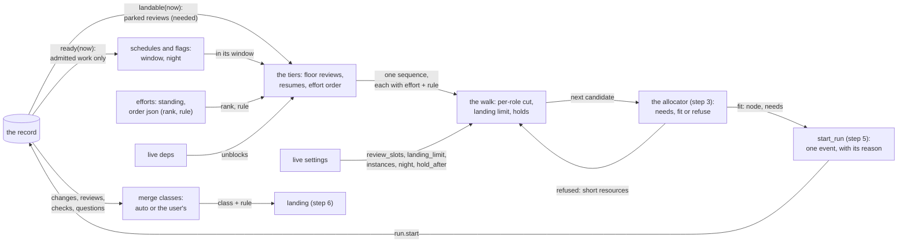

# The order

Plan #3157, effort 0001, step 4: the spec of #3163. The order decides
**what may start next, and why**. It takes the record's ready read, narrows
it by schedules and flags, sorts it by one rule set (floor reviews,
resumes, then each admitted effort's own order), and hands the services a
sequence of candidates, each naming its effort and the rule that placed it.
A walk over that sequence applies the per-role cut and the per-repo landing
limit, and decides what happens behind a candidate the allocator refuses.
The page also specs the schedule parser and the classes of change that may
merge without the user.

**Statement (#3157, user, 2026-10-29):** memLith schedules a mixed workload
on one node, in the yard, under allocation tables, with its record on both
backends behind one contract, and our own development runs on it. This page
is the "schedules" and the "one order" of that sentence. It is policy only:
pure functions over the record's reads. It reserves nothing, starts
nothing, stops nothing and merges nothing.

**What exists at the base commits.**

- quarrylith `bd0420d`: the record (templet 3159, steps 1 to 5 built). The
  ready read `Record.ready(*, now)` gives the items in `ready` and the open
  tasks that are eligible: admitted, linked (directly or through the parent
  chain) to an `admitted` effort, no live dep, no live hold, `not_before`
  passed, attempts under `loop.max_attempts`. The record's page says of it:
  "Step 4 orders this set and does not widen it." Efforts carry `standing`
  and an `order` json, "step 4's rule", default `{"rule":
  "unblocks-then-age"}`. Tasks carry `schedule` (text, unparsed), `labels`,
  `flags`, `loop` (`max_attempts`, `interval_s`) and `supervision`. The
  label grammar (`LABEL_RE`, `FLAG_RE`) and its rule (quarrylith#9, merged
  2026-11-03): one label per key on a record, except the keys of
  `MULTI_VALUED_LABELS`, `repo` and `legacy`; no label twice; a task's
  labels of a key replace all its item's labels of that key in
  `effective_labels(task)`.
- benchLith `2a8a78e5`: today's order, `launch_order`. Each role offers its
  best ready issues, one per free instance (`ranked_ready`: held first,
  then most unblocking, then oldest). Only then are the roles' offers
  sorted together: the floor reviews (`review_slots`), the resumes, the
  ranks table (`ranks_first`), the most unblocking, the oldest. So the
  ranks are applied **after** the per-role cut, and a ranked item that was
  not its role's first never started (#3157's figures). The lanes
  (`launch_lanes`, templet 1376) slice the pool's slots. The sweep merges
  a pool-approved change at risk <= `SCORE_POLICY["auto_merge_risk"]` (4)
  when `sweep_merge_holds` finds nothing.



## Interfaces

### The package

The order is `quarrylith.order`, in quarrylith, standard library only
(`zoneinfo` for time zones). It imports `quarrylith.record` and nothing of
a yard, a harness, a role or a repo host. Who the roles are, how many
instances each has, and the live settings' values are the caller's,
passed in.

| module | holds |
|---|---|
| `quarrylith.order.schedule` | `Schedule`, `parse(text)`, `ScheduleError`, `next_not_before(task, *, finished_at)` |
| `quarrylith.order.settings` | `Settings`, `Settings.problems()`, `DEFAULT` |
| `quarrylith.order.sequence` | `Candidate`, `Left`, `Sequence`, `RULES`, `order(record, *, now, settings)`, `place(record, *, now, settings, task=None, item=None)`, `effort_order(effort)` |
| `quarrylith.order.walk` | `Walk`, `Refusal` |
| `quarrylith.order.merge` | `MergeClass`, `classify(record, number, *, settings)` |
| `quarrylith.cli` | `quarrylith order show|schedule|merge` |

Every function reads the record only through its contract (`get`, `read`,
`reading`, `ready`, `effective_labels`, `contract.efforts_of`), inside one
`reading()`, and takes `now` from its caller. None writes.

### Schedules

A task runs **once at or after a time**, **on a cron expression**, or
**looped with an interval**, and any of these may be kept to a **window**.
Each is said once, in the field that holds it:

| what | where | meaning |
|---|---|---|
| once, at or after a time | `tasks.not_before` (the record's) | not before this ms; `ready()` already reads it |
| a loop | `tasks.loop` (the record's): `max_attempts`, `interval_s` | up to `max_attempts` runs, each at least `interval_s` after the last one finished |
| a cron expression, a window, a zone | `tasks.schedule`, text, parsed here | below |

**The grammar of `tasks.schedule`.** Clauses joined by `;`, spaces around
them ignored, each clause once except `window`:

```
schedule := clause (";" clause)*
clause   := "cron" MIN HOUR DOM MON DOW
          | "window" HH:MM "-" HH:MM [DAYS]
          | "tz" ZONE
```

- **`cron`**: five fields, as cron has them: minute 0-59, hour 0-23, day of
  month 1-31, month 1-12 or `jan`..`dec`, day of week 0-7 (0 and 7 are
  Sunday) or `sun`..`sat`. Each field is `*`, a value, a range `a-b`, a
  list `a,b,...`, or any of them with a step `/n`. When both day of month
  and day of week are restricted (neither `*`), a day matches if **either**
  does, as cron does.
- **`window`**: a start and an end in local time, start included, end
  excluded. An end at or before the start crosses midnight (`22:00-06:00`).
  `DAYS` names the days the window **opens** on: `mon-fri`, `sat,sun`,
  `mon,wed`, a range or a list of `mon`..`sun`; none means every day. Several
  `window` clauses make one window, their union.
- **`tz`**: an IANA zone (`Europe/Lisbon`), read with `zoneinfo`; `UTC` when
  none is given. Local times are wall-clock times in that zone. A local
  time that does not exist (a spring-forward gap) is skipped, and one that
  happens twice (fall-back) counts once, at its first instant.
- Nothing else is a clause. An empty or null `schedule` is no cron and no
  window: the task runs on its `not_before` and its `loop` alone.

```python
class ScheduleError(ValueError): ...   # names the clause and the fault

@dataclass(frozen=True)
class Schedule:
    cron: tuple | None       # the five fields, expanded to sets
    windows: tuple           # ((start_min, end_min, days), ...) in local minutes
    tz: str                  # "UTC" when none is given

    def within(self, at: int) -> bool: ...          # at in a window, or no window
    def next_open(self, at: int) -> int: ...        # the first instant >= at within a window
    def next_fire(self, after: int) -> int | None:  # the first cron minute > after,
        ...                                         #   moved into a window; None: no cron

def parse(text: str | None) -> Schedule: ...        # ScheduleError on any fault
def next_not_before(task: dict, *, finished_at: int) -> int | None: ...
```

- `parse` is total over its grammar: every input is a `Schedule` or a
  `ScheduleError` naming what is wrong (`cron: minute 61 is past 59`,
  `window: "22-6" is not HH:MM-HH:MM`, `tz: no zone "Mars/Base"`, `unknown
  clause "every"`, `cron given twice`).
- **`next_not_before(task, *, finished_at)`** is what the services write
  into the task's `not_before` after each run (step 5 calls it; the record
  stores it). For a task with a cron: the next fire after `finished_at`.
  For a loop: `finished_at + interval_s`, moved to the next instant within
  its window. Both: the later of the two. With neither: `None` (nothing to
  set). **Missed fires collapse**: a cron task whose fires passed while it
  could not run (the machine off, the task held) runs once at its next
  chance, never once per missed fire, because `not_before` holds one time
  and the next one is computed from the run's finish.
- **A window gates starts only.** A task outside its window is left out of
  the sequence (below). A run that is inside its window when it starts is
  never stopped by this page when the window ends: whatever happens to a
  run at a window's end is supervision's, step 5's.
- **A task's attempts are its allowance.** A recurring task runs while
  `attempts < loop.max_attempts` (the record's rule); when they are spent it
  is no longer ready. Whoever files a recurring task (the night document's
  loader, a later step) sets the allowance and files the next task.

### Labels and flags: what the order reads

The grammar is the record's. The order reads these, and nothing else of a
record's labels and flags; the allocator (step 3) reads its own.

| read | from | used for |
|---|---|---|
| role | a task's effective `role:` label, else its item's `role` field | the per-role cut |
| repos | effective `repo:` labels (several on one record) | the landing limit |
| `resync` (flag) | the task's or its item's flags | exempt from the landing limit: work that brings an open change up to date with main |
| `night` (flag) | the task's or its item's flags | the task starts only within `Settings.night` |
| kind | the task's `kind` field, the item's `kind` field | a review is either one's `review` |

Flags are an open list (#3157: supervised, the sandbox class, looped,
night, long, needs:lab, local-ok, ...). A flag this page does not read is
passed on untouched: `long`, `needs:lab`, `local-ok` and the sandbox class
are capacity, the allocator's.

### The settings

```python
@dataclass(frozen=True)
class Settings:
    review_slots: int = 2          # the floor's size, and the landing tier's cap
    landing_limit: int = 6         # unmerged changes per repo; 0 = no limit
    instances: dict = field(default_factory=dict)  # {role: n}; a role not named has 1
    night: str | None = None       # window clauses, e.g. "window 22:00-06:00 mon-fri;
                                   #   window 20:00-08:00 sat,sun; tz Europe/Lisbon"
    hold_after_s: int = 1800       # how long a refused candidate may be passed
    merge_rules: tuple = ({"name": "pool-approved", "risk_at_most": 4,
                           "reviews": ["pool"]},)

    def problems(self) -> list[str]: ...   # [] when every field is valid
```

- **These are live settings** (#3100): the caller reads the yard's
  effective values and passes them at **every** call. Nothing here caches a
  setting, so a change takes effect at the next sequence, a scheduling
  boundary, and never touches a running task.
- `problems()` names each fault: a count below 0, an `instances` value that
  is not a whole number from 1, a `night` that `parse` refuses or that has a
  `cron`, a merge rule without a `name`, a `risk_at_most` outside 0-10, a
  review kind the record does not know. (A rule may name a risk above 7;
  the never-auto bars below still keep risk 8 and up the user's.) `order`, `Walk` and `classify`
  refuse a `Settings` with problems (`ValueError`). Keeping the last good
  settings is the caller's (#1376's last-good rule, #3100).
- `night` set to `None` means no night window: a `night` task is left out,
  with that reason.

### An effort's order

The effort's `order` json is this page's. Its shape:

```json
{"rule": "unblocks-then-age"}
{"rule": "listed", "items": [3163, 3161, 3165]}
{"rule": "unblocks-then-age", "rank": 1}
```

- **`rule`**: `unblocks-then-age` (the default) or `listed`.
  - `unblocks-then-age`: the candidate that unblocks the most open items
    first, then the oldest, then key order.
  - `listed`: the items `items` names first, in that order; every other
    candidate after them, by `unblocks-then-age`. This is how an effort
    says "these first". It replaces the ranks table, scoped to one effort.
- **`rank`**: the effort's place among admitted efforts, lower first. An
  effort with no `rank` comes after every ranked one, and efforts tie by
  `id`.
- `effort_order(effort) -> (rule, rank, items, note)` reads it. An `order`
  that is not this shape (an unknown `rule`, `items` not a list of item
  numbers, a `rank` that is not an int) is read as the default, and `note`
  says why, so a bad edit never stops the order and never hides.

**Unblocks**: the open items that wait on an item through live item deps
(`deps.blocker` = the item, `lifted_at` null), followed through those items'
own, counted once each. A task's unblocks are its item's (none with no
item). A review's are the unblocks of the item it reviews (its `reviews`
record's `target`), since its approval is what lets that merge. **Age** is
the item's `created_at`, or the task's with no item.

### The sequence

```python
RULES = ("floor", "resume", "unblocks-then-age", "listed", "landing")

@dataclass(frozen=True)
class Candidate:
    task: int | None          # a ready task, or None: an item with no open task
    item: int | None
    effort: str               # the effort whose order placed it
    rule: str                 # one of RULES
    tier: int                 # 1 floor, 2 resume, 3 effort order, 4 landing
    why: str                  # one line, below
    unblocks: tuple           # the item numbers, nearest first
    role: str | None
    repos: tuple              # its repo: labels, sorted
    adds: tuple               # the repos where a start would add an unmerged change
    exempt: str | None        # "review", "resync", "post-review": the landing limit skips it

@dataclass(frozen=True)
class Left:
    task: int | None
    item: int | None
    why: str                  # "task 12: outside its window (opens 22:00 Europe/Lisbon)"

@dataclass(frozen=True)
class Sequence:
    candidates: tuple         # in order
    left: tuple               # what the ready set held that the order left out, and why
    notes: tuple              # an effort's unreadable order, and the like
    counts: dict              # the live figures the walk starts from (below)
    at: int                   # now
    seq: int                  # the record's seq the reads saw

def order(record, *, now, settings) -> Sequence: ...
def place(record, *, now, settings, task=None, item=None) -> Candidate | Left: ...
```

**`order(record, *, now, settings)`**, inside one `reading()`:

1. **The ready set.** `record.ready(now=now)`. An item with an open task is
   represented by its task: the task is a candidate when it is in the ready
   set, and the item alone is never one (else it would start beside its
   task). An item with no open task is a candidate as itself (`task` None;
   the services file its task before they start it, step 5).
2. **Schedules and flags narrow it.** A task whose `schedule` `parse`
   refuses is left out, with the fault. A task outside its schedule's window,
   or flagged `night` and outside `Settings.night`, is left out, with when
   its window next opens. Nothing is added.
3. **Each candidate's effort.** For an item (or a task with an item), the
   item's efforts by `contract.efforts_of`, the admitted ones; with several,
   the one that comes first by `rank`, then `id`. For a task with no item,
   its own `effort`. Every candidate of the ready set has one, since the
   ready read gives only an admitted effort's work.
4. **The tiers**, in this order:
   1. **floor**: reviews (a task or an item of kind `review`), as many as
      `review_slots` less the reviews running now (never below 0), taken in
      the effort order below. The rest of the reviews go on to tier 2 or 3.
   2. **resume**: a candidate whose item has a live lease (`leases`,
      `released_at` null): work in flight, held by someone, to take up again.
   3. **the effort order**: everything else, rule `listed` or
      `unblocks-then-age`, as the effort's `order` says.
   4. **landing**: below.
5. **Inside a tier**, candidates sort by their effort (`rank`, then `id`),
   then by the effort's rule (a listed item by its place in `items`, then
   most unblocks, then oldest), then by key: an item's number, then the
   task's id. So the sequence is a total order, the same on every backend
   for the same record, `now` and settings.
6. **The landing tier** comes only when tiers 1 to 3 hold no candidate that
   the walk's cuts would let start (below, "The landing tier").

**`why`**, one line per candidate, names the candidate, its effort, its
rule and the rule's figure:

```
#3169 task 41: effort 0001, floor -- review 1 of 2, unblocks a merge of #3163
#3163: effort 0001, resume -- held by alpha since 2026-11-03 14:02
#3165 task 44: effort 0001, listed -- 2nd of 3 listed
#3170: effort 0001, unblocks-then-age -- unblocks 2 (#3171, #3172), filed 2026-10-29
#3088 task 9: effort unsorted, landing -- review of a parked effort's change
```

The services carry it, with the effort and the rule, into the run's start
(below, "Needs from the record"), so **every start names its effort and the
rule that placed it**.

**`counts`**: the live figures read in the same `reading()`, from which the
walk starts: per role, the live runs; per repo, the unmerged changes the
landing limit counts; the live review runs; the live landing runs (review
runs whose item or task is linked to no admitted effort).

**`place(record, *, now, settings, task=None, item=None)`** gives one task
or item as `order` would place it, with its tier, rule, effort and `why`,
or a `Left` with why it is not a candidate. A start the user names by hand
(step 5's `--task N`) goes through `place` and then the same walk, so a
named start is never placed differently from a full round (templet 1376,
round 6: a named start that skipped the round's rules).

### The walk: the per-role cut, the landing limit, the holds

```python
@dataclass(frozen=True)
class Refusal:                      # the allocator's answer, as the walk reads it
    why: str
    short: dict | None = None       # {resource: amount it lacked}; None: unknown
    never: bool = False             # it can never fit on this node

class Walk:
    def __init__(self, sequence, *, settings, waiting=None): ...
    def check(self, candidate, needs=None) -> str | None: ...
    def started(self, candidate) -> None: ...
    def refused(self, candidate, refusal) -> None: ...
    left: list                      # [(candidate, why)] in the order checked
    waiting: dict                   # {candidate key: first refused at}; the caller keeps it
```

The services (step 5) compose the order, the walk and the allocator:

```
sequence = order(record, now=now, settings=settings)
walk = Walk(sequence, settings=settings, waiting=kept)
for c in sequence.candidates:
    needs = allocator.needs(c)            # step 3: from class, labels, flags
    why = walk.check(c, needs)
    if why: continue                      # walk.left has it
    answer = allocator.fit(c, needs)      # step 3: fit, or refuse with why
    if answer.fits: start_run(...); walk.started(c)
    else: walk.refused(c, answer)
kept = walk.waiting
```

**`check(candidate, needs)`** returns why the candidate may not start now,
or None, testing in this order:

1. **The per-role cut.** Its role has as many live runs, plus starts in
   this walk, as `instances` gives it (1 when not named): "role alpha: 1
   of 1 busy". A candidate with no role is not cut.
2. **The landing limit.** For each repo in `adds`: that repo's unmerged
   changes, plus starts in this walk that add one there, are at
   `landing_limit` or past it: "repo widgets: 6 unmerged of 6". Skipped when
   `landing_limit` is 0 or the candidate is `exempt`.
3. **The landing tier's cap.** A `landing` candidate, while live landing
   runs plus this walk's landing starts reach `review_slots`.
4. **A hold ahead.** An earlier candidate of this walk is **held** (below)
   and short of a resource that `needs` names, or short of something it did
   not name (`short` None), or `needs` is None: "held behind #3170 (memory
   short since 14:02)".

**`started(candidate)`** adds the candidate to the walk's counts (its role,
each repo of `adds`, a landing run) and drops its `waiting` entry.

**`refused(candidate, refusal)`** records the allocator's refusal. A
`never` refusal is left with its reason and holds nothing. Any other sets
`waiting[key]` to the sequence's `at` if it has no entry. The candidate is
**held** when it has waited `hold_after_s` or longer (`at` −
`waiting[key]`): from then on, in this walk, no later candidate that needs
what it was short of may start (rule 4). The `waiting` map is the caller's
to keep between walks: `Walk` drops an entry whose candidate is not in the
sequence, so a candidate that left the ready set loses its wait.

**The rule behind a refused candidate** (the seam with step 3, which this
page decides): **a later candidate that fits may pass a refused one, until
the refused one has waited `hold_after_s`; from then on, nothing that needs
a resource it was short of passes it.** Candidates that need none of those
resources still pass. As runs finish and nothing new takes the short
resources, the held candidate fits, at the latest when every run ahead of
it that holds them has finished. A running task is never preempted to
make room.

**Unmerged changes, counted** (the landing limit's figure, per repo): the
record's open changes in that repo (`changes` with `merged_at` and
`dropped_at` null), plus the live runs whose task's effective `repo:` labels
name it, whose item has no open change there, and which are not `exempt`.
The second term counts work in flight that will open a change, so a
limit of 6 is not passed by six starts at once.

**`adds`**: the candidate's repos where its item has no open change. A
candidate that already has a change open in a repo adds none there (a
resume that pushes to its own change). An item in two repos (`repo:a`,
`repo:b`) adds one in each, is cut if either is at its limit, and counts
one in each when it starts.

**`exempt`**, by #3157's three: `review` (a review task or item);
`resync` (the `resync` flag); `post-review` (a resume whose item's current
round, `review_round`, has a review with verdict `changes`).

### The landing tier

A free slot with nothing admitted to start may review a parked effort's
built change, to land it, and never resume or start work there.

- **Its source** is the record's **`landable(*, now)`** (needed from the
  record, below): the reviews (a task or an item of kind `review`) that are
  eligible by every rule of the ready read but the effort's, linked to at
  least one `parked` effort and to none `admitted`, whose reviewed item has
  an open change. Nothing else of a parked effort is ever a candidate.
- **When**: only when tiers 1 to 3 hold no candidate that passes the walk's
  cuts (rules 1 to 3 of `check`, with no starts yet). A candidate the
  allocator refuses is still admitted work to start, so it does not open the
  landing tier. The sequence then holds the landing candidates, rule
  `landing`, sorted as tier 3 is (their parked efforts by `rank` and `id`).
- **Capped at the review slots**: at most `review_slots` landing runs live
  at once (the walk's rule 3).

### Merge classes

The configured gate rules classify which changes may merge without the
user. Today's one rule: **pool-approved at risk <= 4**. The class is read
from the record; merging is the landing step's (step 6), which records the
class's rule name as the merge's `rule`.

```python
@dataclass(frozen=True)
class MergeClass:
    cls: str            # "auto" or "user"
    rule: str | None    # the merge rule that made it auto
    why: tuple          # every reason it is the user's, one line each

def classify(record, number, *, settings) -> MergeClass: ...
```

`classify(record, number)` classifies an item's open changes **as one
set**: `auto` only when every one of them qualifies, so a set merges whole
or waits whole. A change qualifies under a rule when all hold:

- the item's `risk` is set and at most the rule's `risk_at_most`;
- for each review kind the rule names, a review of that kind on the item
  (`target` = the item), in its current round (`round` = `review_round`),
  with verdict `approve` and `heads[change]` equal to the change's `head`:
  the approval binds to the head it saw (templet 2710);
- every check on `(change, head)` reads `green` or `skipped`, and at least
  one reads `green`;
- the change is not a draft.

And none of these, whatever the rules say (**never auto**, #3044's
non-waivable list and today's sweep rule):

- a `risk` of 8 or more, or none;
- a review in the item's current round with verdict `changes`;
- the item `overruled_at` set;
- an unanswered question on the item (`questions`, `answered_at` null);
- a templet: the item has a review of kind `templet` (the owner's review of
  a templet, which the user's merge agrees);
- a live hold on the item.

`why` lists every reason that applies, not the first. `merge_rules` empty
classifies everything `user` (today's rollback: `auto_merge_risk = 0`).
Whether the change still merges cleanly with main is the landing step's to
check at the merge, since the record does not hold it.

### Needs from the record

The order reads the record as it is, but for two things. Each is named here
for the coordinator, and is made by a build step (below) that proposes it
on the record's page with a `proposed:` History line, as a change to an
agreed templet is made.

1. **`landable(*, now)`**, a read beside `ready()`, for the landing tier:
   `{"items": [...], "tasks": [...]}`, the reviews `ready()` leaves out
   only because no effort they are linked to is admitted, linked to at
   least one `parked` effort, whose reviewed item has an open change; in key
   order. `ready()` and the record's invariant 9 stay as they are.
2. **`start_run(..., placed=None)`**: `placed` is `{"effort", "rule",
   "why"}` (strings, `rule` one of `RULES`), carried in the `run.start`
   event's `data`, so the record says why each run started. No new field
   and no schema change: the event is the record. Step 5 passes it.

### The commands

`quarrylith order show URL [--now MS] [--settings FILE] [--json]` prints
the sequence: one line per candidate (its `why`), then the left-out with
their reasons, then the notes and the counts. `quarrylith order schedule
TEXT [--from MS] [--count N]` prints the next N fires and window openings
of a schedule, or its `ScheduleError`. `quarrylith order merge URL NUMBER
[--settings FILE]` prints an item's class and every reason. A settings
file is a JSON object of `Settings`' fields. Each prints its phases with
elapsed time past five seconds, and takes `--timing` (the store layer) and
`--debug`, as the CLI rule asks.

## Reuse

- quarrylith `src/quarrylith/record/contract.py::Record.ready` -- the set
  the order sorts and never widens; `_ineligible` and `_unready` -- its
  rules, which `landable` reuses with the effort's standing turned the
  other way.
- quarrylith `contract.py::efforts_of` -- a candidate's efforts, its own
  links else its parent chain's, so unlinked work is placed under its
  parent's effort.
- quarrylith `contract.py::Record.effective_labels` and
  `schema.py::MULTI_VALUED_LABELS` -- a task's role and repos, several
  `repo:` labels on one record.
- quarrylith `gauges.py::unmerged_changes` -- the per-repo count of open
  changes the landing limit starts from (the gauge stays the dashboard's
  figure; the limit adds work in flight to it).
- benchLith `bin/lith::unblocks` -- the transitive count, taken as written:
  breadth first, nearest first, each item once.
- benchLith `bin/lith::launch_order` -- the floor (`review_slots`), resumes
  before new work, a review counting its target's unblocks, and the reason
  line (`order_lines`). The order keeps these and moves the cut after the
  sort.
- benchLith `bin/lith::sweep_merge_holds` and `auto_merge_risk` -- every
  condition of today's auto-merge, as the merge class's bars.
- Templet 1376's trilithon holds and its "a hold never takes a guarantee"
  -- the ancestor of the walk's holds, without writing any state into the
  record.

What looked reusable but was not:

- **The ranks table** (`ranks_first`, `set_rank`): one global list, applied
  after the per-role cut. Retired (#3157); an effort's `listed` rule does
  the same inside one effort, before the cut. The import leaves the table
  behind.
- **The lanes** (`launch_lanes`, templet 1376's slot plan, shares,
  reserves, the slow start): capacity, not order (user, 2026-10-29, on
  #3044: lanes stay per repo and harness and schedule by capacity; an
  effort's priority orders work inside a lane). They are not this page's
  (Rationale).
- **`night_in_force`**: a settings window read by one function. A window is
  now a schedule clause, and `Settings.night` is one, so the night is
  parsed by the same parser as any task's window.
- **`ranked_ready`**: a role's own list, cut before the sort. The order has
  one list.

## Invariants

1. **The order narrows; it never widens.** Every candidate of tiers 1 to 3
   is in `ready(now=now)`, and every landing candidate is in
   `landable(now=now)`. Nothing else is ever a candidate.
2. **Admitted work comes first.** No landing candidate is in a sequence that
   holds a tier 1 to 3 candidate passing the cuts, and a landing candidate
   is a review, never a resume or new work.
3. **Every candidate names one effort and one rule** of `RULES`, and its
   `why` says both. Every start the services make from a sequence carries
   them (`placed`).
4. **The order is applied before the cut.** The sequence is one list over
   every role; the per-role cut and the landing limit walk it in order, and
   a candidate is cut only for its own role's or repo's count, never for
   where it stands in its role's list.
5. **The landing limit holds.** A start never brings a repo's unmerged
   changes past `landing_limit`, except an `exempt` one.
6. **Nothing starves behind a passing rule.** A candidate refused for want
   of a resource (not `never`) is, once it has waited `hold_after_s`, never
   passed by a candidate that needs that resource.
7. **Pure policy.** `order`, `place`, `Walk` and `classify` write nothing to
   the record, read it only through the contract inside one `reading()`,
   read no clock (`now` is given), and give the same result for the same
   record, `now`, settings and `waiting` on every backend.
8. **No preemption.** Nothing on this page stops, pauses or signals a run.
   A window, a schedule and a hold gate starts only.
9. **Settings are live.** Every call reads the settings it is given, and
   nothing is cached between calls.
10. **Never auto** for a change at risk >= 8 or unscored, flagged by a
    `changes` verdict in its round, overruled, with a question open, a
    templet, under a live hold, approved for another head, or with a check
    not green; and a set is `auto` only whole.
11. **quarrylith names nothing internal** (the record's invariant 15): no
    role, repo host or yard in `src/`, and the imports on its allow-list.

## Acceptance

Each item is a test marked `templet:3163`, run over every backend in
`BACKENDS` where it reads a record. An ordering test builds its fixture so
that **every other order of the keys it checks gives a different answer**
(templet 1376, round 3: a fixture that passed with the keys swapped). A test
that needs a named time zone skips with the reason on a host with no zone
database, never passes.

- [ ] `parse` refuses, each with a message naming the clause: a cron of four
  fields, a minute of 60, a day of week of 8, a window `22-6`, an unknown
  zone, an unknown clause, `cron` or `tz` given twice
- [ ] `next_fire` of `cron 0 22 * * mon-fri; tz Europe/Lisbon` from a
  Friday 23:00 is Monday 22:00 local; across a spring-forward gap a fire in
  the gap is skipped, and across a fall-back an ambiguous fire comes once
- [ ] with both day of month and day of week restricted, a day matching
  either one fires
- [ ] `window 22:00-06:00 fri` holds Friday 22:00 and Saturday 05:59, and
  not Saturday 06:00 nor Thursday 23:00; two `window` clauses are their
  union; `next_open` gives the next start
- [ ] `next_not_before`: a loop's is the finish plus `interval_s`, moved to
  its window's next opening; a cron task's is the first fire after the
  finish, so fires missed while it could not run give one run, not several
- [ ] the order never widens: over a fixture with items of a parked effort,
  an unadmitted machine-filed should-fix item, an item with a live dep, one
  with a live hold, a task not before now and a task past its attempts,
  every candidate of tiers 1 to 3 is in `ready()` and every landing
  candidate in `landable()`
- [ ] an item with an open task in the ready set is a candidate only as its
  task, and an item with an open task that is not ready is not a candidate
- [ ] the tiers: with `review_slots` 2 and one review running, one review is
  floor, then the resumes, then the effort order; a floor review of a
  lower-ranked effort comes before new work of a higher-ranked one, and the
  second review waits in the effort order
- [ ] `unblocks-then-age`: more unblocks first (counted through a chain, each
  item once), then older, then the lower number; a review counts the
  unblocks of the item it reviews
- [ ] `listed`: the listed items first, in the list's order, then the rest
  by `unblocks-then-age`; an `order` with an unknown rule is read as the
  default and a note says why
- [ ] efforts by `rank`, lower first, unranked after by `id`; an item linked
  to two admitted efforts is placed once, under the one that comes first;
  an item with no link of its own is placed under its parent's effort
- [ ] a task with a schedule `parse` refuses, one outside its window, and a
  `night` task outside `Settings.night` (or with no night set) are left out,
  each with its reason; inside the window, it is a candidate
- [ ] every candidate names an effort and a rule of `RULES`, and its `why`
  holds both; `"ranks"` is no record kind and no read of the order's
- [ ] the order writes nothing (`head()` unchanged), and the same record,
  `now` and settings give the same sequence twice and on every backend
- [ ] `place` gives a task the same tier, rule and effort that `order` gives
  it, and a `Left` with the same reason for one the order leaves out
- [ ] the order before the cut: role alpha with one instance has an old item
  that unblocks nothing and a newer item effort 0001 lists first; the listed
  item is the candidate the walk lets start, and the old one is cut with
  "role alpha: 1 of 1 busy" once it starts
- [ ] the landing limit: a repo with 6 unmerged changes (5 open and a live
  run with none yet) cuts new work there, naming the repo and the counts; a
  review, a `resync` task and a post-review resume pass; a resume whose item
  has an open change in that repo passes; an item in two repos is cut when
  either is at its limit and counts one in each when it starts; a limit of 0
  cuts nothing, and the next sequence reads a changed limit
- [ ] passing: a refused candidate is passed by a later one that fits;
  past `hold_after_s` a later candidate needing the resource it was short of
  is held, naming it, while one needing other resources passes; a refusal
  with `short` None holds every later candidate; a `never` refusal holds
  nothing; when the held candidate starts, the hold ends; `waiting` drops a
  candidate no longer in the sequence
- [ ] the landing tier: with no admitted candidate passing the cuts, a
  parked effort's review of an open change is a candidate, rule `landing`;
  never a parked effort's resume or new work, nor a review whose item has no
  open change; at most `review_slots` landing runs at once; with an
  admitted candidate refused by the allocator, no landing candidate
- [ ] `Settings.problems()` names each invalid field, and `order`, `Walk`
  and `classify` refuse settings that have problems
- [ ] `classify`: a pool approval of the change's head in the current round,
  checks green, risk 4, gives `auto` with the rule `pool-approved`; each of
  risk 5, risk 8 under a rule allowing 9, no risk, a `changes` verdict in the
  round, an approval of an older head, a red or pending check, a draft,
  `overruled_at`, an open question, a `templet` review and a live hold gives
  `user` with that reason among `why`; a set with one member not qualifying
  is `user` whole; empty `merge_rules` gives `user` for all
- [ ] `quarrylith order show`, `schedule` and `merge` print as the page says,
  exit 2 on a refused schedule or settings, and take `--timing` and
  `--debug`

## Build steps

In merge order. Each is one PR in quarrylith that merges alone and passes
its gate without any later step; its tests carry `templet:3163`. The last
step's PR sets `status: built` and the pins, and #3163 closes with it.

1. **The schedule parser** -- `quarrylith.order.schedule`: `parse`,
   `Schedule`, `next_not_before`; `quarrylith order schedule`.
   Acceptance: `parse` refuses; `next_fire` across a weekend and DST; day
   of month or week; `window`; `next_not_before`.
   Aim: tier 3.
2. **The sequence** -- `quarrylith.order.settings` and
   `quarrylith.order.sequence`: `Settings`, `effort_order`, `order`,
   `place`, the tiers 1 to 3, schedules and flags, `why`, `counts`;
   `quarrylith order show`.
   Acceptance: never widens; an item as its task; the tiers;
   `unblocks-then-age`; `listed`; efforts by rank; schedules and flags;
   effort and rule named; writes nothing; `place`; `Settings.problems()`.
   Aim: tier 3.
3. **The walk** -- `quarrylith.order.walk`: `Walk`, `Refusal`, the
   per-role cut, the landing limit and its count, the holds.
   Acceptance: the order before the cut; the landing limit; passing.
   Aim: tier 3.
4. **What the record gains for the order** -- quarrylith's record:
   `landable(*, now)` and `start_run(..., placed=)`, each proposed on the
   record's page (`3159-the-record.md`) with a `proposed:` History line,
   which the record's conformance review answers. No acceptance item of this
   page: its tests are the record's, marked `templet:3159`.
   Aim: tier 3.
5. **The landing tier** -- tier 4 in `order`, from `landable`; the walk's
   landing cap.
   Acceptance: the landing tier.
   Aim: tier 3.
6. **Merge classes** -- `quarrylith.order.merge`: `classify`, `MergeClass`;
   `quarrylith order merge`. It needs only the record, so it may merge
   before steps 2 to 5; whichever merges last sets `built`.
   Acceptance: `classify`; the commands.
   Aim: tier 3.

**Which step builds what this page leaves:**

- the services that call `order`, the walk and the allocator, write
  `not_before` from `next_not_before`, keep `waiting`, file an item's task
  and pass `placed` -- step 5 (#3165);
- **the regeneration of generated pages at merge** (`docs/ATLAS.md`,
  `PLAN.md` status: regenerated at merge, never in a PR) -- step 6 (#3167),
  the GitHub connector, which performs the merges: it files a `job` task
  per merge that needs one, in the merged change's effort, and this order
  places it like any task;
- merging the `auto` class and recording its `rule` -- the landing step:
  the legacy landing mode until the switch, then step 6;
- the dashboard's view of the sequence and its reasons -- step 7 (#3169).

## Boundaries

- What the build may touch: quarrylith's `src/quarrylith/order/`,
  `src/quarrylith/cli.py` (the `order` commands), `tests/`, `changes/`; and,
  for step 4 only, `src/quarrylith/record/` and the record's page, by the
  `proposed:` lines above.
- No other repo. benchLith's order (`launch_order`, the ranks, the lanes,
  the sweep's merge) stays as it is until the switch (#3170), which points
  bin/lith at the scheduler; this page edits nothing of bin/lith.
- No services, no socket, no process, no yard code: step 5's (#3165).
- No allocation: needs, nodes, capacity, reservations, standing consumers,
  lanes and long jobs are the allocator's (step 3, #3161). The walk reads
  its answer and nothing of how it was reached.
- No writes to the record from `quarrylith.order`; no merge, no push, no
  GitHub: the landing step's.
- No roles named in `src/`: the role in a label is a value, and `instances`
  comes from the caller. Nothing internal in `src/` or `tests/`
  (quarrylith is public-bound): fixtures use neutral roles and repos
  (`role:alpha`, `repo:widgets`). This page lives in `docs/`, which the
  mirror leaves out.

## Rationale

**Passing a refused candidate, with a hold after a wait.** The seam leaves
this page to say what happens behind a candidate the allocator refuses.
Chosen: a later one that fits may pass it, until it has waited
`hold_after_s` (30 minutes, a live setting); from then on nothing that
needs a resource it was short of passes it. Rejected:

- **strictly in order** (the refused one holds the rest): one lab cell
  waiting for a VM's memory would idle every harness slot for as long, on a
  machine with room for other work. #3157's figures were too little
  progress, and an idle pool is that;
- **pass always**: a large task (a lab cell, a trilithon of #1376) waits
  forever behind a stream of small ones, which is what #1376's holds were
  made against;
- **reserve ahead** (a future reservation for the refused one): the order
  reserves nothing (the seam), and the time it would fit is not known
  until runs finish.

The hold names its resources from the allocator's refusal (`short`); with
none named it holds everything behind it, which is strict ordering, safe
but idle. So the walk asks the allocator's refusal to carry `short` and
`never` (PR body, for the coordinator). It keeps no state in the record: the
first-refused times are the caller's map, and a scheduler restart restarts
the clock, which costs at most one more `hold_after_s` of passing.

**The order before the cut, as one sequence.** Today each role offers its
best item first and the ranks sort only what was offered, so a ranked item
that was not its role's best never started. One sequence over every role,
cut in its order, makes the effort's order the only thing that decides,
and a cut candidate waits only for its own role's run to end.

**Floor and resumes before the effort order.** A review is the last step
before a merge; ranked last it starved behind new work (#945, #1275), and
the floor keeps `review_slots` for it. A resume holds a claim, and its
changes are out (#3157). Both are for admitted efforts only, since they come
from the ready read; a parked effort's review is the landing tier's.

**An effort's order inside the effort, the efforts by rank.** The ranks
table was one list for everything, applied too late. `listed` gives an
effort the same power over its own work. Across efforts, strict rank: the
user admits efforts and ranks them to say what matters, and #3157 is "align
behind efforts and have control over what we run and why". Interleaving the
efforts (a fair share) is the rejected alternative: it would start a
lower-ranked effort's work ahead of a higher one's whenever the turn came
round. It is for the user to decide (PR body).

**The landing tier from a record read.** The record's ready read is the one
place admission lives (its invariant 9), and this page must not widen it.
A parked effort's review is outside it by design. So the record gains a
second, narrow read, `landable`, which gives only reviews of open changes,
rather than the order re-deriving eligibility from the record's private
rules. The tier opens only when no admitted candidate passes the cuts: a
candidate the allocator refuses is still admitted work, so a parked review
does not take its place.

**The landing limit counts work in flight.** The record's open changes
alone would let six starts at once each open a seventh. Counting live runs
that have no change yet in the repo closes that. A resume of an item whose
change is open adds nothing, so it is not cut; #3157's three exemptions
(reviews, resyncs, post-review resumes) are the work that lands changes.

**Schedules in the record's fields, the parser here.** `not_before` already
says "once at or after", and `loop` says "how often, how many", so the text
holds only what they cannot: a cron, a window, a zone. One way to say each.
The record keeps `schedule` as text and refuses nothing in it (its
Boundaries), and a schedule the parser refuses is left out with its fault,
so the record need not import the order. Rejected: an `every` clause
(it would say `loop.interval_s` twice), and catching up missed fires one
by one (a machine back after a week would run a nightly seven times).

**Windows gate starts, never runs.** #3157: a running task is never
preempted. #731's window end ("killed unless `may_run_over`", later
"progress, not time, decides") is supervision of a running task, step 5's,
and this page does not decide it.

**Merge classes over the record's facts.** Today's rule is
`sweep_merge_holds` over GitHub's facts. The record holds the same facts
(reviews with their heads, checks per head, questions, holds, the drafts),
so the class is a read, and the landing step merges what it says. A
templet is told by its review of kind `templet`, not by its files, which
the record does not hold. Mergeability against main is checked where the
merge happens.

**Left to later steps, or to other pages:**

- **Lanes** (shares, reserves, profiles, the slow start of long jobs,
  trilithons): capacity, by the user's decision on #3044. The order gives
  one sequence that any lane would take in order; whether lanes come back,
  as the allocator's reservations, is step 3's page's to say.
- **Budget pacing and harness fallback** (#2172, #3100's chain): which
  harness and whether its budget allows a start are the allocator's and the
  services'.
- **The night document** (#731): its entries become tasks with a cron, a
  window and the `night` flag; its loader, its spend ledger and its overrun
  question are later steps'. This page parses what it writes.
- **A shared hand-written page edited through one issue per effort**: a
  rule of filing (one open item per effort per page), not of order. It is
  for the services' filing path (step 5) or a later step, and needs nothing
  of this page.
- **The regeneration of generated pages**: step 6 (Build steps).

## History

- 2026-11-03 agreed (merge of this PR, user)
